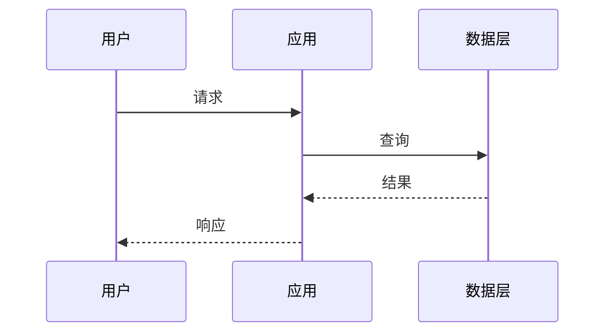

# 笔记模板

> 每条笔记先写 frontmatter，跨项目检索靠它：

```yaml
---
project: <仓库目录名>
type: 踩坑 | 技术 | 设计 | 学习向 | 图解
tags: [<标签1>, <标签2>]
date: YYYY-MM-DD
---
```

> 四种类型挑一个；骨架一致，差别在「原理」那节的写法。

## 踩坑

```markdown
# <N> · 踩坑-<现象>

> 一句话：<什么现象>，根因是 <根因>，改法是 <改法>。

## 现象

- 什么时候出现：<触发条件>
- 表现：<报错原文 / 错误结果 / 卡在哪一步>
- 误导性线索：<一开始以为是什么，为什么错>

## 根因

<机制层面：谁在什么时候做了什么，导致这个结果>

## 改法

| 改哪 | 怎么改 | 为什么够 |
|------|--------|----------|
| <文件/配置> | <动作> | <覆盖了根因的哪一环> |

## 怎么验证

```bash
<一条能复现的命令>
# 预期：<输出>
```

## 边界

<同类问题还会出现在哪；什么情况下这个改法不适用>

## 延伸

<一条：相关概念 / 官方文档章节>
```

## 技术

```markdown
# <N> · 技术-<技术点>

> 一句话：<它解决什么问题>，在本项目的用法是 <用法>。

## 它是什么

<两句人话 + 一句术语定义>

## 在项目里怎么用

| 层 | 位置 | 作用 |
|----|------|------|
| 入口 | <文件> | <做什么> |
| 核心 | <文件> | <做什么> |

## 最小可用示例

```<语言>
<15 行以内，能跑>
```

## 参数与边界

- `<参数>`：<含义 / 默认值 / 什么时候改>
- 不适用：<场景>

## 怎么验证

<一条命令或一个观察点>

## 延伸

<一条：官方文档 / 源码入口>
```

## 设计

```markdown
# <N> · 设计-<取舍点>

> 一句话：选择了 <方案 A>，放弃了 <方案 B>，因为 <判断依据>。

## 问题

<不做决策会怎样；约束是什么（时间 / 人力 / 兼容 / 成本）>

## 候选与取舍

| 方案 | 优点 | 代价 | 结论 |
|------|------|------|------|
| A | | | ✅ |
| B | | | ❌ |

## 选了 A 之后

- 代码上：<落点>
- 组织上：<谁维护 / 升级路径>
- 什么情况下会推翻：<触发条件>

## 怎么验证这个决定是对的

<可观察的指标 / 反例>

## 延伸

<一条：同类设计的公开案例>
```

## 学习向

```markdown
# <N> · 学习向-<概念>

> 一句话：<用日常语言解释这个概念>。

## 先说人话

<不用术语，讲清它像什么、解决什么>

## 再给定义

<术语定义 + 一个关键区别（它不是什么）>

## 它在项目里出现在哪

| 位置 | 它在这里的角色 |
|------|----------------|
| <文件/模块> | <角色> |

## 一个能动手的实验

1. <步骤 1>
2. <步骤 2>
3. 观察：<预期现象>

## 常见误解

| 误解 | 实际 |
|------|------|
| | |

## 延伸

<一条：入门材料 / 官方概念页>
```

## 图解版（可选叠加）

在任意类型上加一节，用 Mermaid 画结构与时序；图只画「读者会问的那个问题」，不要复刻架构图：

````markdown
## 一图看懂



读图要点：<这张图想让人记住的一件事>
````
