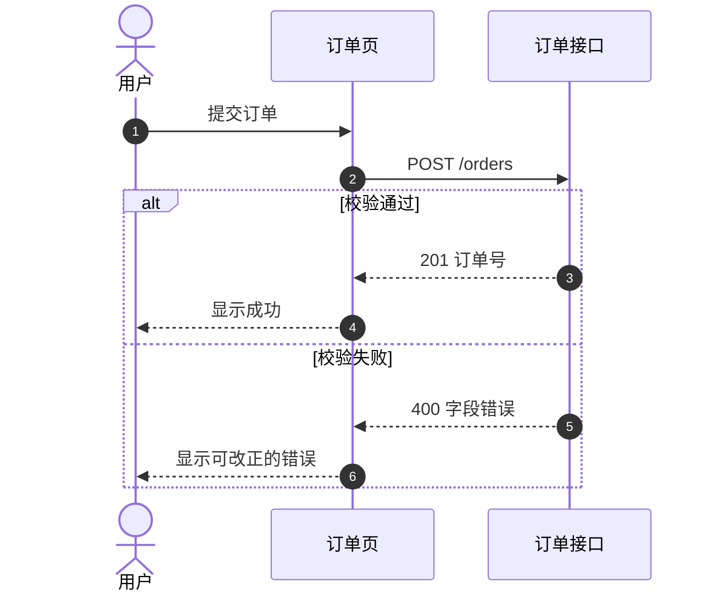

# Mermaid 图质量

语法以 [Mermaid 时序图](https://mermaid.js.org/syntax/sequenceDiagram.html) 与 [流程图](https://mermaid.js.org/syntax/flowchart.html) 为准。箭头与块的对照见 [reference.md](reference.md)。

产出放在 markdown 的 ` ```mermaid ` 代码块里。图上方用一句话标题，说明这条路径是什么。

## 先选图

| 要说明的事 | 图种 |
|------------|------|
| 谁按什么顺序调用谁 | `sequenceDiagram` |
| 步骤与分支 | `flowchart` |
| 状态怎么变 | `stateDiagram-v2` |
| 实体与关系（L2 模型） | `erDiagram` |

一张图只讲一条主路径。失败、重试另开 `alt` / `break`，或另画一张。嵌套超过两层就拆图。

## 时序图

1. 开头显式声明参与者，从左到右按调用顺序：人用 `actor`，系统用 `participant`。长名字用 `as` 起短别名。
2. 箭头含义固定，不要混用：
   - `->>` 同步请求
   - `-->>` 响应
   - `-)` 异步，发出后不等待
3. 消息文字写操作和关键数据（`POST /orders`、`返回订单号`），不写「调用」「处理」。
4. 处理中的一方用 `+` / `-` 或 `activate` / `deactivate`，成对出现。
5. 互斥结果用 `alt` / `else`；可有可无用 `opt`；重复用 `loop` 并写停止条件；失败退出用 `break`。`par` 只用于真正同时发生的事。
6. 每块以单独一行 `end` 关闭。
7. 评审要对步骤编号时，在 `sequenceDiagram` 下一行写 `autonumber`。
8. 约束用 `Note over`，不要伪装成一条消息。

## 流程图与状态图

- `flowchart TD` 或 `LR`，全图一个方向。
- 节点 id 与显示文字分开。步骤用矩形，判断用菱形 `{}`，起止用圆角。判断出口标 `是` / `否`。
- 相关步骤用 `subgraph`。子图里的节点连到外面时，子图自己的 `direction` 会失效，跟父图走。
- 状态图用 `stateDiagram-v2`。迁移标签写事件，不要只画框。

## 交图前检查

- [ ] 参与者已声明，发起方在最左
- [ ] 请求与响应箭头类型一致
- [ ] 激活成对；每个 `alt` / `loop` / `opt` / `par` / `box` / `rect` 都有 `end`
- [ ] 标签里的单词 `end` 已加引号（`"end"`）。小写 id `end` 不能用
- [ ] 分组颜色不用 `#hex`（`#` 会被当成注释）。用颜色名或 `rgb()` / `rgba()`
- [ ] 有失败或无权限时，图里能看见，而不是只画成功

## 示例


