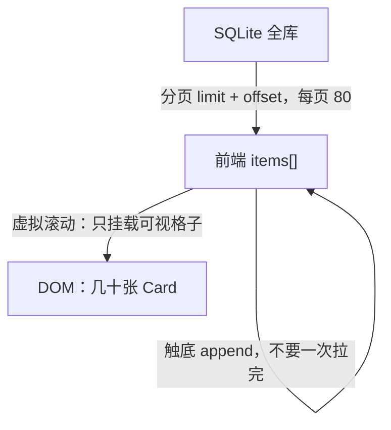
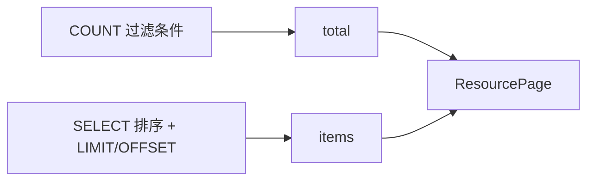
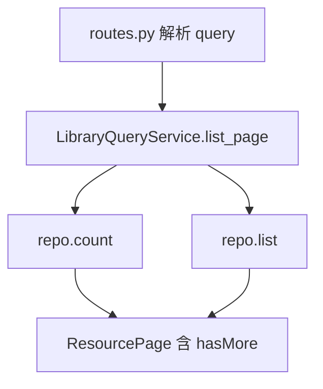
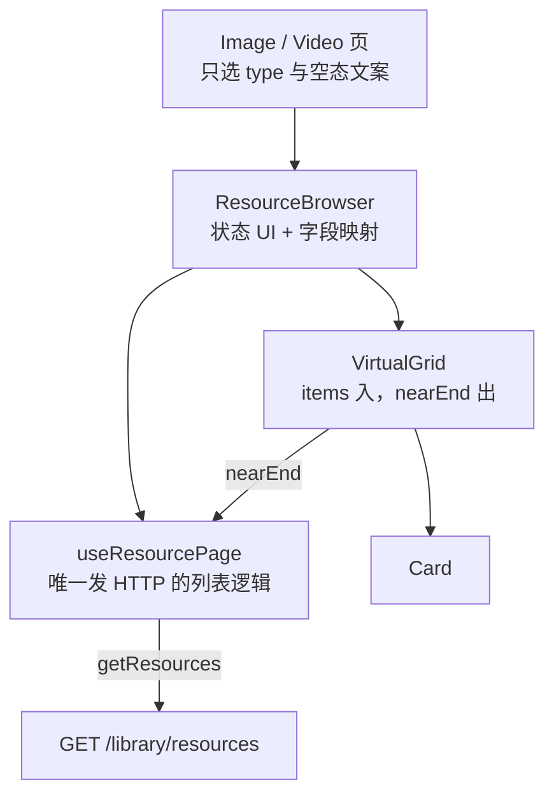
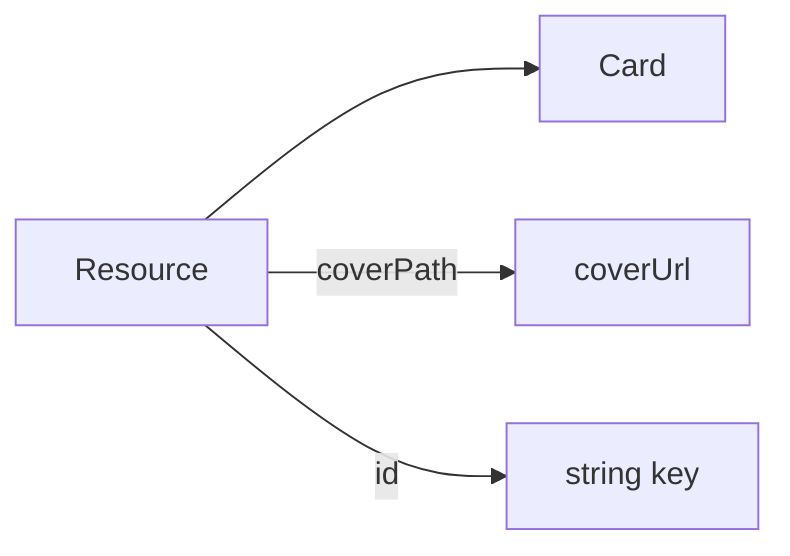
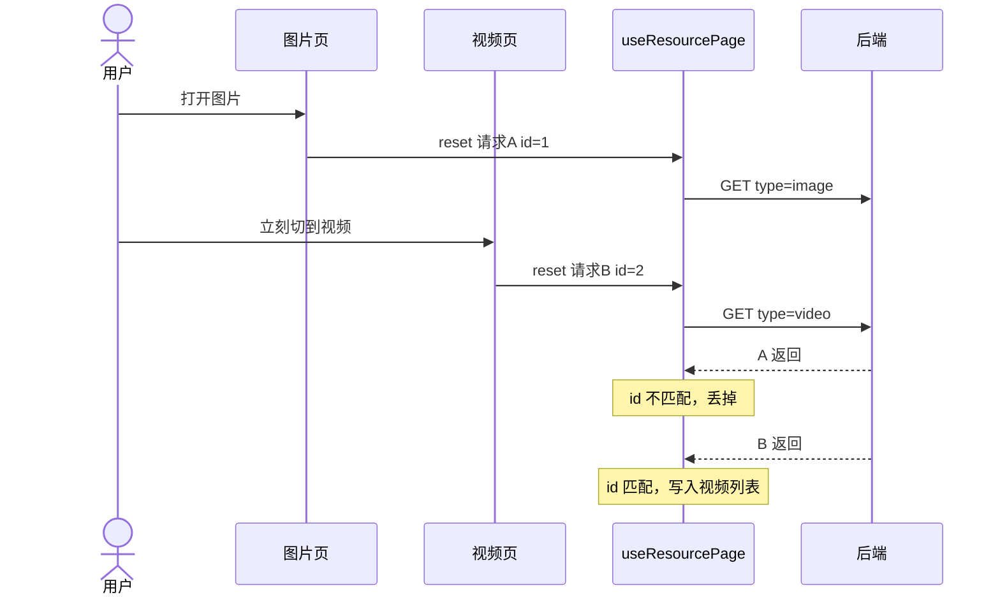
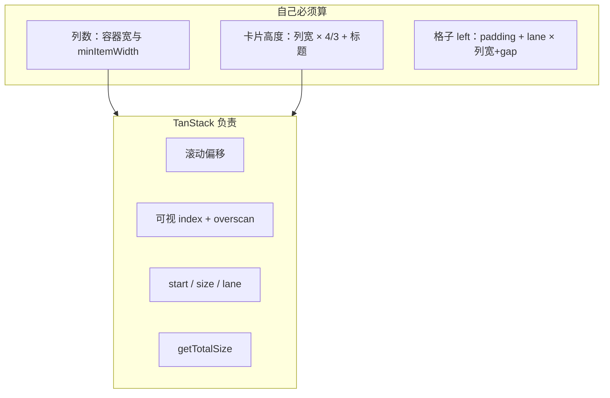
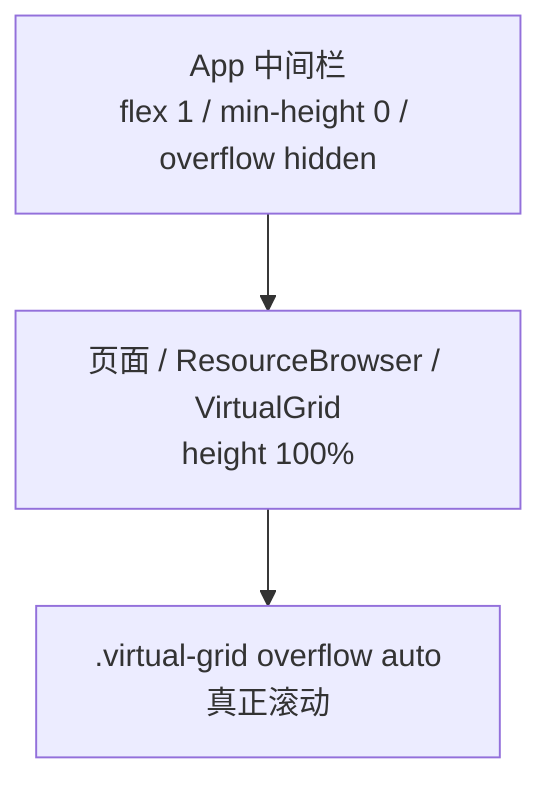
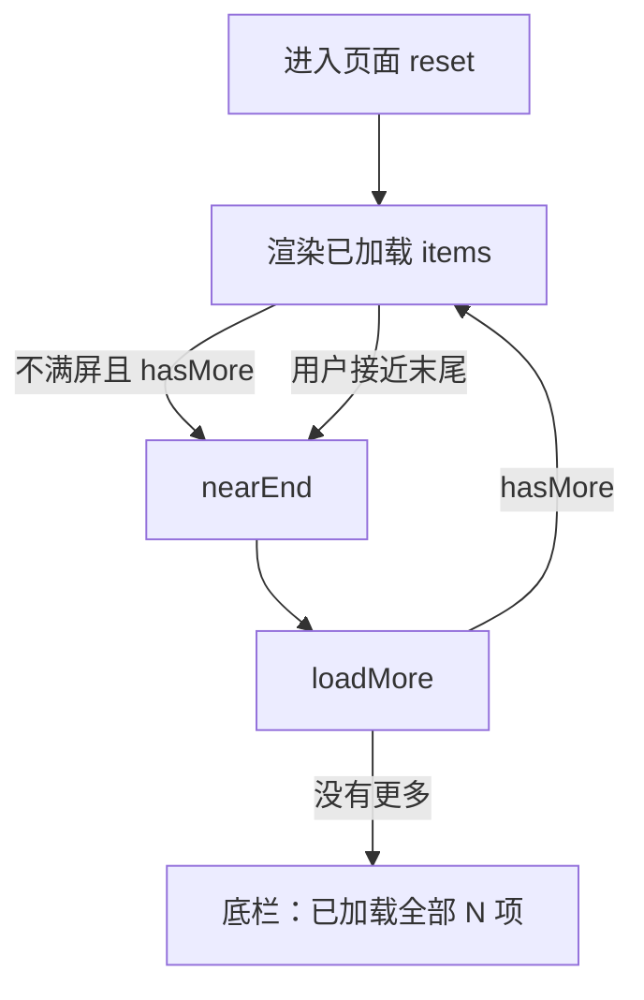
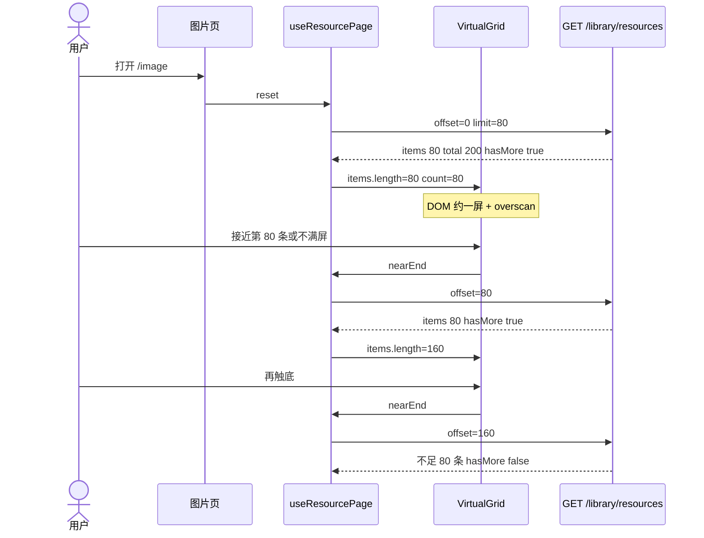

# 06 · 虚拟滚动与分页（学习向）

> 状态：**已落地**（2026-09-07）  
> 契约草案：[05-资源分页与无限滚动.md](05-资源分页与无限滚动.md)  
> 代码：后端 `GET /library/resources` · 前端 `useResourcePage` + `VirtualGrid`  
> 本文目的：讲清**为什么拆两层、各自算什么、我们踩过什么坑**，方便以后做列表时复用，而不是只抄 API。

---

## 0. 先记住一句话

**虚拟滚动管 DOM，分页管内存和磁盘。**  
把 5 万条一次性塞进 Vue，和在屏幕上挂 5 万个 `<div>`，是两类灾难。只做其中一层，另一层仍会把应用拖死。

---

## 1. 问题拆解（为什么是两层）

资源库列表有三个「规模」：

| 规模 | 量级（目标） | 若不管会怎样 |
|------|----------------|----------------|
| SQLite 全库 | 万～十万 | 一次 `SELECT *` 把后端和网络打爆 |
| 前端 `items[]` | 已加载窗口（80、160、240…） | 全库 JSON 进内存，滚动再快也卡 GC |
| 屏幕上的 DOM | 一屏 + overscan（约几十） | 万张卡同时布局/解码图片，主线程卡死 |

对应手段：



**经验：** 产品说「无限滚动」时，先问清楚是「DOM 虚拟」还是「接口分页」。两者经常被混成一个词。本项目两个都做，但触发下一页看的是 **已加载数组的下标**，不是全库 `total`。

---

## 2. 刻意不做的事（边界即设计）

| 不做 | 原因 |
|------|------|
| `virtualizer.count = total`（滚动条按全库高度） | 中间会出现空洞，变成「跳页加载」，交互和实现都另一套 |
| 游标分页（`created_at, id`） | 本地库插入不频繁，offset 够用；扫描入库并发高了再换 |
| CSS `auto-fill` 当虚拟网格 | 列数在 CSS 里，JS 拿不到，TanStack 的 `lanes` 喂不进去 |
| 再引入第二套虚拟列表库 | 列数、行高是 **Card 的 3:4 + 标题**，换库公式还在 |
| 演示封面走 picsum | 远程图 + 302 + CSP，列表会「假卡」；已改成本地 SVG data URI |

滚动条高度 = **已经拉到的条数**，不是库里一共有多少。用户要的是「快到底再请求」，不是「拖到 80% 跳到第 400 页」。

---

## 3. 后端：分页信封

### 3.1 为什么不能返回数组

旧接口：`GET /resources → Resource[]`。

前端无法区分：

- 真的只有 17 条（完了）
- 还有下一页（只是这次 limit=80）

所以改成信封（`ResourcePage`，JSON camelCase）：

```json
{
  "items": [ /* Resource */ ],
  "total": 200,
  "limit": 80,
  "offset": 0,
  "hasMore": true
}
```

`hasMore = offset + len(items) < total` **由后端算**，避免前端 off-by-one。

### 3.2 两次 SQL，不搞窗口函数



经验：一次请求里两次查询，比窗口函数 `COUNT(*) OVER()` 更好懂，SQLite 上万级也够用。复合索引 `(type, status, created_at, id)` 可以以后再加。

### 3.3 排序必须「稳定」

只 `ORDER BY created_at DESC` 时，同一秒插入的多行，翻页可能 **重复或漏条**。

本项目：`ORDER BY created_at DESC, id DESC`。  
`id` 是单调主键，同等时间戳也有全序。

### 3.4 分层落点



路由不拼 `hasMore`，用例层拼信封。仓储不管 HTTP。

默认 `limit=80`（约 2～4 屏）。类型页前端 **显式传 `status=active`**；不传 status 则不过滤（给回收站等留口）。

---

## 4. 前端：谁也不要越界



**经验：网格组件禁止 `axios`。**  
虚拟列表不知道「还有没有下一页」，只知道「用户快看到我这批数据的尾巴了」。`hasMore` / `loading` 由 hook 把门。

映射（领域 → 展示）：



封面将来改成本地协议，只改映射，不动网格。

---

## 5. 分页状态机（`useResourcePage`）

### 5.1 状态

| 字段 | 含义 |
|------|------|
| `items` | 已加载窗口 |
| `total` / `hasMore` | 来自信封 |
| `loading` | 任意在途请求（挡住连打 loadMore） |
| `loadingMore` | 仅追加，首屏转圈用 `loading && items.length===0` |
| `error` | 首屏失败可清空；追加失败 **保留已有 items** |

### 5.2 两个动作

| 动作 | offset | 写 items |
|------|--------|----------|
| `reset()` | 0 | **替换** |
| `loadMore()` | `items.length` | **追加**，按 `id` 去重 |

`loadMore` 前置：`hasMore && !loading`。这是防抖的第一道闸。

### 5.3 `requestId`：作废过期响应



实现就是递增整数，不必上 AbortController 也能正确。真正取消请求是优化，不是正确性前提。

**经验：** 无限滚动里「过期响应」比「重复点击」更阴险，因为用户感觉在另一页，数据却是上一页的。

---

## 6. 虚拟网格：库算什么，自己算什么

选型：`@tanstack/vue-virtual`（headless）。Naive 出卡片，不负责虚拟化。

### 6.1 TanStack 负责

- 当前滚动偏移
- 哪些 index 在可视区 + `overscan`
- 每个虚拟项的 `start`（纵向）、`size`、`lane`（列号）
- 占位总高度 `getTotalSize()`

配置：`count = items.length`（不是 `total`）、`lanes = columns`、`estimateSize`、滚动节点为网格自己的 `overflow: auto`。



**`count` 必须等于已加载条数。** 若写成 `total`，滚动条会按全库拉长，中间没有数据，那是另一套产品。

### 6.2 自己必须算（换库也消不掉）

这些是 **Card 布局契约**，不是虚拟化算法：

```text
列数     = floor((容器内宽 + gap) / (minItemWidth + gap))
列宽     = (内宽 - gap × (列数-1)) / 列数
卡片高度 ≈ 列宽 × 4/3  + 标题区 + 边框     // 封面 aspect-ratio 3/4
格子 left = padding + lane × (列宽 + gap)
```

容器宽度用 `@vueuse/core` 的 `useElementSize`，要量 **中间栏**，不要量 `window`（左右栏可拖）。

CSS `repeat(auto-fill, minmax(160px, 1fr))` 看起来能自适应，但 **列数进不了 JS**，`lanes` 对不上，虚拟化会错位。

### 6.3 滚动容器高度（最容易忘）

虚拟列表父级高度若是 `auto`，等于「没有视口」，会把全部 item 当可视。

本项目高度链：



首页等其它页要自己 `overflow: auto`，否则会被中间栏 `hidden` 裁切。

---

## 7. 触底加载怎么接上网格

网格 **不知道** `hasMore`，只 `emit('nearEnd')`。

触发条件（满足其一）：

1. 可视区最大 `index >= items.length - columns*2`（提前约两行）
2. `scrollHeight <= clientHeight`（一页撑不满屏幕，否则永远滚不到「底」）

同一 `items.length` 只 emit 一次，避免一帧连发。hook 里 `loading` 再挡一层。

追加成功后 `length` 变了，可以再 emit，直到 `hasMore=false` 或撑满视口。



---

## 8. 数据流时序



用 Network 面板验收：首屏 **一页**；再滚才有第二页。DOM 节点数不应随 200 条线性涨到 200 个卡片。

---

## 9. 封面与「假卡顿」

列表慢不一定是虚拟滚动失败。本项目演示数据曾用 `picsum.photos`：

- 每张卡一次跨境 HTTP
- 站点常 302 到别的 CDN
- Electron CSP 的 `img-src` 未放行跳转域名 → 图一直挂起

表现：滚动流畅，封面一片空白或很慢。

处理：演示封面改为 **SVG data URI**（`img-src` 已允许 `data:`）。真资源将来走本地文件/自定义协议，仍通过 `coverPath → coverUrl` 映射。

**经验：** 虚拟列表只保证少挂 DOM；图片解码和网络是第三条规模。可视区外的图用 `loading="lazy"` 只能减一点，根因仍是 URL。

---

## 10. 落地时踩过的坑（和列表强相关）

### 10.1 ORM 主键写成 `Mapped[int | None]`

批量 `INSERT` 时 SQLAlchemy 把 `id` 当成「哨兵列」，报 *sentinel column with no default*。  
主键用 `Mapped[int]` + `autoincrement=True`，插入时不要传 `id`。

### 10.2 `created_at` 被插入 NULL

表有 `DEFAULT (datetime('now'))`，但 ORM 把未赋值的可选列 **显式写成 NULL**，默认值不生效。  
插入时在仓储里写入时间戳，列上再加 `server_default`。

### 10.3 每次启动都「初始化数据库」

迁移执行器本来就会跳过已应用版本；日志写成「正在初始化」会误导。  
正确语义：无库文件 → 创建 + 迁移 + seed；有库 → 连接 + 仅补 pending 迁移，**不要每次 seed**。

### 10.4 Python 改完必须重启 Electron

后端是主进程 spawn 的，不会跟 Vite HMR。前端已按信封解析、后端仍返回 `[]` 会直接炸。  
改 FastAPI 后重启 `pnpm run dev`。

---

## 11. 以后做同类功能时的检查清单

- [ ] 接口是信封（`items + total + hasMore`），不是裸数组
- [ ] `ORDER BY` 有第二键保证稳定翻页
- [ ] 前端 `offset = items.length`，且 `loading` 单飞
- [ ] 有 `requestId` 或等价的过期响应丢弃
- [ ] 虚拟列表 `count === 已加载 length`，不是全库 total
- [ ] 滚动发生在 **固定高度** 的 overflow 容器上
- [ ] 列数由 **该容器宽度** 计算，不是 `window.innerWidth`
- [ ] 不满一屏也会触发下一页
- [ ] 网格不发 HTTP；失败追加不丢已有数据
- [ ] 封面 URL 的性能/CSP 单独验收，别误判成滚动卡

---

## 12. 代码地图

| 职责 | 路径 |
|------|------|
| 信封 DTO | `apps/backend/app/library/application/schemas.py` → `ResourcePage` |
| 用例 | `…/use_cases.py` → `list_page` |
| 仓储 count/list | `…/infrastructure/repositories.py` |
| 路由 | `…/api/routes.py` → `GET /resources` |
| TS 类型 | `apps/desktop/src/renderer/src/domain/resource.ts` |
| HTTP | `…/infrastructure/http/resources.ts` |
| 分页 hook | `…/hooks/useResourcePage.ts` |
| 网格 | `…/components/VirtualGrid/index.vue` |
| 接线 | `…/components/ResourceBrowser/index.vue` |
| 类型页 | `views/Image`、`views/Video` |

---

## 13. 和下一阶段的关系

| 能力 | 对本设计的影响 |
|------|----------------|
| 扫描入库 | 入库后 `reset()`；高并发写入时再考虑 cursor |
| 排序 / 搜索 | 同一信封加 query，变化时 `reset()` 不要 append |
| 跳页滚动条 | 另开设计：`count=total` + 按 index 补洞 |
| 本地封面服务 | 只改 `coverPath` 怎么变成可显示的 URL |

把「列表能滚」分成 **取数窗口** 和 **绘制窗口** 之后，上面这些都可以加在窗口之上，而不必推翻网格。
