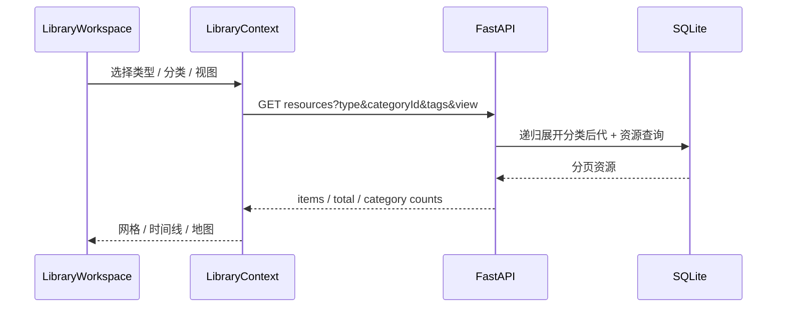

# 设计 · library-workspace（L2 能力设计 · 已定稿）

> 复杂需求 L2。本文只定模型、交互、模块、拆分与抽象；不写业务代码，不做 L3 文件清单。
> 视觉细化另走 `project-spec-design`；本设计定“什么在哪、为什么”。

## 0. 复杂度

- [x] 新实体/契约：每类型分类树、多对多分类、保存视图
- [x] 跨模块或前后端：SQLite / FastAPI / Vue / Electron 壳
- [x] 新主交互：资源库导航、视图切换、分类树、首页
- [x] 新抽象或拆分子能力：分类树、视图上下文、首页组合
- [x] >1 PR / 跨层多文件
- [x] 用户要求先设计

结论：**必须 L2；不进入 apply。**

## 1. 设计原则

| 原则 | 本能力含义 | 不做 |
|------|------------|------|
| 资源是唯一内容实体 | 时间线、地图、分类、合集、角色都是查询或关系，不复制资源 | 把图片复制进时间线/文件夹 |
| 分类是面，不是文件夹 | 资源可多分类；分类不映射磁盘目录 | 物理目录镜像、按分类移动文件 |
| 每类型一棵树 | 图片树、视频树独立；同名节点可存在于不同类型 | 一个全局树混杂所有类型 |
| 单节点筛选、多分类赋值 | 赋值可多个；筛选一次一个节点并含后代 | MVP 多节点并集筛选 |
| 导航与存储解耦 | 侧栏是目的地；分类树是资源库上下文 | 每个功能加一个顶级菜单 |
| 视图共享上下文 | 网格/时间线/地图共享类型、分类、标签、搜索 | 各视图各存一套筛选 |
| 渐进披露 | 全局栏、上下文栏、批量栏、信息栏分层 | 所有动作堆一条工具栏 |
| 数据不丢 | 迁移保留资源、分类、合集；分类删除有保护 | 静默级联删资源 |

## 2. 模型

### 2.1 对象

| 对象 | 关系 | 说明 |
|------|------|------|
| `Resource` | 1..N `ResourceCategory`；0..N 标签；0..N 合集成员 | 现有资源表，不复制到视图 |
| `Category` | 自引用 `parent_id`；属于一个 `type` | 每类型独立树；最多 4 层 |
| `ResourceCategory` | 多对多连接 | 资源可挂多个分类；分类与资源类型必须一致 |
| `Collection` / `CollectionItem` | 现有手动集合 | 跨类型；详情按类型 tabs 展示 |
| `SavedView` | 按 `type` 保存筛选条件 | 用户可见名「时间线」；无成员表 |
| 地图 | 无实体 | 当前筛选 + GPS 的视图 |

### 2.2 Category

```text
Category
  id
  type          # image / video / ...；每类型独立树
  parent_id     # null = 根
  name
  sort
  is_system     # 「待整理分类」等系统节点
```

不变量：

- `type` 不可变；节点只能在同类型树内移动。
- 根节点 `parent_id is null`；深度 ≤ 4；禁止循环。
- 同 `(type, parent_id, name)` 唯一；根节点用部分唯一索引处理 SQLite NULL。
- 资源分类必须满足 `category.type == resource.type`。
- 删除有子节点或资源关系的分类 → 阻止并提示；删除空分类 → 从引用它的保存视图中清空该分类 ID，不阻止。
- 「待整理分类」为图片树系统根，收纳迁移后无资源的旧分类；不可删除，子节点可移出；**非空才显示**，空则隐藏。

筛选语义：

- 选中节点 = 该节点 + 全部后代（递归 CTE 展开）。
- 资源只要挂到其中任一节点即命中；父节点计数按 `resource_id` 去重。
- 多分类导致计数重叠：父节点显示**去重后的匹配数**，不是子节点计数之和。
- 「未分类」= 没有任何 `resource_categories` 记录；虚拟筛选，不建真实分类。

### 2.3 Resource 分类字段

- 新真源：`resource_categories(resource_id, category_id)`。
- 旧 `resources.category_id` 单值列迁移后停止读写，保留一版用于回滚；下一版迁移删除，不允许双真源长期并存。
- `Resource` DTO 从 `category: Category | null` 改为 `categories: Category[]`。
- 资源编辑请求从 `categoryName` 改为 `categoryIds: number[]`（空数组=清空）；服务端校验类型与存在性。
- 分类名不再用于资源关联，避免同名歧义。

### 2.4 SavedView（用户界面叫「时间线」）

```text
SavedView
  id
  kind          # timeline（本版本唯一）
  type          # image / video
  name          # 同类型内唯一
  filters_json  # categoryIds[], tagIds, dateFrom, dateTo, includeUntimed
  sort
  created_at / updated_at
```

- 无成员表；结果由查询实时计算。
- 一个时间线可包含**多个分类**（并集；父子同时选中按资源去重）；分类删除时从 filters 中清空该 ID，剩余条件继续生效。
- 时间线按类型拆分；旧混合 image+video 的 `/photos` 迁移为图片时间线。
- 地图不保存为 SavedView；地图只是当前查询的视图。

### 2.5 迁移

1. `categories` 增加 `type`；现有分类按资源实际使用类型分组。
2. 一个分类被多个类型使用 → 在每个类型树中各建同名节点；资源关系指向对应类型节点。
3. 无资源使用的分类 → 图片树「待整理分类」系统根下；不删除。
4. 现有 `resources.category_id` 逐行写入 `resource_categories`。
5. 旧单值列停止读写，保留一版用于回滚；下一版迁移删除。保留迁移校验：资源数、分类数、关系数对账。
6. 新建部分唯一索引 `(type, parent_id, name)`；深度与循环由服务层校验。
7. 不移动任何库内文件；不改变合集成员。

### 2.6 查询与计数

- `categoryId` 单参数：后端展开后代 ID，再用 `EXISTS`/join 过滤；keyset 分页不变。
- 分类树 API 返回树 + `count`（去重匹配数）；一次请求，避免每节点 N+1。
- 搜索 `q` 对分类名的匹配改为匹配资源的任一分类；不再依赖单值 join。
- 时间线/合集筛选复用同一子树语义。

## 3. 交互

### 3.1 资源库主路径



- 类型 tabs：切换类型时**重置全部筛选**（q、标签、分类、保存时间线、排序）；视图模式保留，该类型不支持则回网格。
- 分类树：当前类型树，常驻可折叠；选中节点后网格/时间线/地图共享筛选。
- 视图切换：只改 `view`，不改变类型/分类/标签/搜索/排序。
- URL：`type`、`view`、`categoryId`、`tagIds`、`q`、`sort`；保存时间线额外 `timelineId`。
- 旧 `/photos` → 图片时间线视图；不保留混合媒体默认页。

### 3.2 分类管理

- 入口：分类树头部「管理分类」。
- 分类树常驻可折叠，**默认展开到第一层**。
- 新建：在选中节点下建子节点，或建根节点；深度 4 阻止。
- 重命名/移动：同类型树；循环检测；移动后筛选结果自动跟随。
- 删除：有子节点/资源 → 阻止；空节点可直接删，并从保存时间线的分类列表中清空该 ID。
- 「待整理分类」不可删，非空才显示；其子节点可移出。
- 资源归类：信息栏分类 chips 多选；批量归类后续加，不阻塞本刀。

### 3.3 保存的时间线

- 时间线视图顶部「保存为时间线」；输入名称，保存当前类型 + **一个或多个分类** + 标签 + 日期范围；分类按并集匹配。
- 保存后出现在视图切换旁的下拉/首页入口；不复制资源。
- 新建资源若匹配规则，自动出现。
- 编辑名称/筛选；删除不影响资源。
- 无拍摄时间的资源：**默认不包含**；保存筛选器时可显式开启「包含未知时间」。
- 分类删除时从保存筛选器的分类列表中清空该 ID；剩余条件继续生效。
- 图片/视频各自时间线；不提供混合媒体时间线（后续可加独立“全部媒体”视图，无分类树）。

### 3.4 合集

- 合集列表使用统一 D 卡片：最多 3 张成员缩略图；0/1/2+ 三态；hover/focus 扇形；`prefers-reduced-motion` 静态。
- 合集详情：
  - 类型 tabs：全部 / 图片 / 视频 / …；
  - 选中单一类型时显示该类型分类树；
  - 「全部」不显示分类树，只用标签/搜索；
  - 网格/时间线/地图视图共享当前合集成员集合。
- 合集成员关系不变。

### 3.5 首页工作台

- 顶部：导入、搜索、新建合集。
- 最近添加：横向缩略图带（默认 12 个）；**点击缩略图只打开当前一张**（查看器/播放器），不建立播放序列、不跳转页面；「查看全部」另进入资源库。
- 我的合集：D 卡片横向排列；点击进入合集详情。
- 时间线：最近保存的时间线入口。
- 继续整理：进行中的工作/导入任务。
- 最近消费：保留。
- 统计：压缩为一行小卡。
- 数据按区块懒加载/限量；空区块显示引导或隐藏。

### 3.6 批量快捷键

- 仅批量模式：
  - `Ctrl + 左键`：切换当前项；
  - `Shift + 左键`：从锚点选连续范围，**替换**当前选择；
  - `Esc`：关闭上层弹窗/查看器；否则退出批量。
- 范围仅基于当前已加载、可选资源的显示顺序；合集卡排除。
- 输入框、弹窗、查看器内不响应；不新增 `Ctrl+A`。
- 批量栏显示快捷键提示。

### 3.7 操作区层级

| 区域 | 放什么 | 不放什么 |
|------|--------|----------|
| 全局栏 | 导入、全局搜索、设置、主题、更新 | 类型筛选、批量动作 |
| 上下文栏 | 类型 tabs、视图切换、分类树入口、标签、排序、批量选择 | 导入/设置 |
| 批量栏 | 选中数、加入合集、打标、移入回收站、更多、快捷键提示 | 单资源编辑 |
| 信息栏 | 封面/标题；信息、元数据、关系（分类/标签/合集/时间线/角色） | 全局筛选 |
| 首页 | 最近添加、合集、保存时间线、继续整理、最近消费、统计 | 完整分类树 |

### 3.8 空态/失败/边界

- 分类树为空：提示「新建分类」；未分类筛选仍可用。
- 分类加载失败：保留资源列表，树区域可重试。
- 分类删除被阻止：明确列出子节点/资源；空分类删除后保存时间线自动去掉该 ID。
- 地图首版：显示入口与空态；不实现完整地图交互。
- 保存时间线名称重复：提示改名；不覆盖。
- 迁移失败：启动时阻断并给日志/恢复路径，不部分写入。
- 旧路由/旧链接：重定向到新视图，不 404。
- 时间线无匹配或只剩未知时间：显示空态与「包含未知时间」开关。

## 4. 模块划分

| 模块 | 边界 | 不进入 | 依赖 |
|------|------|--------|------|
| 分类领域 | Category 树、类型约束、深度/循环、系统节点 | Vue、HTTP | 无 |
| 保存视图领域 | SavedView 筛选器校验、名称唯一、类型约束 | 资源成员表 | 分类/资源类型 |
| 资源查询 | 资源列表/时间线/地图筛选、keyset、计数 | UI 布局 | 分类树、标签、资源 |
| 分类管理 API | 树 CRUD、计数、迁移对账 | 资源编辑 UI | 分类领域/仓储 |
| 视图 API | 保存时间线 CRUD、查询 | 资源复制 | 保存视图领域/资源查询 |
| 资源库前端 | LibraryContext、类型/视图/筛选状态、URL | 直接 SQL | HTTP/domain |
| 分类树 UI | 树展示、选择、管理弹窗 | 业务校验 | 分类 API |
| 首页组合 | 最近添加/合集/时间线/工作区 | 独立数据副本 | 现有 API/合集 API |
| 合集卡 UI | D 卡片、预览、可访问性 | 成员规则 | 合集 API |
| Shell 操作区 | 工具栏/批量栏/信息栏分区 | 分类模型 | 资源库前端 |

依赖方向：`UI → 应用状态/用例 → API/领域`；算法不依赖 Vue/HTTP。

## 5. 功能拆分

### 5.1 产品切片

| 切片 | 可感知结果 | 依赖 | 本版本 |
|------|------------|------|--------|
| P1 资源库导航 | 首页/资源库/类型 tabs/视图切换 | 无 | 是 |
| P2 分类树 | 每类型树、多分类、子树筛选、管理 | P1 | 是 |
| P3 保存时间线 | 命名筛选器、图片/视频分开、多分类并集 | P1/P2 | 是 |
| P4 首页工作台 | 最近添加（点击直接打开查看器）/合集/时间线/继续整理 | P1/P5 | 是 |
| P5 合集卡 D | 叠层封面、hover/focus | 合集 API | 是 |
| P6 批量快捷键 | Ctrl/Shift/Esc | 现有选择 store | 是 |
| P7 Shell 操作区 | 全局/上下文/批量/信息栏分区 | P1 | 是 |
| P8 地图视图 | 入口 + 空态 | P1/P2 | 入口/空态 |
| P9 角色/人脸 | 角色维度 | R3/R4 | 否 |

### 5.2 实现切片

| 切片 | 能力 | 路径（模块级） | 组装于 |
|------|------|----------------|--------|
| 算法 | 分类树构建/展开、移动校验、保存筛选器校验、范围选择 | 后端分类领域；前端树工具/选择 store | 分类 API / LibraryContext |
| 功能 | 分类 CRUD、资源归类、保存视图 CRUD、资源查询 | 后端 application/use_cases | API 路由 |
| UI | 类型 tabs、分类树、视图切换、D 卡、首页、批量栏、信息栏 | renderer UI | LibraryWorkspace / Home |
| 组合根 | 把类型/分类/视图/筛选/首页区块接到页面 | `LibraryWorkspace` 页面 | 资源库路由 |

### 5.3 切片契约

| 调用方 | 提供方 | 名称 | 入参 | 出参/错误 |
|--------|--------|------|------|-----------|
| 分类树 UI | 分类 API | `GET /library/categories?type=` | type | 树 + count；失败可重试 |
| 分类管理 UI | 分类 API | `POST/PATCH/DELETE /library/categories` | type/parentId/name/order | 节点；循环/深度/占用冲突 4xx |
| 资源编辑 UI | 资源 API | `PATCH /library/resources/{id}` | categoryIds[] | 更新后的 categories；类型不符 422 |
| LibraryContext | 资源 API | `GET /library/resources` | type/categoryId/tags/q/view | 分页资源；分类子树含后代 |
| 时间线 UI | 保存视图 API | `GET/POST/PATCH/DELETE /library/saved-views` | kind=timeline/type/filters | 视图；重名 409 |
| 首页 | 聚合 API | `GET /library/home` | — | 最近添加/合集/时间线/统计；限量 |
| 合集卡 UI | 合集 API | `GET /library/collections` | — | 集合 + previewThumbnails[≤3] |
| 资源库 UI | 选择 store | `selectRange` | orderedIds, toId | 替换范围；锚点失效退化单选 |

## 6. 抽象

**抽：**

- 分类树：树构建、后代展开、移动校验、计数去重；后端查询与前端展示共用语义。
- 视图上下文：`type + view + categoryId + tags + q + sort` 一处定义，网格/时间线/地图共用。
- 保存筛选器：统一 `SavedView`，未来可扩展其他视图，不另起一套时间线表。
- 选择范围：沿用现有 `selection.selectRange`，不新建快捷键体系。

**不抽：**

- 不做通用“页面引擎/微前端”；类型页仍由现有页面/组件组合。
- 不为一次性的首页区块抽数据层抽象。
- 不让算法层依赖 Vue 组件或 HTTP。
- 不把分类树做成通用文件系统 API；它只服务资源分类。

## 7. 开放问题

无阻塞项。已定：
1. 「待整理分类」非空才显示、不可删除、子节点可移出。
2. 首页最近添加只打开当前一张，不建立播放序列。
3. 分类树默认展开到第一层。
4. 多分类时间线允许父子节点同时选，按并集去重。

---

**L2 已定稿 · 已按 L3 落地（2026-10-19）**。发版手验与提交见 handoff。
