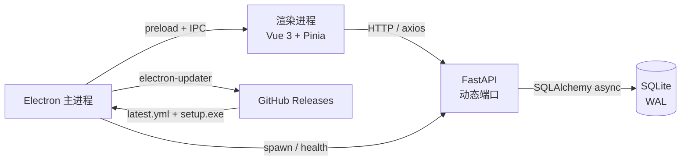

# 01 · 架构全景（2026-10-19 现状）

> 本文描述当前实现，不保留已废弃的下载模块设计。
> 早期“aria2c + rqbit 双引擎”已按 D-20261007-01 移除，下载统一委托第三方下载器。

## 1. 三进程数据流

```text
┌─ Electron 渲染进程（Vue 3 + naive-ui + Pinia + vue-router）────────┐
│  axios → http://127.0.0.1:<动态端口>                               │
│  地址/token 由 additionalArguments 注入（见 03）                    │
├─ Electron 主进程（TypeScript）──────────────────────────────────────┤
│  窗口 / IPC / 进程编排 / 更新 / 主题 / 外链                         │
│  infrastructure/services/ 拉起 Python 后端（见 02）                  │
├─ Python FastAPI 单进程（127.0.0.1）─────────────────────────────────┤
│  /library   资源库：资源/分类/合集/时间线/导入/导出/工作台           │
│  /scrape    抓取：TMDB / Bangumi / B 站 / Open Graph / 候选与任务    │
│  /settings  设置：凭证/系统路径/监视目录/解析规则                    │
│  /health    健康检查                                                │
├─ 更新通道（主进程）─────────────────────────────────────────────────┤
│  electron-updater → GitHub Releases（见 23）                        │
└─ 存储：SQLite 单文件（WAL + 迁移 + 仓储层）──────────────────────────┘
```



开发态数据在 `apps/backend/data/library.db`；安装版在：

```text
%APPDATA%/local-resource-manager/library.db
```

## 2. 统一四层约定

| 层 | 前端（renderer） | 后端（每个应用） | 职责 |
|----|------------------|------------------|------|
| UI | `ui/` + `components/` + `views/` | `api/`（薄路由） | 展示、输入、HTTP 契约入口 |
| 业务 | `hooks/` + `application/`（Pinia stores） | `application/`（用例/服务） | 流程编排、权限/规则 |
| 领域 | `domain/`（类型、常量、纯规则） | `domain/`（实体、枚举、值对象） | 不依赖框架的业务内核 |
| 基础设施 | `infrastructure/`（http/log/shell/viewer） | `infrastructure/`（ORM/仓储/文件/外部 API） | 技术细节 |

依赖方向：

```text
UI → application → domain
                 ↑
          infrastructure（实现细节）
```

domain 不依赖 Vue、axios、FastAPI、SQLAlchemy。

## 3. 关键技术选型

| 领域 | 选型 | 说明 |
|------|------|------|
| 桌面 | Electron 44 + Vue 3 + Vite 8 + TypeScript | 主进程/preload/渲染进程分离 |
| UI | naive-ui + Less + design tokens | 亮/暗主题，布局与组件分离 |
| 状态 | Pinia + persistedstate | 浏览状态、分类树、更新状态 |
| 路由 | vue-router（hash history） | 打包后无需服务端 rewrite |
| 后端 | FastAPI + uvicorn | 单进程，多 APIRouter |
| 数据 | SQLite + SQLAlchemy 2.0 async + aiosqlite | 本地单机，WAL |
| 抓取 | httpx + selectolax + 站点适配器 | 直接官方 API/页面，不依赖自建搜索 |
| 媒体 | Pillow + ffprobe | EXIF、缩略图、视频元数据 |
| 打包 | electron-builder（NSIS + zip） | Windows x64 |
| 更新 | electron-updater + GitHub Releases | 安装版自动更新；zip 手动替换 |
| CI | GitHub Actions | tag `v*` 触发发布 |

## 4. 主要请求链路

### 4.1 列表/详情

```text
Vue 页面
  → Pinia browseQuery / useResourcePage
  → infrastructure/http/client.ts（axios + Bearer token）
  → FastAPI router
  → application service（参数归一化、规则）
  → repository（SQLAlchemy async）
  → SQLite
  ← JSON 信封 {code,status,message,data}
  ← axios 拦截器解包
```

### 4.2 导入

```text
UI 导入向导
  → ImportService（扫描/复制/哈希/缩略图/元数据）
  → Resource + ResourceFile + 标签/分类
  → library.invalidate({ resources: [type], categories: [type], home: true })
  → 列表/分类树/首页自动刷新
```

### 4.3 抓取

```text
UI 搜索
  → /scrape/jobs
  → 队列 worker
  → 站点适配器 / Open Graph
  → Candidate
  → 用户确认
  → 写回 Resource 元数据
```

### 4.4 更新

```text
主进程启动 8s 后检查
  → electron-updater 读取 GitHub Release latest.yml
  → 发现新版本 → 状态 available
  → 用户点下载 → 下载/校验 → downloaded
  → 重启安装
```

## 5. 为什么这样拆

- **单后端进程**：本地单机，SQLite 单写者更简单；不需要为微服务付出跨进程事务成本。
- **渲染层不碰 Node**：contextIsolation + preload 白名单，减少攻击面，也避免把文件系统逻辑散进组件。
- **后端分层**：API 只做契约，application 做流程，domain 做规则，infrastructure 做 SQL/IO；测试可以绕过 HTTP。
- **更新独立通道**：更新是桌面能力，不放进 FastAPI；失败不影响主业务启动。
- **更新与业务解耦**：0.1.1 首次装 updater，之后 tag 发布；zip 用户手动替换。

## 6. 当前模块地图

| 区域 | 入口 |
|------|------|
| 主进程启动 | `apps/desktop/src/main/index.ts` |
| 后端子进程 | `apps/desktop/src/main/infrastructure/services/` |
| 更新 | `apps/desktop/src/main/infrastructure/services/update.ts` |
| preload 白名单 | `apps/desktop/src/preload/index.ts` |
| 路由 | `apps/desktop/src/renderer/src/router/route.ts` |
| 资源库组合根 | `apps/desktop/src/renderer/src/views/LibraryWorkspace/index.vue` |
| 列表分页 | `apps/desktop/src/renderer/src/hooks/useResourcePage.ts` |
| HTTP | `apps/desktop/src/renderer/src/infrastructure/http/` |
| 后端入口 | `apps/backend/app/main.py` |
| 资源库 API | `apps/backend/app/library/api/` |
| 资源库用例 | `apps/backend/app/library/application/use_cases.py` |
| 媒体时间线 | `apps/backend/app/library/application/photos.py` |
| 仓储 | `apps/backend/app/library/infrastructure/repositories.py` |
| 迁移 | `apps/backend/app/shared/db/migrations/` |

## 7. 已废弃/已收敛

| 旧设计 | 当前 |
|--------|------|
| `/download` + aria2c/rqbit | 移除，委托第三方下载器 |
| 单一 `resources.category_id` | `resource_categories` 多对多；旧字段仅保留一版回滚 |
| `categories` 扁平表 | 按资源类型的树，最多 4 层 |
| 照片独立页 `/photos` | 重定向到 `/timelines/all` + `/library/image` |
| 时间线成员表 | `saved_views` 规则，无成员表 |
| 远程 picsum 封面 | 本地占位/缩略图为主 |

## 8. 延伸阅读

- 子进程：[02-Electron后端子进程编排.md](02-Electron后端子进程编排.md)
- 传参：[03-主进程传参additionalArguments.md](03-主进程传参additionalArguments.md)
- 领域模型：[06-领域模型-状态机值对象常量.md](06-领域模型-状态机值对象常量.md)
- SQLite：[07-SQLite迁移与仓储.md](07-SQLite迁移与仓储.md)
- 桌面分层：[24-桌面端分层与模块封装.md](24-桌面端分层与模块封装.md)
- 后端分层：[25-后端分层与数据访问.md](25-后端分层与数据访问.md)
- 发布/更新：[23-GitHub-Releases与自动更新.md](23-GitHub-Releases与自动更新.md)、[26-发布构建与测试门禁.md](26-发布构建与测试门禁.md)
- 学习路线：[28-学习路线图.md](28-学习路线图.md)

## 9. 关联设计文档

- 需求：`docs/requirements/features/local-resource-manager.md`
- 技术栈：`docs/requirements/features/lrm-tech-stack.md`
- 数据模型：`docs/design/02-数据模型.md`
- API：`docs/design/03-API设计.md`
