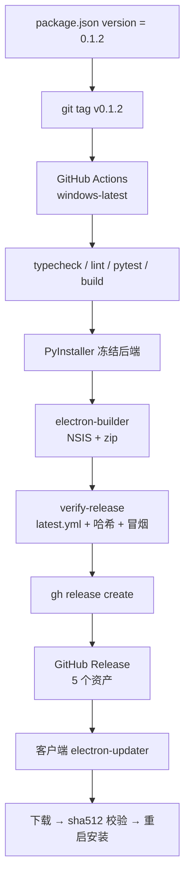
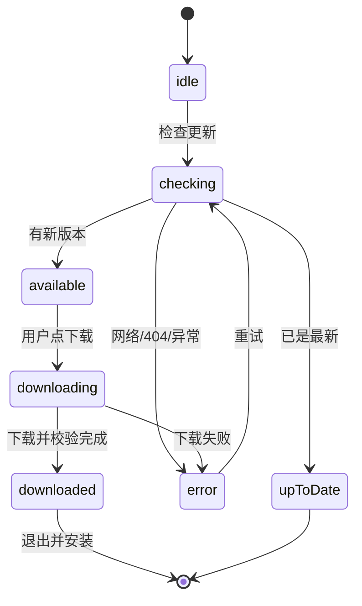

# 23 · GitHub Releases 与自动更新

> 本文解释「打一个 tag，为什么能变成 Windows 安装包，又为什么旧版本能自己发现并安装它」。
> 相关实现：`apps/desktop/src/main/infrastructure/services/update.ts`、`.github/workflows/release-windows.yml`、`apps/desktop/electron-builder.yml`、`scripts/release.mjs`、`scripts/verify-release.mjs`。
> 相关故障复盘：2026-10-19 的 `v0.1.2` 发布。

## 1. 一句话结论

本项目使用 **electron-updater + GitHub Releases**：

```text
package.json version
        │
        │ git tag v0.1.2
        ▼
GitHub Actions（Windows runner）
        │
        ├─ pytest / typecheck / lint / vue build
        ├─ PyInstaller 冻结 Python 后端
        ├─ electron-builder 生成 NSIS 安装包 + zip
        └─ gh release create 上传资产
                    │
                    ▼
GitHub Release
  ├─ local-resource-manager-0.1.2-win-x64-setup.exe
  ├─ ...setup.exe.blockmap
  ├─ local-resource-manager-0.1.2-win-x64.zip
  ├─ latest.yml
  └─ SHA256SUMS.txt
                    │
                    ▼
已安装的 0.1.1（electron-updater）
  └─ 读取 latest.yml → 下载 setup.exe → 校验 → 退出 → NSIS 静默安装
```





关键点不是“上传文件”，而是 **版本号、`latest.yml`、安装包、blockmap、GitHub Release 和客户端 updater 配置六者互相对齐**。

## 2. GitHub 侧：tag、Release、资产分别是什么

### 2.1 tag 是触发器，不是安装包

工作流：

```yaml
on:
  push:
    tags:
      - 'v*'
```

推送 `v0.1.2` 时，Actions 会以该 tag 指向的提交为源码构建。tag 本身只是 Git 引用；Release 才是 GitHub 上可下载的发布对象。

本项目约定：

- 应用版本真源：`apps/desktop/package.json` 的 `version`
- tag：`v` 加同一个版本号，例如 `v0.1.2`
- Release 标题：`v0.1.2`
- Release 资产名：由 `electron-builder.yml` 的 `artifactName` 决定

版本号不一致会导致客户端检查到 0.1.2，但安装包内部仍是 0.1.1，或者 `latest.yml` 指向不存在的文件。`scripts/verify-release.mjs` 会检查 `latest.yml` 是否包含 `package.json` 的版本与安装包名。

### 2.2 Release 必须上传哪些资产

| 资产 | 作用 | 缺失后果 |
|------|------|----------|
| `latest.yml` | updater 的版本清单，含版本、文件名、sha512、size | 客户端不知道有更新，或下载地址错误 |
| `*-setup.exe` | NSIS 安装包，自动更新实际下载的文件 | 无法安装 |
| `*-setup.exe.blockmap` | 差分下载用的块索引 | 通常退化为全量下载，更新更慢 |
| `*.zip` | 绿色版/手动替换包 | 手动分发缺失；自动更新不依赖它 |
| `SHA256SUMS.txt` | 人工校验与故障排查 | 不影响 updater，但失去完整性凭据 |

`latest.yml` 的形态类似：

```yaml
version: 0.1.2
files:
  - url: local-resource-manager-0.1.2-win-x64-setup.exe
    sha512: <base64 sha512>
    size: 164610269
path: local-resource-manager-0.1.2-win-x64-setup.exe
sha512: <base64 sha512>
releaseDate: '2026-10-19T15:10:53.205Z'
```

`sha512` 不是可选项：electron-updater 下载后会按它校验文件。不要手工改 `latest.yml` 里的哈希。

### 2.3 `app-update.yml` 从哪来

`electron-builder.yml`：

```yaml
publish:
  provider: github
  owner: MyLoveou
  repo: local-resource-manager
```

打包时 electron-builder 会把发布配置写进安装目录：

```text
win-unpacked/resources/app-update.yml
```

内容大致是：

```yaml
provider: github
owner: MyLoveou
repo: local-resource-manager
```

客户端不是把仓库地址硬编码在 TypeScript 里，而是读这个文件。`verify-release.mjs` 会检查它是否仍然是 `provider: github`。

### 2.4 仓库可见性与权限

- 仓库必须是 **public**，否则未登录的客户端无法匿名读取 Release 和资产。
- 工作流需要：

```yaml
permissions:
  contents: write
```

`GITHUB_TOKEN` 由 Actions 注入，不能写进仓库。

- 默认分支与 tag 构建不是一回事，但 Release 的 `target_commitish`、PR/分支管理和手动重跑会受影响。本项目已把默认分支统一为 `master`。

## 3. 客户端：electron-updater 的完整状态机

### 3.1 只在“安装版”启用

```ts
function isInstalledBuild(): boolean {
  return app.isPackaged && existsSync(join(dirname(process.execPath), 'installed.marker'))
}

function updateSupported(): boolean {
  return isInstalledBuild() || Boolean(process.env.UPDATE_FEED_URL)
}
```

- NSIS 安装版：安装器写入 `installed.marker`，支持自动更新。
- 绿色 zip：没有 marker，只能手动替换。
- 开发态：`app.isPackaged === false`，返回 `unsupported`，避免开发环境误触发。
- `UPDATE_FEED_URL`：预留的自定义 generic feed 入口，用于联调或镜像。

状态定义在：

```text
idle → checking → available → downloading → downloaded
                         └──→ error
checking ───────────────────→ up-to-date
```

UI 只消费 `UpdateStatus`，不直接操作 `autoUpdater`。

### 3.2 检查与下载分离

```ts
autoUpdater.autoDownload = false
autoUpdater.autoInstallOnAppQuit = true
autoUpdater.allowPrerelease = false
autoUpdater.allowDowngrade = false
```

- `autoDownload = false`：发现更新只提示，用户点“下载更新”才下载，避免后台偷偷占带宽。
- `autoInstallOnAppQuit = true`：已下载后，即使不点“重启安装”，退出应用时也会安装。
- `allowPrerelease = false`：不接收 beta/rc。
- `allowDowngrade = false`：默认只升不降。

`downloadUpdate()` 只在 `phase === 'available'` 时执行；`installUpdate()` 只在 `phase === 'downloaded'` 时执行。状态机是客户端的第一道防线。

### 3.3 更新说明为什么会出现 `<p>`

electron-updater 的 GitHub provider 会从 GitHub Atom feed 计算 release notes。Atom 里的内容可能是 HTML，例如：

```html
<p>Windows x64 build v0.1.2</p>
```

早期 `notesText()` 原样返回，UI 又放在 `<pre>{{ notes }}</pre>` 里，于是用户看到的就是标签本身。

修复方式：

```ts
function htmlToText(value: string): string {
  return decodeEntities(
    value
      .replace(/<br\s*\/?>/gi, '\n')
      .replace(/<\/(?:p|div|h[1-6]|li|tr)>/gi, '\n')
      .replace(/<li[^>]*>/gi, '• ')
      .replace(/<[^>]*>/g, '')
  ).trim()
}
```

原则：

- 更新说明按 **纯文本** 展示，不使用 `v-html`。
- `v-html` 会引入 XSS 面；更新说明来自远程，不能默认信任。
- 数组形式的 `releaseNotes` 也要逐条清洗，并保留版本号。

> 时间线提醒：`v0.1.2` 的安装包构建于这次修复之前，因此 0.1.1/0.1.2 仍会显示旧 UI；清洗逻辑要下个版本才会随包生效。

### 3.4 下载进度：不要只显示百分比

`download-progress` 事件实际提供：

```ts
transferred      // 已下载字节
total            // 总字节
bytesPerSecond   // 当前速度
percent          // 百分比
```

主进程把这些字段放进 `UpdateStatus`，渲染层显示：

```text
1% · 1.6 MB / 164.6 MB · 320 KB/s · 剩余约 8:12
```

这解决两个体验问题：

1. 用户知道“是否真的在下载”，而不是卡在 1%。
2. 慢的时候能判断是网络慢，还是程序卡住。

### 3.5 手动下载兜底

设置页提供“手动下载”，打开：

```text
https://github.com/MyLoveou/local-resource-manager/releases/latest
```

它不能直接让 GitHub 变快，但让用户可以：

- 用浏览器/下载工具下载；
- 断点续传；
- 在自动更新被代理或防火墙卡住时完成升级。

打开外链通过主进程 `shell.openExternal`，并只允许 HTTPS：

```ts
if (typeof raw !== 'string' || !/^https:\/\//i.test(raw)) {
  return fail('仅支持 HTTPS 链接')
}
```

不要让渲染进程直接 `window.open` 任意 URL。

## 4. 发布工作流拆解

完整文件：`.github/workflows/release-windows.yml`。

### 4.1 环境

| 项 | 值 | 原因 |
|----|----|------|
| runner | `windows-latest` | 构建 Windows NSIS |
| Node | 24 | Electron/Vite 工具链 |
| pnpm | 11 | 与 lockfile 对齐 |
| Python | 3.14 | 后端测试与 PyInstaller |
| timeout | 90 分钟 | 首次缓存冷启动较慢 |
| `CSC_IDENTITY_AUTO_DISCOVERY` | `false` | 当前不做代码签名 |

### 4.2 后端依赖必须包含 dev

```yaml
pip install -r requirements.txt \
            -r requirements-dev.txt \
            -r requirements-packaging.txt
```

这里踩过一次真实故障：只装 `requirements.txt` 时 CI 没有 `pytest`，`pnpm release:win` 在测试阶段直接失败。本地能跑，是因为本地 `.venv` 早已装过 dev 依赖。

### 4.3 `pnpm release:win` 的顺序

`scripts/release.mjs` 不是只调用 electron-builder，它是一条质量门禁：

```text
清理 release / build / dist
  → typecheck
  → lint
  → pytest
  → electron-vite build
  → PyInstaller onedir 冻结后端
  → copy ffprobe
  → electron-builder（NSIS + zip，不发布）
  → verify-release
```

任何一步非零退出，整个发布停止。这样不会出现“安装包构建成功，但后端跑不起来”。

### 4.4 上传与创建 Release

```yaml
- uses: actions/upload-artifact@v4
  with:
    path: |
      release/local-resource-manager-*-setup.exe
      release/local-resource-manager-*.blockmap
      release/local-resource-manager-*.zip
      release/latest.yml
      release/SHA256SUMS.txt

- name: Publish GitHub Release
  if: startsWith(github.ref, 'refs/tags/v')
  env:
    GH_TOKEN: ${{ secrets.GITHUB_TOKEN }}
  run: |
    gh release create "${GITHUB_REF_NAME}" \
      release/... \
      --title "${GITHUB_REF_NAME}" \
      --notes "Windows x64 build ${GITHUB_REF_NAME}"
```

注意：

- `gh release create` 在 Release 已存在时会失败。重发前要么删除旧 Release，要么改用 `gh release upload --clobber`。
- 工作流先上传 Actions artifact，再创建 Release；即使创建 Release 失败，构建产物仍可从 Actions 下载。
- Release 创建成功不等于 updater 一定成功；还要看 `latest.yml` 是否被上传、仓库是否 public。

## 5. `v0.1.2` 实战复盘

### 5.1 发生过的失败

| 现象 | 根因 | 修复 |
|------|------|------|
| CI 找不到 pytest | venv 只装了运行依赖 | workflow 安装 `requirements-dev.txt` |
| `test_export_endpoint_404_unknown_collection` 报 `no such table: resources` | `TestClient` 触发 app lifespan，但测试只迁移了临时库，全局 app 仍指向默认库 | 改为服务层测试，用临时 session 直接断言 404 |
| Release 构建成功但客户端看不到 | 空 Release 已存在/没有资产/仓库曾为 private/默认分支不对 | 删除空 Release、改 public、统一 `master`、重打 tag |
| 更新说明显示 `<p>...</p>` | Atom release notes 是 HTML，UI 原样输出 | 主进程清洗为纯文本 |
| 下载很慢 | 安装包约 164 MB，GitHub 资产受网络影响 | 显示速度/剩余，提供手动下载；镜像需自建 |

### 5.2 为什么重打 tag

修复测试后：

```bash
git add apps/backend/tests/test_batch_tag_export.py
git commit -m "fix(test): 合集缺失测试改为服务层隔离"
git push origin master
git tag -f v0.1.2 HEAD
git push -f origin v0.1.2
```

tag 指向新提交，Actions 重新运行。强制更新 tag 会覆盖远端引用，只应在“该版本尚未正式发布/Release 为空”时使用；已经有人下载的版本不要重写 tag。

### 5.3 最终成功判据

- Actions 运行成功；
- Release 为 public、非 draft；
- 5 个资产齐全；
- `latest.yml` 的 `version` 与安装包版本一致；
- `latest.yml` 的 `path` 指向 setup.exe；
- 安装版 0.1.1 能检查到 0.1.2；
- 下载完成后能重启安装。

## 6. 安全与完整性

### 6.1 已有保护

- GitHub 走 HTTPS；
- electron-updater 按 `latest.yml` 的 sha512 校验下载文件；
- `SHA256SUMS.txt` 提供人工二次校验；
- workflow 权限最小化为 `contents: write`；
- 更新说明按纯文本显示，不使用 `v-html`；
- 外链只允许 HTTPS。

### 6.2 尚未做

- **代码签名**：当前 `CSC_IDENTITY_AUTO_DISCOVERY=false`，Windows 可能弹 SmartScreen。生产分发应配置 Authenticode 证书。
- **镜像**：默认只走 GitHub，没有第三方加速。不要为了速度把可执行文件交给不可信代理；镜像必须由自己控制，并保持 `latest.yml` 与二进制一致。
- **回滚**：`allowDowngrade=false`，没有自动回滚通道。严重故障时需要发布更高版本修复。

### 6.3 如果要做镜像

`update.ts` 已预留：

```ts
if (process.env.UPDATE_FEED_URL) {
  autoUpdater.setFeedURL({ provider: 'generic', url: process.env.UPDATE_FEED_URL })
}
```

镜像目录至少要有：

```text
latest.yml
local-resource-manager-0.1.2-win-x64-setup.exe
local-resource-manager-0.1.2-win-x64-setup.exe.blockmap
```

要求：

- HTTPS；
- 文件与 GitHub Release 完全一致；
- `latest.yml` 里的哈希不要改；
- 客户端能访问，且镜像不会替换二进制；
- 最好在发布流程中自动同步，而不是手工上传。

## 7. 学习指南

### 7.1 先建立的模型

1. **版本号**是发布的主键：`package.json`、tag、`latest.yml`、安装包文件名必须一致。
2. **Release 是资产容器**：tag 只负责触发，Release 才负责分发。
3. **updater 是状态机**：检查、下载、安装是三件事，不要混在一个按钮里。
4. **完整性校验**：下载地址可以变，哈希不能变。
5. **网络是外部依赖**：慢、断、代理、404 都要有可解释的状态。

### 7.2 推荐阅读

- electron-builder Auto Update：<https://www.electron.build/auto-update>
- electron-builder Publish：<https://www.electron.build/configuration/publish>
- electron-updater 源码（重点看 `GitHubProvider`、`NsisUpdater`、`download-progress`）
- GitHub Actions：<https://docs.github.com/en/actions>
- GitHub Releases：<https://docs.github.com/en/repositories/releasing-projects-on-github>
- Semantic Versioning：<https://semver.org/>

### 7.3 动手练习

1. 在测试仓库打一个 `v0.0.1` tag，观察 Actions 如何生成 Release。
2. 手动删除 Release 中的一个资产，再让客户端检查更新，观察报错。
3. 把 `latest.yml` 的版本改错，验证客户端是否还会升级。
4. 用 `UPDATE_FEED_URL` 指向本地静态文件服务器，做一次不依赖 GitHub 的更新联调。
5. 给 164 MB 的安装包记录一次下载速度曲线，判断瓶颈在本机、代理还是 GitHub。

### 7.4 自检问题

- 为什么绿色版不自动更新？
- 为什么 `autoDownload=false` 仍然需要 `autoInstallOnAppQuit`？
- `latest.yml` 和 `app-update.yml` 各自解决什么问题？
- Release 已存在时 `gh release create` 会怎样？
- 更新说明为什么不能直接 `v-html`？
- 如果用户网络访问 GitHub 很慢，哪些方案是安全的，哪些不是？

## 8. 关联文档

- [02-Electron后端子进程编排.md](02-Electron后端子进程编排.md)
- [24-桌面端分层与模块封装.md](24-桌面端分层与模块封装.md)
- [26-发布构建与测试门禁.md](26-发布构建与测试门禁.md)
- `apps/desktop/src/main/infrastructure/services/update.ts`
- `.github/workflows/release-windows.yml`
- `apps/desktop/electron-builder.yml`

## 扩展阅读

- [26-发布构建与测试门禁](26-发布构建与测试门禁.md)
- [48-图解-启动时序与发布流水线](48-图解-启动时序与发布流水线.md)
- [19-命令速查](19-命令速查.md)
