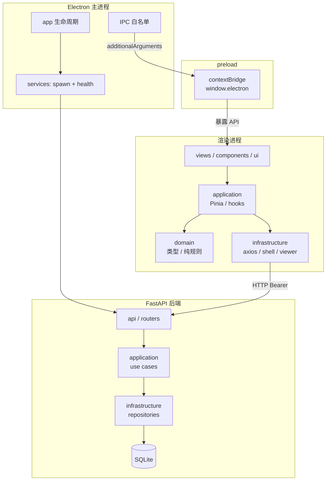
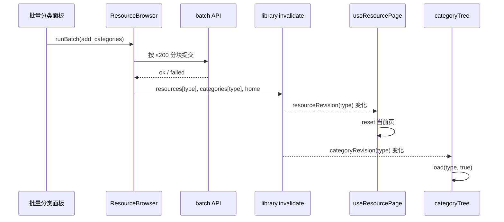

# 24 · 桌面端分层与模块封装

> 本文解释本项目的 Electron 进程边界、Vue 渲染层分层、Pinia 状态、IPC 封装和“页面是组合根”的落地方式。
> 主要代码：`apps/desktop/src/main/`、`apps/desktop/src/preload/`、`apps/desktop/src/renderer/src/`。

## 1. 先看整体：三个进程，三种职责

```text
┌──────────────────────────────────────────────────────────────┐
│ Electron 主进程（Node.js / TypeScript）                      │
│  main/index.ts                                               │
│  ├─ app 生命周期、窗口、菜单                                 │
│  ├─ startServices() → 找空闲端口 → spawn uvicorn / 后端 exe  │
│  ├─ 生成 BACKEND_TOKEN，通过 additionalArguments 注入 preload │
│  ├─ IPC：dialog / shell / theme / update                     │
│  └─ 退出时 stopServices()                                    │
└──────────────────────────────┬───────────────────────────────┘
                               │ contextBridge（preload）
┌──────────────────────────────▼───────────────────────────────┐
│ 预加载脚本 preload/index.ts                                  │
│  - contextIsolation=true，渲染层不能直接 require('fs')       │
│  - 暴露 window.electron：后端地址/token、文件选择、外链、更新 │
│  - 只转发白名单 IPC，不把整个 ipcRenderer 交出去               │
└──────────────────────────────┬───────────────────────────────┘
                               │ HTTP / IPC
┌──────────────────────────────▼───────────────────────────────┐
│ 渲染进程（Vue 3）                                            │
│  views / components / ui/layouts                             │
│  application（Pinia stores / hooks / notify）                │
│  domain（类型、常量、纯规则）                                │
│  infrastructure（axios、媒体 URL、logging、shell、viewer）    │
└──────────────────────────────┬───────────────────────────────┘
                               │ HTTP 127.0.0.1:<port>
┌──────────────────────────────▼───────────────────────────────┐
│ Python FastAPI 后端（独立进程）                              │
│  library / scrape / settings                                 │
│  SQLAlchemy async → SQLite                                   │
└──────────────────────────────────────────────────────────────┘
```



这是本项目最重要的架构约束：**UI 不直接碰数据库，渲染层不直接碰 Node，主进程不写业务查询。**

## 2. 主进程：启动顺序与边界

### 2.1 启动顺序不能反

`apps/desktop/src/main/index.ts`：

```ts
app.whenReady().then(async () => {
  registerDialogIpc()
  registerShellOpenIpc()
  registerThemeCssIpc()
  registerUpdateIpc()

  try {
    const backend = await startServices()
    backendUrl = backend.baseURL
    backendToken = backend.token
    createWindow()
    initUpdater()
  } catch (err) {
    createWindow()
    initUpdater()
    broadcastNotify(BACKEND_FAILED)
  }
})
```

关键点：

1. **先启动后端，再创建窗口**：创建窗口时要把后端地址和 token 放进 `additionalArguments`，否则 preload 拿不到。
2. **后端失败也要建窗口**：用户至少能看到错误提示和日志入口，而不是应用直接消失。
3. **IPC 先注册**：窗口加载时渲染层可能立刻调用 `dialog`、`shell`、`update`。
4. **退出时清理**：`will-quit` 调 `stopServices()`，避免 Python 后端变成孤儿进程。

### 2.2 后端子进程封装

`apps/desktop/src/main/infrastructure/services/`：

| 文件 | 职责 |
|------|------|
| `index.ts` | `startServices` / `stopServices`，保存唯一后端实例 |
| `backend.ts` | 找端口、spawn、健康检查、退出监听、停止 |
| `port.ts` | 让系统分配空闲端口 |
| `config.ts` | dev/frozen 两种路径与超时配置 |

核心流程：

```text
getFreePort()
  → randomBytes(16) 生成 token
  → dev: python -m uvicorn ...
    frozen: resources/backend/source-manager-backend.exe ...
  → 轮询 GET /health，200 才 resolve
  → 返回 { baseURL, token, stop, watchExit }
```

几个容易踩的点：

- `spawn` 的失败通常走 `error` 事件，不是同步 `throw`；必须监听。
- 健康检查要同时处理连接拒绝、超时和非 200，不能只写一次 `fetch`。
- Windows 下杀子进程要等 `exit`，否则主进程先退，后端可能残留。
- 开发态和冻结态的参数不同：冻结态用 `--no-access-log`，数据库路径放到 `app.getPath('userData')`。

### 2.3 为什么用 `additionalArguments` 而不是 `process.env`

渲染进程运行在 Chromium 沙箱里，不能可靠读取主进程后设置的 `process.env`。本项目在创建窗口时注入：

```ts
additionalArguments: [
  `--backend-url=${backendUrl}`,
  `--backend-token=${backendToken}`,
]
```

preload 从 `process.argv` 解析：

```ts
function readArg(name: string): string | undefined {
  const prefix = `--${name}=`
  const arg = process.argv.find((a) => a.startsWith(prefix))
  return arg?.slice(prefix.length)
}
```

这样 token 不进入 URL、不进入 localStorage、不写进前端日志。详细分析见 [03-主进程传参additionalArguments.md](03-主进程传参additionalArguments.md)。

### 2.4 IPC 白名单

preload 暴露的是能力，不是底层对象：

```ts
const api = {
  platform,
  versions,
  backend: { baseUrl, token },
  selectFiles,
  selectDirectory,
  showItemInFolder,
  openPath,
  openWith,
  openAny,
  openExternal,
  runCommand,
  selectThemeCss,
  readThemeCss,
  onAppNotify,
  update: { getState, check, download, install, onStatus },
}
```

设计原则：

- 渲染层只能调用这些方法，不能直接 `require('child_process')`。
- `shell:openExternal` 只接受 `https://`，防止被当成任意协议启动器。
- `shell:runCommand` 只接受带 `{path}` 的模板，并解析已存在文件。
- 更新 IPC 返回 `UpdateStatus`，渲染层不接触 `autoUpdater` 实例。

## 3. 渲染层四层：各放什么，不放什么

```text
apps/desktop/src/renderer/src/
├─ views/           页面级组合根：一个路由对应一个目录
├─ components/      可复用业务组件
├─ ui/              布局、主题、样式、通用外观
├─ application/     Pinia stores、hooks、notify、consume 用例
├─ domain/          类型、常量、纯规则、可见性
└─ infrastructure/  axios、HTTP API、媒体 URL、日志、shell、viewer
```

### 3.1 UI 层

- `views/`：页面级组合，负责把多个能力拼成一个用户流程。
- `components/`：有业务含义、可复用的组件。
- `ui/layouts/`：工具栏、菜单、信息面板、全局样式、主题。
- `ui/styles/`、`ui/themes/`：设计 token、亮暗主题。

UI 层可以做：

- 绑定输入、展示状态、空态/错误态；
- 调用 store/hook；
- 组合子组件；
- 处理路由跳转。

UI 层不应该：

- 直接写 SQL 或拼 API 查询参数之外的数据规则；
- 直接读文件系统；
- 把大段算法塞进组件；
- 直接操作 `autoUpdater` 或 `ipcRenderer`。

### 3.2 application 层

| 模块 | 职责 |
|------|------|
| `stores/browseQuery.ts` | 每个资源类型/回收站的浏览状态，持久化 |
| `stores/library.ts` | `revision` 失效信号；导入/删除后通知列表刷新 |
| `stores/categoryTree.ts` | 分类树加载、创建、更新、删除 |
| `stores/selection.ts` | 当前选中资源 id |
| `stores/viewOptions.ts` | 是否显示已合集资源等视图开关 |
| `stores/imageViewer.ts`、`videoPlayer.ts`、`audioPlayer.ts` | 全局播放器/查看器状态 |
| `stores/update.ts` | 订阅主进程更新状态，暴露 check/download/install |
| `hooks/useResourcePage.ts` | 分页、keyset 追加、刷新、错误处理 |
| `hooks/useLibraryImport.ts` | 导入流程编排 |
| `hooks/useWatchAutoRefresh.ts` | 监视目录变更后刷新 |
| `notify/` | 统一 Toast/Push/Confirm/Loading 门面 |

`useResourcePage.ts` 是本项目“列表状态”的核心：

```text
reset()        → 第一页
loadMore()     → 用 nextKey/nextId 追加
refreshTop()   → 只把新数据插到顶部，不重置滚动
library.invalidate({...}) → 失效相关查询；必要时 reset
```

它把“请求竞态、重复追加、加载更多去重、刷新位置”收在 hook 里，页面不需要重复实现。

### 3.3 domain 层

- `domain/libraryTypes.ts`：资源类型、排序键、类型 profile。
- `domain/resource.ts`、`collection.ts`、`savedView.ts`：API DTO/视图类型。
- `domain/visibility.ts`：隐藏分区规则。
- `domain/update.ts`：更新状态类型。
- `domain/menu.ts`：从路由生成菜单。

domain 尽量保持“无 Vue、无 axios、无 DOM”。这样类型和纯规则可以被任何层引用，也容易测试。

### 3.4 infrastructure 层

- `http/client.ts`：axios 实例、baseURL、Bearer token、响应解包。
- `http/resources.ts`、`collections.ts`、`settings.ts` 等：按领域拆 API。
- `http/mediaUrl.ts`：媒体/缩略图 URL 与 cache bust。
- `logging/logger.ts`：渲染层统一日志。
- `shell/openLibraryFile.ts`：把“打开资源”封装成 UI 可调用的能力。
- `viewer/`：图片查看器、视频播放器等基础设施。

这一层是“外部世界适配器”。换 HTTP 客户端、换日志实现、换打开方式，只改这里。

## 4. 页面是组合根：以资源库为例

`views/LibraryWorkspace/index.vue` 是典型的组合根：

```text
LibraryWorkspace
├─ TypeTabs                 切换 image/video/...
├─ ViewSwitch               grid / map
├─ BrowseControls           q / tag / sort
├─ CategoryTreePanel        分类树、选择、管理入口
├─ ResourceBrowser          实际资源列表（内部用 useResourcePage）
└─ CategoryManageModal      分类管理弹窗
```

页面负责：

- 从路由读 `:type`；
- 调 `browse.ensure(type)` 拿当前浏览 session；
- 调 `categoryTree.load(type)`；
- 监听 `library.categoryRevision(type)` 触发分类树刷新；
- 把 UI 事件翻译成 store patch 或路由 query；
- 打开管理弹窗。

页面不负责：

- 手写 SQL；
- 手写分页请求；
- 在组件里维护一份与 store 重复的筛选状态。

这样做的收益：

- 切换类型时，`browseQuery` 为每个类型保留独立 session；
- URL query 可分享、可刷新；
- 分类树与资源列表通过各自的 scope revision 解耦，不需要互相引用；
- 新增一个资源类型，主要改 domain/profile + 路由，不需要复制整页。

### 4.1 数据失效：按 scope 的 revision 总线

`library` store 不再使用单一 `revision`，而是按 scope 记录修订号：

```ts
library.invalidate({
  resources: [type],
  categories: [type],
  home: true,
})
```

可用 scope：

| scope | 订阅方 | 说明 |
|-------|--------|------|
| `resources` | `useResourcePage`、`InfoPanel`、`PhotoTimeline` | 按类型失效；`true` 表示全部 |
| `categories` | `LibraryWorkspace`、`InfoPanel` | 分类树/计数 |
| `collections` | 合集列表/详情 | 成员/顺序/删除 |
| `savedViews` | 时间线列表/详情 | 保存的筛选规则 |
| `home` | 首页 | 最近添加/合集/时间线 |
| `tags` | 标签筛选 | 标签选项缓存 |

`useResourcePage` 只监听自己类型的 `resourceRevision(type)`；混合列表监听全部类型的总和。分类树只监听 `categoryRevision(type)`，不会因为无关类型变更而重取。

写操作现在统一声明影响范围，例如：

```ts
// 批量分类
library.invalidate({
  resources: [type],
  categories: [type],
  home: true,
})

// 导入
library.invalidate({
  resources: [type],
  categories: [type],
  tags: true,
  home: true,
})

// 合集成员变化
library.invalidate({
  collections: true,
  resources: true,
  home: true,
})
```

`watchBump` 仍用于监视目录自动导入：它走 `watchRevision` 的软刷新路径（保留列表位置），同时更新分类计数/首页/标签，而不是重置列表。



分类树不再有 HTTP 模块级缓存，唯一缓存归 Pinia `categoryTree` store；`load(type, true)` 直接请求最新树，避免“force 了但还是旧计数”。

### 4.2 浏览状态持久化

`browseQuery` 用 `pinia-plugin-persistedstate` 持久化 `sessions`：

```ts
persist: { pick: ['sessions'] }
```

同时做旧数据兼容：

```ts
if (!Array.isArray(current.categoryIds)) current.categoryIds = []
if (!current.view) current.view = 'grid'
```

持久化状态升级时，不能假设新字段一定存在；要在 `ensure()` 里补默认值。

### 4.3 打开资源：统一命令，不复用失效总线

数据失效是广播；打开资源是**有调用方的命令**，必须带播放列表/分集/pager 上下文，不能全局广播。

```ts
openResource(item, {
  playlist: ids,
  fileId,      // 视频分集
  pager,       // 图片/音频翻页
})
```

统一入口在 `infrastructure/consume/consumeResource.ts`：

- 解析消费渠道（embedded / system / command / workbench）
- 按类型选择图片查看器、视频/音频播放器、模型预览、系统打开
- 传入 playlist / fileId / pager
- 错误提示与回退

页面只负责点击/选中策略；`ResourceBrowser`、`CollectionDetail`、`Home`、`PhotoTimeline`、`InfoPanel` 都调用同一个 `openResource`，不再直接 `imageViewer.open` / `videoPlayer.open`。

## 5. 更新模块的分层示例

```text
SettingsModal/index.vue
  └─ useUpdateStore()              // application
       └─ window.electron.update    // preload
            └─ ipcRenderer.invoke('update:*')
                 └─ main update.ts  // 主进程
                      └─ autoUpdater
```

- 主进程拥有 `autoUpdater` 和 `UpdateStatus` 的真源；
- store 只缓存并转发状态；
- 页面只渲染状态和发命令；
- “手动下载”通过 `window.electron.openExternal`，不直接操作 DOM 外链；
- 更新说明在主进程清洗，页面不做 HTML 解析。

这就是“能力在模块里，页面只组合”的具体样子。

## 6. 模块封装的常见坑

| 坑 | 现象 | 正确做法 |
|----|------|----------|
| 渲染层直接 `require('fs')` | CSP/contextIsolation 下失败 | 走 preload 白名单 IPC |
| 组件直接拼 API URL | 换端口/加 token 时到处改 | 统一走 `infrastructure/http` |
| Boolean prop 缺省 | `undefined` 被当成 `false` | 用显式默认值或 `props.x === true ? true : undefined` |
| 组件未导入 | 运行时才报 unknown component | script setup 显式 import；lint/typecheck 提前发现 |
| store 里放 DOM 操作 | 难测试、生命周期混乱 | store 只放状态和用例，DOM 放组件/基础设施 |
| 页面维护重复筛选状态 | 返回页面后丢失/不一致 | 统一用 `browseQuery` + URL query |
| 更新说明 `v-html` | XSS 面 + 样式污染 | 纯文本清洗后展示 |
| 外链直接 `window.open` | 可能打开任意协议/窗口 | 主进程 `shell.openExternal` + HTTPS 白名单 |

## 7. 学习指南

### 7.1 必须理解的概念

1. Electron 主进程、渲染进程、preload 的权限差异。
2. `contextIsolation` 与 `contextBridge` 为什么存在。
3. Vue 3 `script setup`、`computed`、`watch`、`onMounted`。
4. Pinia setup store 与持久化。
5. Vue Router 的 hash history、动态参数、query。
6. TypeScript 的 DTO 类型与 `MaybeRefOrGetter`。
7. axios 拦截器与统一错误处理。

### 7.2 推荐阅读

- Electron Process Model：<https://www.electronjs.org/docs/latest/tutorial/process-model>
- Context Isolation：<https://www.electronjs.org/docs/latest/tutorial/context-isolation>
- IPC：<https://www.electronjs.org/docs/latest/tutorial/ipc>
- Vue 3 文档：<https://vuejs.org/guide/>
- Pinia：<https://pinia.vuejs.org/>
- Vue Router：<https://router.vuejs.org/>
- Naive UI：<https://www.naiveui.com/>
- electron-vite：<https://electron-vite.org/>

### 7.3 动手练习

1. 在 `preload` 增加一个只读的 `app.getVersion()` IPC，并在设置页显示。
2. 给 `LibraryWorkspace` 加一个“仅未分类”开关，要求状态进入 URL query。
3. 新建一个页面，复用 `useResourcePage`，但使用不同的默认排序。
4. 把某个组件的直接 axios 调用移到 `infrastructure/http`，观察依赖变化。
5. 给 `browseQuery` 增加一个字段，并处理旧持久化数据缺失的情况。

### 7.4 自检问题

- 为什么后端要先启动再创建窗口？
- token 为什么不放 URL 或 localStorage？
- `application` 和 `infrastructure` 的边界是什么？
- 页面为什么不应该自己实现分页？
- `library.invalidate` 的 scope 和 type 解决什么问题？
- 哪些操作必须经过主进程，不能在渲染层做？

## 8. 关联文档

- [01-架构全景.md](01-架构全景.md)
- [02-Electron后端子进程编排.md](02-Electron后端子进程编排.md)
- [03-主进程传参additionalArguments.md](03-主进程传参additionalArguments.md)
- [23-GitHub-Releases与自动更新.md](23-GitHub-Releases与自动更新.md)
- [25-后端分层与数据访问.md](25-后端分层与数据访问.md)

## 扩展阅读

- [25-后端分层与数据访问](25-后端分层与数据访问.md)
- [42-图解-一次请求的完整旅程](42-图解-一次请求的完整旅程.md)
- [46-图解-分层数据模型与状态机](46-图解-分层数据模型与状态机.md)
- [51-图解-虚拟滚动的算法](51-图解-虚拟滚动的算法.md)
