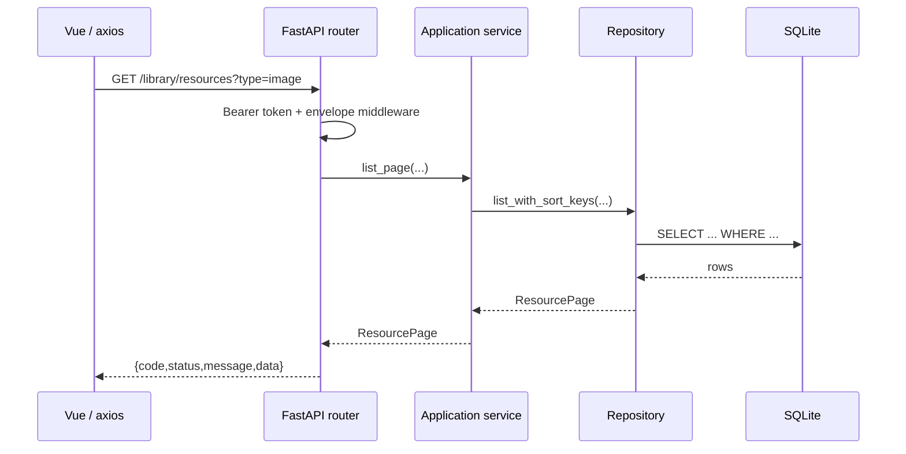

# 25 · 后端分层与数据访问

> 本文解释 FastAPI 后端的请求链路、四层职责、SQLAlchemy async + SQLite、迁移机制和测试隔离。
> 主要代码：`apps/backend/app/`、`apps/backend/tests/`。

## 1. 请求从进来到落库

以 `GET /library/resources` 为例：

```text
HTTP 请求
  │
  ├─ log_requests        记录 method/path/status（/content 静默）
  ├─ require_token       Bearer token 校验（未配置 token 时放行）
  ├─ wrap_json_envelope  把 JSON 包成 {code,status,message,data}
  └─ CORS
        │
        ▼
library/api/resources.py
  │  Query 参数、别名（camelCase）
  ▼
LibraryQueryService（application/use_cases.py）
  │  参数归一化、业务规则、调用仓储
  ▼
ResourceRepository（infrastructure/repositories.py）
  │  SQLAlchemy 2.0 async 查询
  ▼
SQLite（WAL）
```

响应再反向经过信封和日志中间件。



### 1.1 入口只做三件事

`app/library/api/*.py` 的 router 应保持薄：

1. 声明 HTTP 参数和 Pydantic response model；
2. 通过 `Depends` 拿服务/仓储；
3. 调 application 方法，必要时把异常交给统一异常处理器。

不要在 router 里写复杂 SQL 或文件处理；否则测试只能走 HTTP，复用性差。

### 1.2 依赖注入

`app/library/api/deps.py`：

```python
def get_repos(
    session: AsyncSession = Depends(get_session),
) -> tuple[ResourceRepository, TaskSummaryRepository]:
    return ResourceRepository(session), TaskSummaryRepository(session)
```

每个请求一个 `AsyncSession`，请求结束自动关闭。仓储共享同一个 session，因此一个用例里的多步操作可以落在同一事务边界内。

## 2. 四层职责

```text
app/
├─ main.py                 # 应用入口、lifespan、路由挂载、中间件
├─ library/
│  ├─ api/                 # HTTP 适配层
│  ├─ application/         # 用例编排、纯业务规则
│  ├─ domain/              # 实体、枚举、值对象、类型 profile
│  └─ infrastructure/      # ORM、仓储、导入 job、seed
├─ scrape/                 # 抓取应用（同样的分层）
├─ settings/               # 设置应用
└─ shared/                 # config/db/log/middleware/fs/utils/errors
```

### 2.1 domain：不依赖数据库和 HTTP

`app/library/domain/models.py`：

- `ResourceType`：image/video/anime/av/audio/novel/game/model/comic/work_directory；
- `StorageKind`：owned/indexed；
- `ResourceStatus`：active/trashed/lost；
- `Resource`、`ResourceFile`、`Tag`、`Category`、`Collection`、`SavedView` 等。

domain 负责：

- 状态迁移合法性，例如 `Resource.restore()` 只允许从 `trashed` 恢复；
- 值对象校验，例如评分范围、尺寸；
- 资源类型能力，例如 `type_profile.py` 决定扩展名和是否允许用户封面。

domain 不负责：

- 拼 SQL；
- 读写文件；
- 发 HTTP；
- 依赖 FastAPI。

### 2.2 application：用例编排

`app/library/application/use_cases.py` 里有：

- `LibraryQueryService`：列表、详情、编辑、删除、恢复、批量操作；
- `CollectionService`：合集 CRUD、成员、导出；
- `CategoryService`：分类树、深度/循环校验、删除保护；
- `SavedViewService`：保存的时间线筛选。

`photos.py` 负责照片/视频时间线：

- `scope=image/video/media`；
- 图片、视频分别有 include/exclude 分类规则；
- 未知时间照片单独返回；
- `backfill()` 重读 EXIF/GPS。

application 的输入输出是 Pydantic schema/domain model，不直接暴露 ORM Row。

### 2.3 infrastructure：数据库和外部系统

`app/library/infrastructure/repositories.py`：

- `_orm_to_resource()` 把 `ResourceRow` 转成 domain `Resource`；
- 查询时批量 `attach_categories()`、`_attach_thumbnail_paths()`，避免 N+1；
- `list_with_sort_keys()` 同时返回排序键，供 keyset 分页；
- `list_mixed()` 处理首页“资源 + 合集卡片”混合流。

仓储的职责是“把 SQL 结果变成领域对象”，不是“业务决策”。例如是否排除已合集资源、分类是否展开子树，由 application 决定。

### 2.4 shared：横切能力

| 目录 | 内容 |
|------|------|
| `shared/db/` | engine、session、迁移执行器、SQLite PRAGMA |
| `shared/middleware/` | token 校验、请求日志 |
| `shared/fs/` | 文件操作、复制、哈希 |
| `shared/utils/` | 时间、监视目录、watch bridge |
| `shared/errors.py` | 领域错误、非法状态 |
| `shared/api_envelope.py` | 统一 JSON 信封与异常处理 |

## 3. API 契约：snake_case 落库，camelCase 出站

`app/shared/models.py`：

```python
class ApiModel(BaseModel):
    model_config = ConfigDict(
        alias_generator=to_camel,
        populate_by_name=True,
    )
```

效果：

```python
class Resource(ApiModel):
    cover_path: str | None = None
    created_at: datetime | None = None
```

序列化成 JSON：

```json
{
  "coverPath": "...",
  "createdAt": "..."
}
```

约定：

- 数据库列名：`snake_case`；
- Python 字段：`snake_case`；
- API JSON / 前端 TypeScript：`camelCase`；
- 前端不手写 snake_case DTO。

### 3.1 统一信封

成功：

```json
{
  "code": 0,
  "status": "success",
  "message": "ok",
  "data": {}
}
```

失败：

```json
{
  "code": 404,
  "status": "error",
  "message": "collection not found",
  "data": null
}
```

`wrap_json_envelope` 会跳过：

- 文件响应、流式响应；
- 非 JSON；
- 204；
- OpenAPI 文档；
- 已经在信封里的响应。

前端 axios 拦截器负责解包 `data`，页面只拿业务对象。

### 3.2 认证

`require_token`：

- `settings.token` 为空：不校验，仅开发态；
- `Authorization: Bearer <token>` 与配置不一致：401；
- 使用 `secrets.compare_digest`，避免时序侧信道；
- `OPTIONS` 预检放行；
- 日志只记录 method + path，不打印 token。

主进程生成随机 token，通过环境变量传给后端，再通过 `additionalArguments` 传给 preload。

## 4. SQLite 与迁移

### 4.1 连接与 PRAGMA

`app/shared/db/db.py`：

```python
cursor.execute("PRAGMA journal_mode=WAL")
cursor.execute("PRAGMA foreign_keys=ON")
cursor.execute("PRAGMA busy_timeout=5000")
cursor.execute("PRAGMA synchronous=NORMAL")
cursor.execute("PRAGMA cache_size=-8000")
```

- WAL：读写并发更好；
- `foreign_keys=ON`：SQLite 默认不启用外键，必须显式开；
- `busy_timeout`：避免瞬时锁竞争直接报错；
- `synchronous=NORMAL`：在可靠性和写入性能之间折中。

### 4.2 迁移执行器

`app/shared/db/migrations.py`：

```text
schema_version 表记录已应用的最大版本
  → 扫描 migrations/NNNN_*.sql
  → 按文件名排序
  → version > current 才执行
  → executescript + 记录 version + commit
```

规则：

- 迁移文件只增不改；已发布的迁移不要回头修改。
- 新表/改表新增 `0020_xxx.sql`，不要改 `0001_init.sql`。
- 冻结后迁移文件要能通过 PyInstaller 找到：

```python
if getattr(sys, "frozen", False):
    MIGRATIONS_DIR = Path(sys._MEIPASS) / "app" / "shared" / "db" / "migrations"
```

- 启动时 `ensure_db()`：
  - 文件不存在/为空：完整迁移；
  - 已存在：只补未应用的迁移。

### 4.3 重要演进：分类从单值到多值

`0018_category_tree.sql` 做了三件事：

1. `categories` 增加 `type` 和 `parent_id`，变成按资源类型独立的树；
2. 新建 `resource_categories` 多对多表；
3. 迁移旧 `resources.category_id` 到新表。

`resources.category_id` 暂时保留一个版本用于回滚，但新代码只读写 `resource_categories`。

分类约束：

- 最多 4 层；
- 同一父节点下不允许重名；
- 不能把节点挂到自己的后代上；
- 有子分类或资源引用时不能直接删除；
- 系统分类 `待整理分类` 不允许普通删除。

### 4.4 时间线不建成员表

时间线是“保存的筛选规则”，不是固定成员集合：

```text
saved_views
  kind = 'timeline'
  type = 'image' | 'video' | 'media'
  filters_json
  sort = 'takenAt'
```

这样新增照片会自动进入满足规则的时间线，不需要维护成员关系。

## 5. 测试：为什么不能随便用 TestClient

`test_batch_tag_export.py` 曾经用：

```python
with patch.object(settings, "db_path", self.db_path):
    with TestClient(app) as client:
        res = client.post(...)
```

CI 报：

```text
no such table: resources
```

原因是 `TestClient` 会触发 FastAPI `lifespan`，而 lifespan 使用全局 engine/session；测试只迁移了临时库，全局 app 仍然指向另一个库。测试在本地偶尔能过，是因为全局 engine 已被其他测试初始化。

修复原则：

- **单元/用例测试优先直接调 application service**，用临时 DB + `async_sessionmaker`。
- 只有确实要测 HTTP 中间件/路由时，才用 `TestClient`，并完整控制 lifespan/依赖覆盖。
- 临时库必须自己 `migrate(conn)`，不要依赖开发库。
- 每个测试 `dispose()` engine，避免连接泄漏。

当前测试模式：

```python
self.db_path = self.root / "t.db"
conn = sqlite3.connect(self.db_path)
migrate(conn)
conn.close()
self.engine = create_async_engine(...)
self.factory = async_sessionmaker(self.engine, expire_on_commit=False)
```

好处：

- 不碰真实 `apps/backend/data/library.db`；
- 不依赖测试执行顺序；
- CI 和本地行为一致；
- 失败时定位在服务层，不是“环境问题”。

## 6. 学习指南

### 6.1 推荐顺序

1. HTTP 基础：方法、状态码、JSON、Bearer token。
2. FastAPI：路由、依赖注入、Pydantic、lifespan、异常处理。
3. SQL 基础：SELECT/JOIN/索引/事务。
4. SQLite：WAL、外键、迁移。
5. SQLAlchemy 2.0 async：engine、session、select、关系加载。
6. 分层：api / application / domain / infrastructure。
7. 测试：临时 DB、async fixture、服务层测试。

### 6.2 推荐资料

- FastAPI：<https://fastapi.tiangolo.com/>
- Pydantic v2：<https://docs.pydantic.dev/latest/>
- SQLAlchemy 2.0：<https://docs.sqlalchemy.org/en/20/>
- SQLAlchemy async：<https://docs.sqlalchemy.org/en/20/orm/extensions/asyncio.html>
- SQLite WAL：<https://www.sqlite.org/wal.html>
- SQLite 外键：<https://www.sqlite.org/foreignkeys.html>
- pytest：<https://docs.pytest.org/>

### 6.3 动手练习

1. 给 `resources` 加一个只读统计接口，走 router → service → repository，不直接写 SQL 在 router。
2. 写一个 `0020_*.sql` 加字段，并在测试临时库验证迁移。
3. 给分类树增加“移动节点”，要求禁止移动到自己的后代。
4. 把某个列表查询改成 keyset 分页，比较 offset 分页的性能差异。
5. 写一个测试，证明删除有资源的分类会返回 422。

### 6.4 自检问题

- 为什么每个请求一个 session？
- WAL 解决什么问题，不解决什么问题？
- 迁移为什么不能修改已发布的文件？
- `resource_categories` 和 `resources.category_id` 当前是什么关系？
- 为什么时间线不建成员表？
- `TestClient` 为什么会触发 lifespan？
- API 的 camelCase 是在哪一层转换的？

## 7. 关联文档

- [06-领域模型-状态机值对象常量.md](06-领域模型-状态机值对象常量.md)
- [07-SQLite迁移与仓储.md](07-SQLite迁移与仓储.md)
- [24-桌面端分层与模块封装.md](24-桌面端分层与模块封装.md)
- [26-发布构建与测试门禁.md](26-发布构建与测试门禁.md)
- [27-媒体库领域与时间线.md](27-媒体库领域与时间线.md)

## 扩展阅读

- [24-桌面端分层与模块封装](24-桌面端分层与模块封装.md)
- [07-SQLite迁移与仓储](07-SQLite迁移与仓储.md)
- [46-图解-分层数据模型与状态机](46-图解-分层数据模型与状态机.md)
- [50-图解-搜索与筛选的组合逻辑](50-图解-搜索与筛选的组合逻辑.md)
