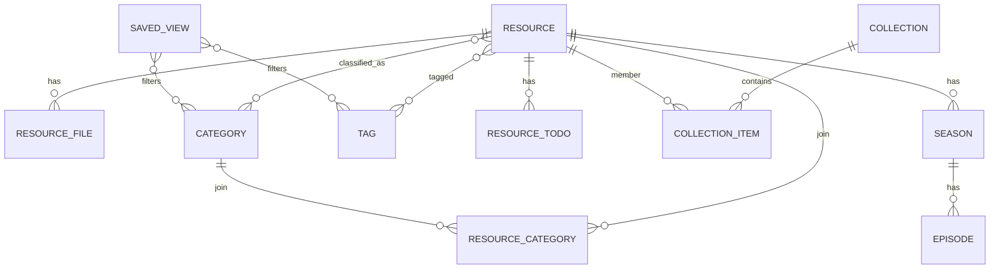

# 27 · 媒体库领域与时间线

> 本文把“资源库为什么这样建模”讲清楚：Resource、File、Category、Collection、SavedView、Timeline 各是什么，时间线为什么不是文件夹，以及 EXIF/ffprobe 在链路中的位置。
> 主要代码：`apps/backend/app/library/domain/models.py`、`application/photos.py`、`infrastructure/repositories.py`、`apps/backend/app/shared/db/migrations/`。

## 1. 领域对象总览

```text
Resource（一个作品/一张图/一个视频/一个游戏/一个目录）
├─ ResourceFile[]        primary / page / cover / thumbnail / subtitle
├─ Category[]            多对多，按资源类型独立分类树
├─ Tag[]                 标签
├─ ResourceTodo[]        待办
├─ seasons/episodes      仅系列型作品
└─ extras                花絮/特典

Collection（合集） ── collection_items ──> Resource[]
SavedView（保存的时间线筛选）
ScrapeJob / Candidate（抓取任务与候选）
```



> `SAVED_VIEW` 只保存规则，不保存成员；`resource_categories` 是资源与分类的多对多连接表。

核心原则：

- **Resource 是用户感知的“作品”**，不是文件。
- **File 是物理文件**，一个 Resource 可以有多个文件。
- **Category 是组织方式**，不是 Resource 的固有属性。
- **Collection 是用户手动编组**，和时间线的自动规则不同。
- **Timeline 是保存的筛选视图**，没有成员表。

## 2. 资源类型

`ResourceType`：

```text
image          图片
video          视频
anime          番剧/动画作品
av             AV 作品
audio          音频
novel          小说
game           游戏
model          3D 模型
comic          漫画
work_directory 工作目录（只登记路径）
```

### 2.1 存储方式

`StorageKind`：

- `owned`：导入时复制/写入库内，应用管理文件；
- `indexed`：只登记源路径，不复制，适合游戏/工作目录。

不是所有类型都适合同一种存储策略。游戏默认只登记路径，视频/图片可以复制入库，具体由导入流程和类型 profile 决定。

### 2.2 状态

`ResourceStatus`：

```text
active  → trashed  （进回收站）
trashed → active   （恢复）
active  → lost     （文件丢失）
```

合法迁移在 domain 中校验：

```python
def restore(self) -> None:
    if not self.is_trashed:
        raise InvalidStateError(...)
    self.status = ResourceStatus.ACTIVE
    self.deleted_at = None
```

这类规则不要散落在 router 或前端；前端按钮只是入口，最终由 domain/application 拒绝非法操作。

## 3. 文件与角色

`ResourceFile` 的关键字段：

| 字段 | 作用 |
|------|------|
| `path` | 库内相对路径或登记路径 |
| `sha256` | 去重、内容寻址 |
| `role` | `primary` / `page` / `cover` / `thumbnail` / `subtitle` |
| `format` | 扩展名/格式 |
| `size` | 字节数 |
| `duration` | 视频/音频时长 |
| `width` / `height` | 分辨率 |
| `codec` / `fps` / `bitrate` | 视频技术信息 |
| `exif_taken_at` | 图片拍摄时间 |
| `exif_lat` / `exif_lng` | 图片 GPS |

角色决定“谁是主文件”：

- 视频的主文件是 `primary`；
- 图片可以有多页 `page`；
- 封面/缩略图/字幕是辅助文件；
- 列表默认只展示 `primary`，避免把字幕/封面当成资源。

一个 Resource 可以有多个文件，因此“文件路径”不能作为 Resource 的唯一标识；`sha256` 用于内容去重。

## 4. 分类树

### 4.1 每个资源类型一棵树

`0018_category_tree.sql` 之后：

```text
categories(id, type, parent_id, name, sort, is_system)
resource_categories(resource_id, category_id)
```

- `type`：这棵树属于哪个资源类型；
- `parent_id`：父分类，`NULL` 为根；
- `is_system`：系统分类，例如“待整理分类”；
- `resource_categories`：资源与分类多对多。

为什么按类型分树：

- 图片的“角色/场景”与视频的“系列/类型”语义不同；
- 同一分类名在不同类型下可以独立存在；
- 分类计数、拖动、删除保护都只影响本类型。

### 4.2 不变量

- 最大深度 4 层；
- 同一父节点下名称唯一；
- 不能把节点移动到自己或自己的后代下；
- 有子节点或资源引用时不能删除；
- 系统分类不能按普通分类删除/重命名；
- 查询父分类时默认包含后代分类。

代码入口：

```text
CategoryService.create/update/remove
CategoryRepository.descendant_ids
```

### 4.3 旧字段

`resources.category_id` 在迁移后仍保留一个版本，用于回滚；新代码使用 `resource_categories`。不要在新增功能里继续依赖旧单值字段。

## 5. 合集与时间线的区别

| | Collection | Timeline（SavedView） |
|---|---|---|
| 成员 | 手动加入/移除 | 由筛选规则实时计算 |
| 存储 | `collection_items` | `saved_views.filters_json` |
| 用途 | 用户编组、导出、分享 | 浏览照片/视频的时间视图 |
| 新资源 | 不会自动加入 | 满足规则会自动出现 |
| 排序 | 手动 position | 拍摄时间/创建时间等 |

合集是“我选的”，时间线是“符合规则的”。不要把时间线做成成员表，否则每次导入都要更新所有时间线。

## 6. 时间线模型

### 6.1 scope

`GET /library/photos/timeline` 支持：

```text
scope=image   只看图片
scope=video   只看视频
scope=media   图片 + 视频
```

也可以传 `type=image|video`（兼容旧调用）。

### 6.2 分类规则

图片和视频可以分别设置：

```text
imageCategoryIds
imageExcludeCategoryIds
videoCategoryIds
videoExcludeCategoryIds
```

合并规则：

- include 为空：该类型不过滤分类；
- include 非空：只保留命中分类（含后代）的资源；
- exclude 非空：排除命中分类（含后代）的资源；
- image 和 video 的规则互不影响；
- `scope=media` 时，两类分别过滤后合并。

### 6.3 其它筛选

- `tagIds`：标签；
- `dateFrom` / `dateTo`：拍摄时间范围；
- `year` / `month`：月份；
- `includeUntimed`：是否包含没有拍摄时间的资源；
- `includeAll`：兼容/全量模式。

### 6.4 未知时间

没有 `exif_taken_at` / `creation_time` 的资源：

- 默认不进入按时间分组的区域；
- 设置 `includeUntimed=true` 后放到“未知时间”分组；
- 前端单独展示，不混进某一天。

这避免了“所有无时间照片都落到 1970”的假数据。

### 6.5 没有成员表

```sql
CREATE TABLE saved_views (
  id, kind, type, name, filters_json, sort, created_at, updated_at
);
```

`kind='timeline'`，`type` 是 scope（image/video/media），`filters_json` 保存规则。这样：

- 规则变更不需要批量改成员；
- 新导入自动进入；
- 删除时间线不影响资源；
- 导出/分享只需保存规则。

## 7. 媒体探测：EXIF 与 ffprobe

### 7.1 图片

导入/回填时读取：

- EXIF `DateTimeOriginal` 等字段 → `exif_taken_at`；
- GPS → `exif_lat` / `exif_lng`；
- 宽高、格式。

注意：

- EXIF 时间没有时区，按本地时间处理；
- 没有 EXIF 时不要伪造时间；
- 用户可以在信息面板手动改拍摄时间；
- 手动修改写回 `files.exif_taken_at`，并让列表/时间线刷新。

### 7.2 视频

通过 ffprobe 读取：

- `creation_time`；
- duration；
- width/height；
- codec/fps/bitrate。

项目把 ffprobe 作为资源打包，不依赖用户安装：

```text
resources/ffprobe/ffprobe.exe
  ← FFProbe_BIN 环境变量
```

如果 ffprobe 缺失/执行失败：

- 视频仍可入库；
- 时间线可能落到未知时间；
- 不应让整个导入失败。

### 7.3 回填

`POST /library/photos/backfill`：

- 重新读取图片 EXIF/GPS；
- 只在检测到新值时更新；
- 返回更新时间等统计。

适合老数据迁移后补齐时间线。

## 8. API 形状示例

### 8.1 资源列表

```http
GET /library/resources?type=image&sort=takenAt&order=desc&limit=80&untimed=false
```

响应（简化）：

```json
{
  "code": 0,
  "status": "success",
  "message": "ok",
  "data": {
    "items": [
      {
        "id": 1,
        "type": "image",
        "title": "example",
        "thumbnailPath": "/library/resources/1/files/2/content",
        "exifTakenAt": "2026-10-01T12:00:00",
        "categories": []
      }
    ],
    "total": 1,
    "hasMore": false,
    "nextKey": null,
    "nextId": null
  }
}
```

### 8.2 时间线

```http
GET /library/photos/timeline?scope=media&year=2026&month=10&includeUntimed=true
```

返回：

- 按天分组；
- 每组照片/视频；
- `unknownCount` / `unknownPhotos`；
- 月份密度条所需统计。

## 9. 常见坑

| 坑 | 说明 | 处理 |
|----|------|------|
| 把分类当标签 | 分类有树、有类型、有删除保护；标签是扁平集合 | 不要混用表 |
| 时间线建成员表 | 新资源不会自动进入，导入要批量维护 | 用规则 + 查询 |
| 用创建时间代替拍摄时间 | 照片时间线会错 | 用 EXIF/ffprobe，缺失放未知 |
| 无时区时间直接 UTC 化 | 跨时区会偏移 | 明确本地时间语义，展示时不要二次转换 |
| 删除分类不检查引用 | 资源变孤儿 | 有子节点/引用时 422 |
| 只存封面路径 | 换封面/缩略图后缓存不更新 | 用文件内容 URL + revision/cache bust |
| 目录当作品 | 一个目录可能包含多集/多图 | 用 ResourcePackage / series 建模 |

## 10. 学习指南

### 10.1 推荐顺序

1. 关系建模：一对多、多对多、连接表。
2. SQLite 外键、索引、WAL、迁移。
3. 时间与 EXIF：`DateTimeOriginal`、GPS、时区。
4. ffprobe JSON 输出与媒体元数据。
5. 时间线/相册的查询与分组。
6. 缓存与缩略图：内容 URL、cache bust。

### 10.2 推荐资料

- EXIF 标准：<https://exiftool.org/TagNames/EXIF.html>
- ffprobe：<https://ffmpeg.org/ffprobe.html>
- SQLite 索引：<https://www.sqlite.org/optoverview.html>
- SQLite 外键：<https://www.sqlite.org/foreignkeys.html>
- Justified layout：<https://github.com/flickr/justified-layout>

### 10.3 动手练习

1. 导入一张有 EXIF 时间的图片和一张没有的图片，观察时间线分组。
2. 给图片分类树增加三级子分类，验证父分类查询包含后代。
3. 建一个只包含“视频 + 排除花絮分类”的时间线，导入新视频验证自动出现。
4. 用 ffprobe 读取一个视频的 duration/width/height，和数据库字段对照。
5. 删除一个有资源的分类，确认返回 422 而不是静默丢引用。

### 10.4 自检问题

- Resource 和 File 为什么要分开？
- 为什么分类要按资源类型分树？
- 合集和时间线的本质区别是什么？
- 为什么未知时间不能直接丢掉？
- EXIF 时间为什么不能简单当 UTC？
- 删除分类前要检查哪些引用？
- 为什么视频时间线依赖 ffprobe，而图片不依赖？

## 11. 关联文档

- [06-领域模型-状态机值对象常量.md](06-领域模型-状态机值对象常量.md)
- [07-SQLite迁移与仓储.md](07-SQLite迁移与仓储.md)
- [25-后端分层与数据访问.md](25-后端分层与数据访问.md)
- [26-发布构建与测试门禁.md](26-发布构建与测试门禁.md)

## 扩展阅读

- [06-领域模型-状态机值对象常量](06-领域模型-状态机值对象常量.md)
- [39-技术-番剧目录结构识别](39-技术-番剧目录结构识别.md)
- [49-图解-导出备份与恢复](49-图解-导出备份与恢复.md)
- [50-图解-搜索与筛选的组合逻辑](50-图解-搜索与筛选的组合逻辑.md)
