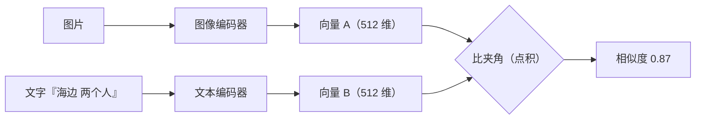

# 40 · 学习向：AI 名词到底是什么意思

> 给「完全不懂 AI」的人看。每个词都对应到本仓里真实在用的东西，不是泛泛科普。

## 一、向量 / 嵌入（embedding）

**一句话**：把一个东西（图片、文字）换算成一串数字，让"意思相近"变成"数字相近"。

本仓的图片会被 CLIP 换算成 **512 个数字**，存进 `ai_vectors.vector`（float32 二进制）。所以"图搜图"本质是**找数字最接近的图**，不是比对像素。



两个编码器**输出到同一个空间**，这是「用文字找图」能成立的前提。

类比：给每张图在 512 维空间里定一个坐标，意思接近的图坐标也接近。

## 二、余弦相似度

**一句话**：两个向量"方向"有多接近。同向 = 1，垂直 = 0，反向 = -1。

本仓存的向量已经归一化（长度都是 1），所以**点积就是余弦**：

```python
scores = matrix @ query_vector     # 一行算完所有图的相似度
```

界面上看到的"相似度 87%"就是这个数。

## 三、CLIP

**一句话**：一个把**图和文字放进同一个空间**的模型。所以「用一句话找图」才成立。

```
图片 → CLIP 图像编码器 → 512 维向量
文字 → CLIP 文本编码器 → 512 维向量（同一空间）
两者直接比相似度
```

本仓用的是 **`chinese-clip-vit-base-patch16`**（中文 CLIP，ViT-B/16）。选中文版是因为你的标签、描述都是中文。

**没训练过你的图**：CLIP 是通用模型，直接拿来用，这叫**零样本**（zero-shot）——不训练，只做映射。

## 四、零样本（zero-shot）

**一句话**：不针对你的数据训练，直接拿通用模型来用。

- 「文搜图」是零样本：你的文字和库里的图都没参与训练
- 「分类建议」里的近邻投票**不是**零样本，它是统计你家库里的邻居——两者别混

## 五、VLM（视觉语言模型）

**一句话**：能"看图说话"的大模型，输出的是**自然语言**，不是标签。

本仓通过 **Ollama** 调用本机 VLM，产出 caption（描述）、短标题、场景、动作、颜色、服饰、OCR 文字、标签。

特点：**慢**（每张几百毫秒到几秒）、**贵**（吃显存/内存）、**能写不存在的词**。所以它最适合"生成描述"，不适合"做分类"。

## 六、标签器（WD14）

**一句话**：专门为动漫图训练的**多标签分类器**，输出固定词表里的标签。

本仓的 `wd14-moat-tagger-v2`：快（几十毫秒）、标签固定（几千个）、不会写字幕。

它和 VLM 的分工：

| | VLM | WD14 |
|---|---|---|
| 输出 | 自由文本 + 标签 | 固定词表标签 |
| 速度 | 慢 | 快 |
| 适合 | 描述、OCR、场景 | 大批量打标、动漫图兜底 |

本仓的兜底链就是「VLM 先上，重复输出或失败就换 WD14」。

## 七、ONNX Runtime

**一句话**：跑模型的引擎，CPU 也能跑。

CLIP、WD14、YOLO（人数检测）在本仓都是 **ONNX 本地推理**，不联网、不需要显卡。这也是"本地优先"能成立的原因。

## 八、Ollama

**一句话**：在本机跑大模型的服务，开了个 HTTP 接口（`127.0.0.1:11434`）。

本仓不打包模型，需要你自己装/下。没装时 AI 文案功能不可用，但**检索、建议、分类这些不依赖 Ollama 的功能照常工作**。

## 九、Prompt（提示词）与"闭集"

**一句话**：prompt 是你给模型的指令；闭集是在指令里限定"只能从这些词里选"。

本仓踩过的坑：早期 prompt 写着「以下是用户已整理的信息，**仅作参考，不要机械重复**」——等于叫模型别用你的词表，于是它造了一堆「人物」「室内」「白色」。现在改成「**优先使用列表里的原词**」，并在 SQL 层再过滤一次。

> 教训：**不要只靠 prompt 约束模型**，一定要在代码里再挡一次。

## 十、索引（indexing）

**一句话**：把"每张图算一次向量"的结果存起来，检索时只算查询那一次。

```
建索引：500 张图 → 500 次图像编码 → 存 ai_vectors
检索：1 条查询 → 1 次编码 → 与 500 条向量比大小
```

**增量**：只补没算过的（后台每 30 秒扫一次）
**全量**：清空重算（显式触发，换模型时才需要）

## 十一、LTR（学习型重排）

**一句话**：用"你点了哪个结果"训练一个排序模型，替代现在的固定打分。

本仓**只有设计没有实现**：已有反馈数据（`ai_feedback`：相关/不相关），但训练、影子模式、A/B 都还没做。所以现在排序仍是"相似度 + 硬条件"的固定规则。

## 一张速查表

| 名词 | 本仓里的实体 | 你需要知道的 |
|---|---|---|
| 向量 | `ai_vectors.vector`（512 维 float32） | 图/文的数字表示，相近即相似 |
| CLIP | `chinese-clip-vit-base-patch16` | 图与文同一空间，所以能文搜图 |
| VLM | Ollama 里的视觉模型 | 慢、会造词，用来写描述 |
| WD14 | `wd14-moat-tagger-v2` | 快、固定词表，动漫图兜底 |
| ONNX | `onnxruntime` | 本地 CPU 推理 |
| 索引 | `ai_vectors` + 后台补索引 | 增量为主，全量显式 |
| 闭集 | 建议层的 SQL 过滤 + prompt | 只在你的词表里选 |
