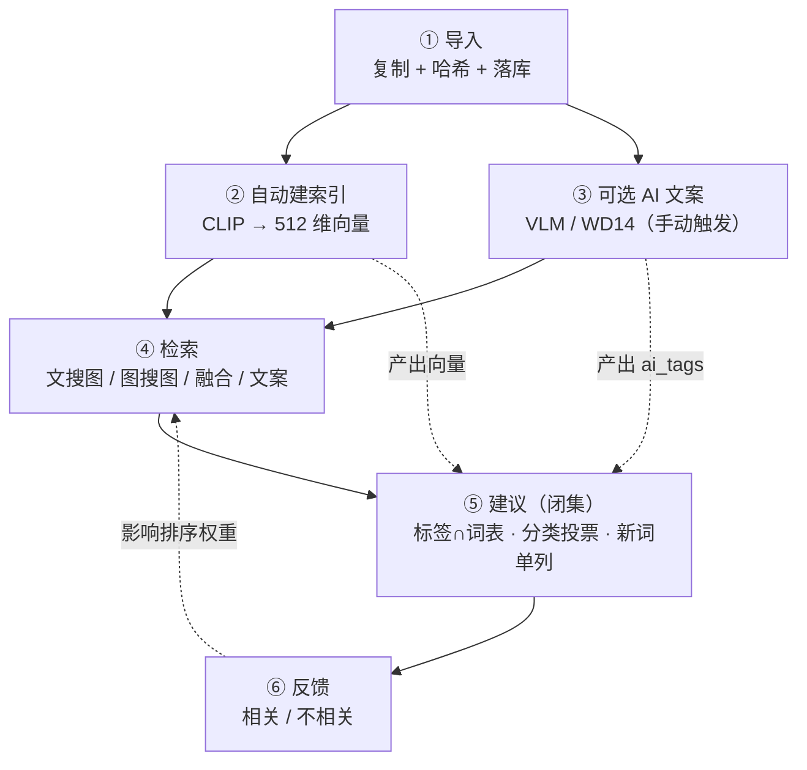

# 41 · 学习向：本仓的 AI 功能是怎么串起来的

> 接 [40 名词解释](40-学习向-AI名词到底是什么意思.md)。这篇讲「从导入一张图，到你在界面上搜到它」，中间发生了什么。

## 图示：一张图的六步



两条虚线值得注意：**建议依赖索引与文案的产出**，但两者都可以缺失——缺了就退化成"没有依据，不产生建议"，而不是报错。

## 全链路（一张图的生命周期）

```text
① 导入
   图片复制进库 → 生成缩略图 / 封面 → 落 resources + files
   ↓（后台，不阻塞导入）
② 建索引
   每 30 秒扫一次「还没索引的图」
   → CLIP 图像编码 → 512 维向量 → 存 ai_vectors
   同时算 dHash（感知哈希，用于近似重复）
   ↓
③ 可选：AI 文案（VLM / WD14）
   你手动在 AI 中心点「分析图片」
   → VLM 出 caption / 标签 / OCR  → 存 ai_documents + ai_attributes
   → 失败或重复输出 → WD14 兜底 → 存 ai_tags
   ↓
④ 检索（四种模式）
   文搜图 / 图搜图 / 图文融合 / 按文案标签
   ↓
⑤ 建议（闭集）
   标签 ∩ 你的词表；分类靠邻居投票；新词单列
   ↓
⑥ 反馈
   点「相关/不相关」→ 存 ai_feedback → 影响后续排序权重（当前是简单加权）
```

## 四种检索模式分别回答什么问题

| 模式 | 你输入 | 它回答 | 靠什么 |
|---|---|---|---|
| **文搜图** | 一句话「海边 两个人」 | 哪些图符合 | 文字 → CLIP 向量 → 比相似度 |
| **图搜图** | 一张图（库内或外部） | 哪些图像它 | 图像 → CLIP 向量 → 比相似度；近似重复走 dHash |
| **图文融合** | 一张图 + 一句话 | 像这张，且符合这句 | 两路打分加权；严格模式取交集 |
| **文案/标签** | 关键词 | 哪些图的描述或标签里有 | 全文/标签匹配，不走向量 |

**为什么不能只留一个模式**：一张图和一句话的目标不同。"找我这条裙子的同款"（图搜图）和"找红裙子的图"（文搜图）是两种问题，混在一起排出来的结果没法解释。

## 哪些功能要模型、哪些不要

| 功能 | 需要什么 | 没有时 |
|---|---|---|
| 文搜图 / 图搜图 / 融合 | 中文 CLIP | 整个 AI 检索不可用（提示去下载模型） |
| 近似重复 | 不需要模型（dHash） | 一直可用 |
| AI 文案（描述/标签/OCR） | VLM（Ollama）或 WD14 | 该功能不可用，其它照常 |
| 分类建议（近邻兜底） | CLIP 向量 | 退回「同标签投票」 |
| 分类建议（同标签投票） | 无 | 只要你有标签和分类就能用 |
| 名称清洗 / 导入建议 | 无（纯规则） | 永远可用 |

这张表很重要：**AI 不是开关，是一组可独立失效的能力**。任何一环缺失，其它环节都应该继续工作。

## 为什么「建议」要单独一层

模型擅长"描述"，不擅长"替你决定"。所以：

- 模型的原始输出（caption、自由标签）**只作为素材**
- 建议层负责收敛：只取你词表里的词、只推你可能缺的那几个
- 决定权在你（勾选/采纳），并且每条都有理由

这也是为什么「导入建议」用纯规则也能跑得很好——它解决的是"规范化"，不是"理解内容"。

## 并发与卡顿

本地模型都在**同一个进程**里跑（后端单进程单事件循环），所以：

- 编码必须放 `asyncio.to_thread`，否则会卡住 `/health` 和列表请求
- AI 任务有并发档位（1–4 路），按显存推荐；太高会让 Ollama 排队
- 后台补索引只在空闲时跑，且同时只有一个任务

## 自己动手看一遍

```powershell
# 1. 看某张图有没有索引
apps/backend/.venv/Scripts/python.exe -c "import sqlite3;c=sqlite3.connect('apps/backend/data/library.db');print(c.execute('select count(*) from ai_vectors').fetchone())"

# 2. 看 AI 任务历史
#    界面：AI 中心 → 任务

# 3. 看建议为什么没出现
#    建议只在「AI 标签 ∩ 你的词表 ∩ 这张图还没打」时出现
```

## 常见误解

1. **"建模"= 训练模型** ❌ 本仓不训练，全部是现成模型直接推理。
2. **"相似度 87%" 是准确率** ❌ 是向量余弦，不是对错概率。
3. **AI 建议为空 = 坏了** ❌ 多数是"没有命中你的词表"或"邻居太少"。
4. **装了 AI 就自动给所有图打标** ❌ 目前文案分析要手动触发，只有索引是自动补的。
