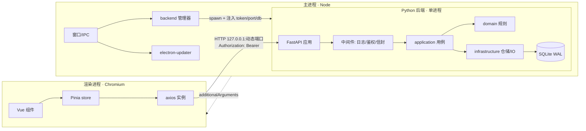
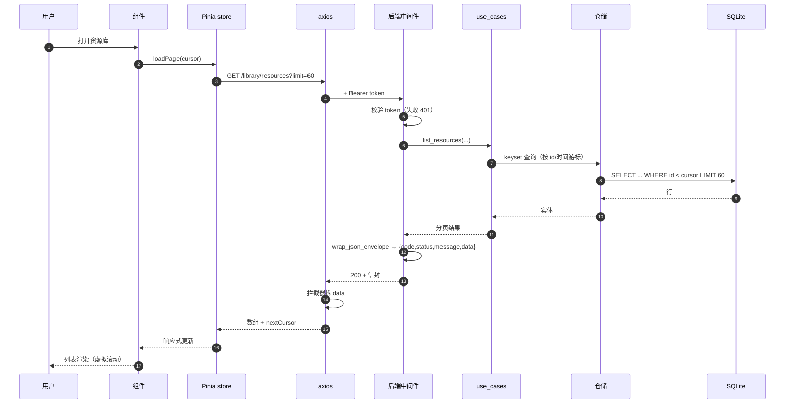
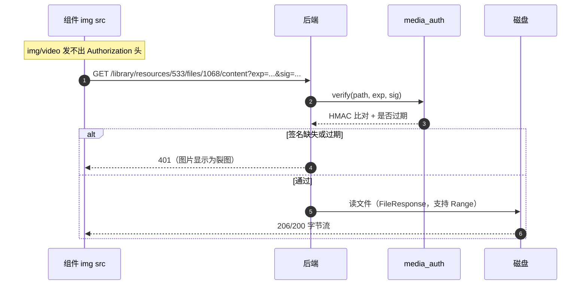
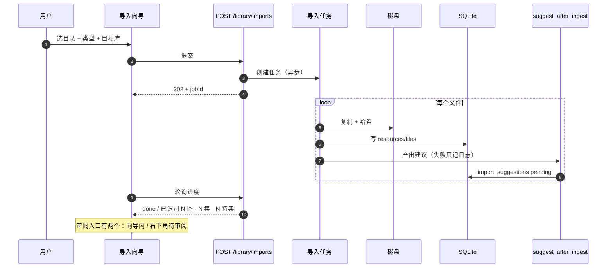
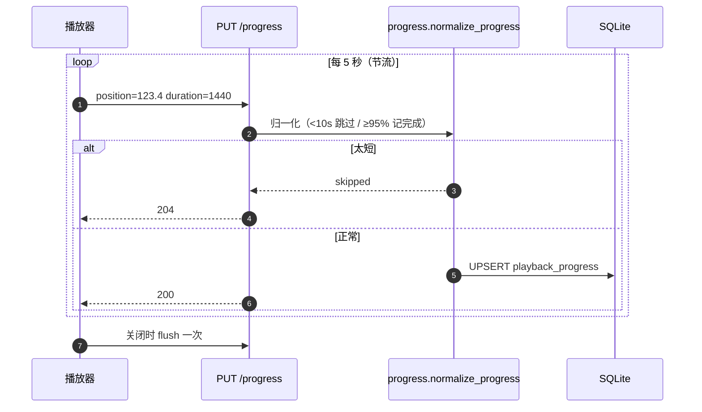
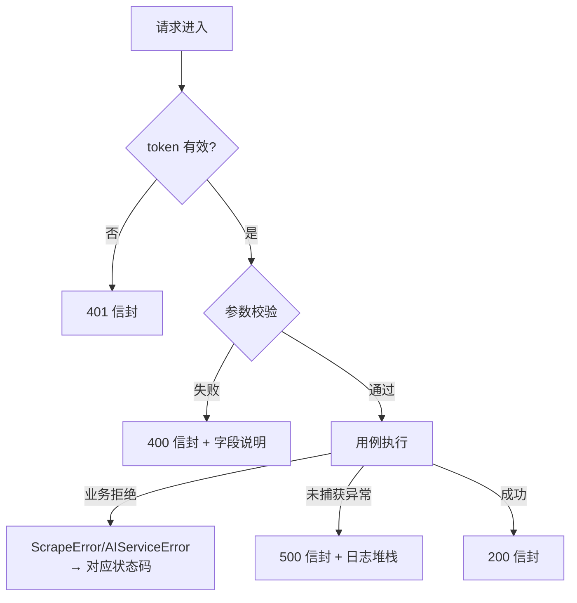

# 42 · 图解：一次请求的完整旅程

> 用一条请求串起所有层。看懂了这一篇，就知道每层在哪、谁调谁、错在哪一层。

## 1 三个进程的边界

**为什么渲染层不直接连数据库**：渲染层是 Web 上下文，拿不到 Node API；而且 SQLite 单写者，必须集中到一个进程里排队。

## 2 列表请求：从点击到渲染

**要点**：

- 分页用 **keyset（游标）** 不是 offset。深翻页时 offset 会越翻越慢，而且并发插入会重复/漏行。
- 信封只在中间件里包一次；`204` 跳过包裹（`_should_skip`），否则前端会拿到空 body 报错。

## 3 媒体流：为什么图片必须签名

**结论**：任何拼媒体 URL 的地方都必须走 `file_content_url()` / `media_path()` / `resource_thumb_url()`，不要手拼字符串。踩过的坑见 [34](34-踩坑-两个静默的数据层陷阱.md)。

## 4 导入：为什么"复制完就返回"

**为什么建议不阻塞导入**：监视目录自动导入时没人点确认，任务卡住会堆积。

## 5 播放进度：为什么刷新后才"补上"

**踩过的坑**：`session` 是 `expire_on_commit=False`，裸 SQL 写完再读会拿到旧实例 → 表现为"上报了但接口返回旧值"。修法是写完 `expire_all()`（见 [34](34-踩坑-两个静默的数据层陷阱.md)）。

## 6 错误在哪一层被拦住

