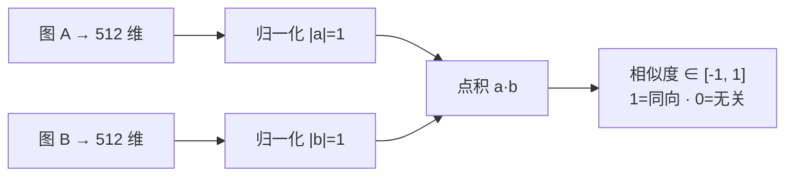
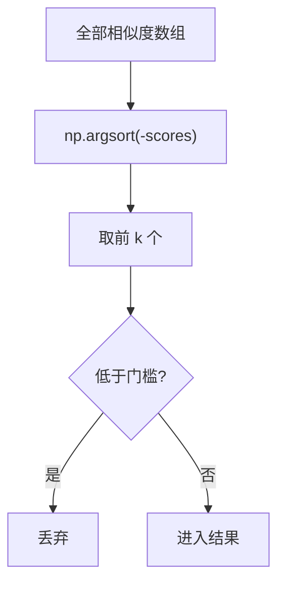
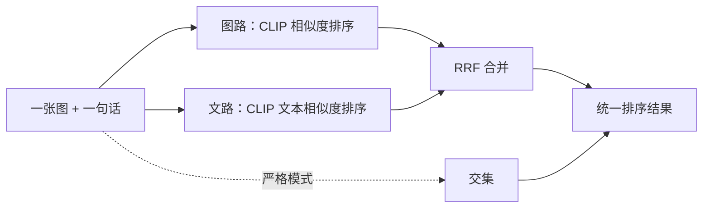
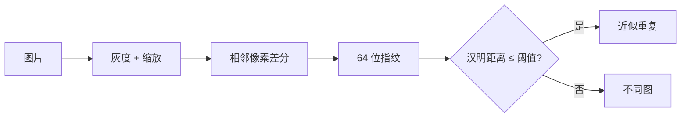
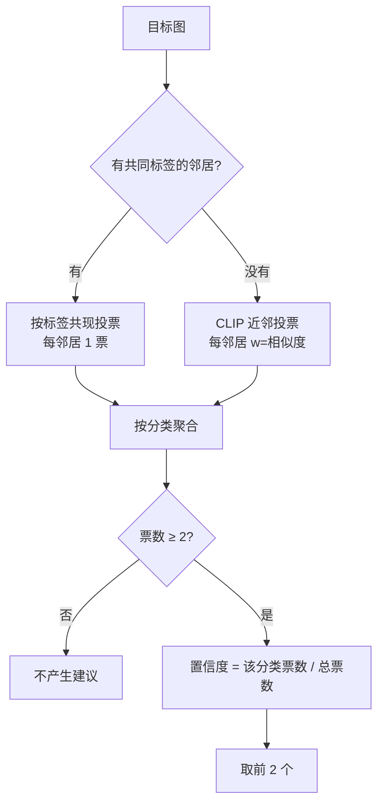
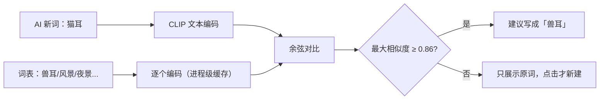
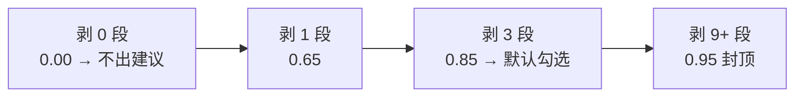
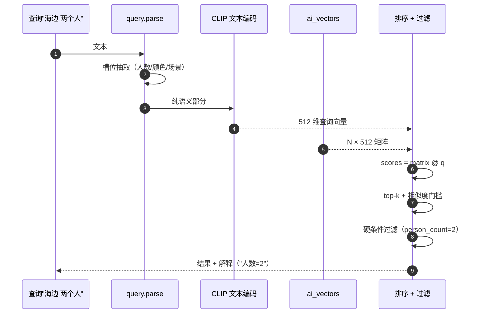

# 43 · 图解：AI 检索与建议里的算法

> 这一篇讲"为什么这个分数是 0.87"、"为什么要 top-k"、"为什么门槛是 0.82"。公式不多，但都对应代码。

## 1 向量与余弦：相似度到底是啥

一张图被 CLIP 编码成向量 **v**（512 维）。两张图是否相似，看两个向量的**夹角**：

$$
\cos(\theta) = \frac{a \cdot b}{\lVert a \rVert \, \lVert b \rVert}
$$

因为写入时已归一化（长度 = 1），分母恒为 1，于是：

$$
\text{similarity} = a \cdot b
$$



**代码上就是一行矩阵乘**：

```python
scores = matrix @ query_vector      # 一次算完 N 张图
```

代价是 `N × 512` 次乘加。500 张图 ≈ 25 万次，毫秒级；几万张就要考虑索引或预计算。

## 2 top-k 与"为什么不用全排序"



`argsort` 是 O(N log N)。本仓规模下无所谓；真要快可以用 `argpartition` 取 top-k（O(N)）。**门槛过滤必须在排序之后**，否则"先过滤再排序"会丢掉本该靠前的结果。

## 3 四个检索模式为什么不能共用一个排序

| 模式 | 打分来源 | 回答的问题 |
|---|---|---|
| 文搜图 | 文本向量 · 图向量 | "哪些图符合这句话" |
| 图搜图 | 图向量 · 图向量 | "哪些图像这张" |
| 图文融合 | 两路分数合成 | "像这张 **且** 符合这句" |
| 文案/标签 | 关键词命中 | "描述里有这个词" |

分数语义不同 → **不可直接相加**。融合用的是 **RRF（Reciprocal Rank Fusion）**：

$$
\text{score}(d) = \sum_{i} \frac{1}{k + \text{rank}_i(d)}, \quad k \approx 60
$$

它只看"排第几"，不看绝对分，所以能把两套不同量纲的排序合起来。**严格模式**则取交集（必须同时命中）。



## 4 近似重复：为什么不用向量

向量相似度对"同一张图被重压缩"不敏感——它可能只给 0.93，和"很像的两张不同图"拉不开。

所以重复检测用**感知哈希（dHash）**：缩到 9×8 灰度、逐像素比相邻、得到 64 位指纹，比**汉明距离**。



好处：对缩放、轻微压缩、亮度变化稳；坏处：对裁剪、旋转不稳。所以它和向量检索是**两套互补信号**，不是替代关系。

## 5 分类建议的加权投票

前提：先找到"同标签的资源"，或"视觉最像的邻居"。



三个数字的来历：

| 参数 | 值 | 理由 |
|---|---|---|
| `MIN_VOTES` | 2 | 1 个邻居不足以成议，避免单张图带偏 |
| 邻居数 | 8 | 太多引入噪声，太少覆盖不足 |
| 相似度门槛 | 0.82 | 低于此"不算像"；越高越保守，冷启动越难触发 |

**置信度是"占比"不是"概率"**：它回答"这批邻居里有多一致"，不是"我有多确定对"。

## 6 标签同义映射：为什么门槛更高

同一套 CLIP 文本编码器，把标签名编码成向量，算最近邻：



**词-词门槛（0.86）比图-图（0.82）高**：短词向量容易"看起来都挺像"，放宽会乱配。

## 7 名称清洗的置信度

$$
\text{confidence} = \min\left(0.95,\; 0.55 + 0.1 \times n_{\text{removed}}\right)
$$



为什么用"剥掉几段"而不是模型打分：**可数、可解释、可复现**。用户问"为什么 0.85"，答案就是"去掉了 3 段：（分辨率）（编码）（音轨）"。

## 8 一次文搜图的完整计算



**槽位先抽、再向量化**的原因：让"两个人"这类条件走**精确过滤**，而不是指望向量理解数量——向量对数字不敏感。

## 扩展阅读

- [36-技术-CLIP在本仓的两种用法](36-技术-CLIP在本仓的两种用法.md)
- [35-设计-AI建议为什么要做成闭集](35-设计-AI建议为什么要做成闭集.md)
- [42-图解-一次请求的完整旅程](42-图解-一次请求的完整旅程.md)
- [44-图解-智能导入的算法与判断](44-图解-智能导入的算法与判断.md)
