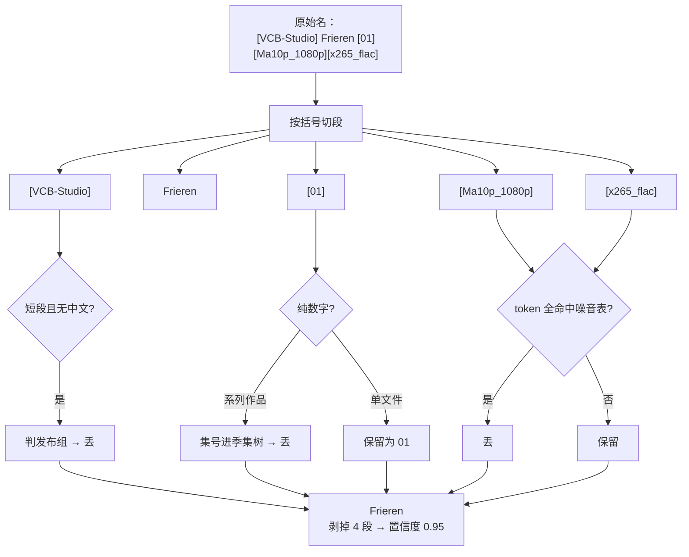
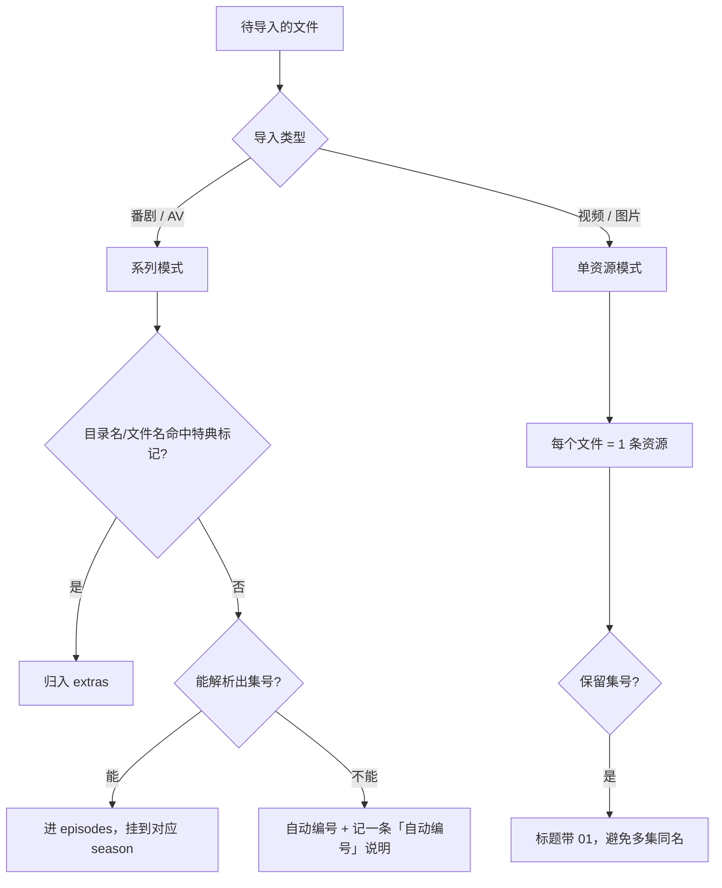
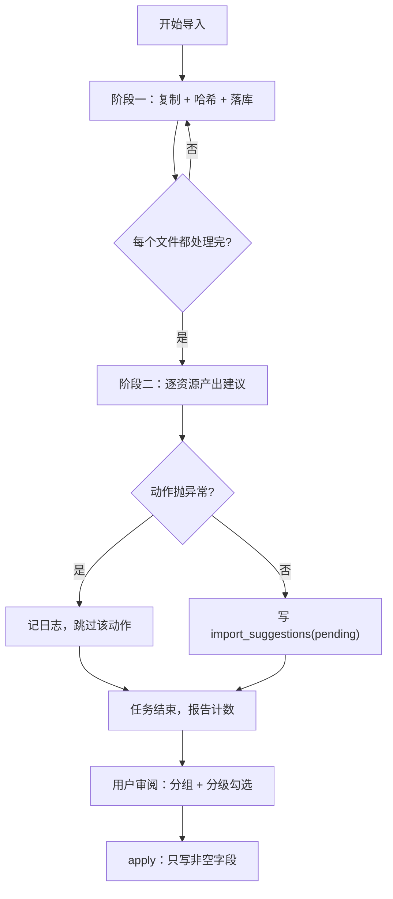
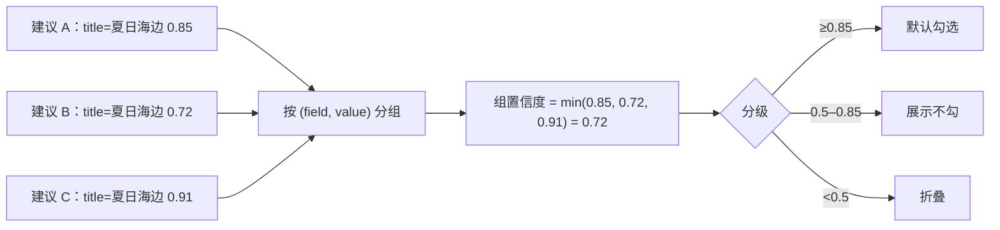
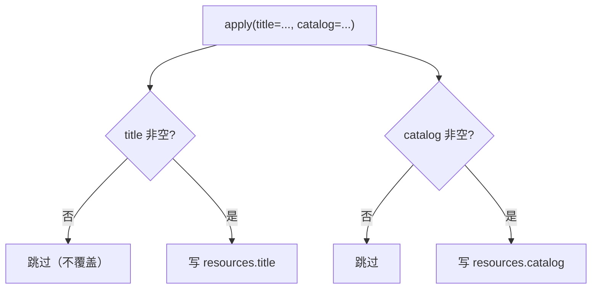

# 44 · 图解：智能导入的算法与判断

> 导入是"规则密集"的功能：切片、判噪、判类型、算置信度、再给建议。没有模型参与，所以每一步都能追。

## 1 名称清洗的流水线

## 2 噪音词表为什么分七类

| 类别 | 例子 | 单独列出的理由 |
|---|---|---|
| 分辨率 | `1080p` `2160p` `BDRip` | 与编码组合出现 |
| 编码 | `x265` `H264` `10bit` `HEVC` | 常和位深连写 |
| 音轨 | `flac` `aac` `DTS` | 中文组还会写「自压」 |
| 来源 | `WEB-DL` `BluRay` `TV` | 与分辨率混排 |
| 语言 | `CHS` `JPN` `简繁` `双语` | 与字幕组标记混排 |
| 容器 | `mkv` `mp4` | 常和音轨挤在一段 |
| 站点 | `dmhy` `mikan` `nyaa` | 有时放在末尾括号 |

**为什么要分词而不是整段匹配**：`[x265_flac]` 这种把编码和音轨写在一段里的很常见，整段匹配会漏。

## 3 类型判断：番剧还是单文件

**最容易搞错的点**：同一套目录，选「番剧」还是「视频」，归档语义完全不同（见 [39](39-技术-番剧目录结构识别.md)）。

## 4 集号解析：为什么用"首个括号里的数字"

规则刻意简单：**纯数字段才是集号**。这样 `1080p`、`10bit`、`2024` 都不会被误判成集号——年份会，但年份通常出现在标题里而不是独立括号段，风险可接受。

## 5 两阶段导入：复制与建议分离

**两个阶段必须分开**：阶段一失败要让整个任务失败（文件没进库）；阶段二失败**不能**影响导入（建议只是锦上添花）。

## 6 建议分组与分级的算法

**为什么取最小值而不是平均**：一组里只要有一条拿不准，整组就不该被默认采纳。取平均会把"一条很确定 + 一条很瞎"抬到中等，诱导误操作。

## 7 写入侧的空值闸门

这条闸门是事故换来的：早期解析失败时把数字 id 当标题写进去了（见 [33](33-踩坑-解析失败不要编造内容.md)）。

## 扩展阅读

### 站内（本仓）

- [38-技术-名称清洗规则与置信度](38-技术-名称清洗规则与置信度.md)
- [39-技术-番剧目录结构识别](39-技术-番剧目录结构识别.md)
- [37-设计-智能导入的动作与建议模型](37-设计-智能导入的动作与建议模型.md)
- [43-图解-AI检索与建议的算法](43-图解-AI检索与建议的算法.md)

### 站外知识

- [Anitomy · 发布名解析](https://github.com/erengy/anitomy)
- [Python · re 正则](https://docs.python.org/3/library/re.html)
