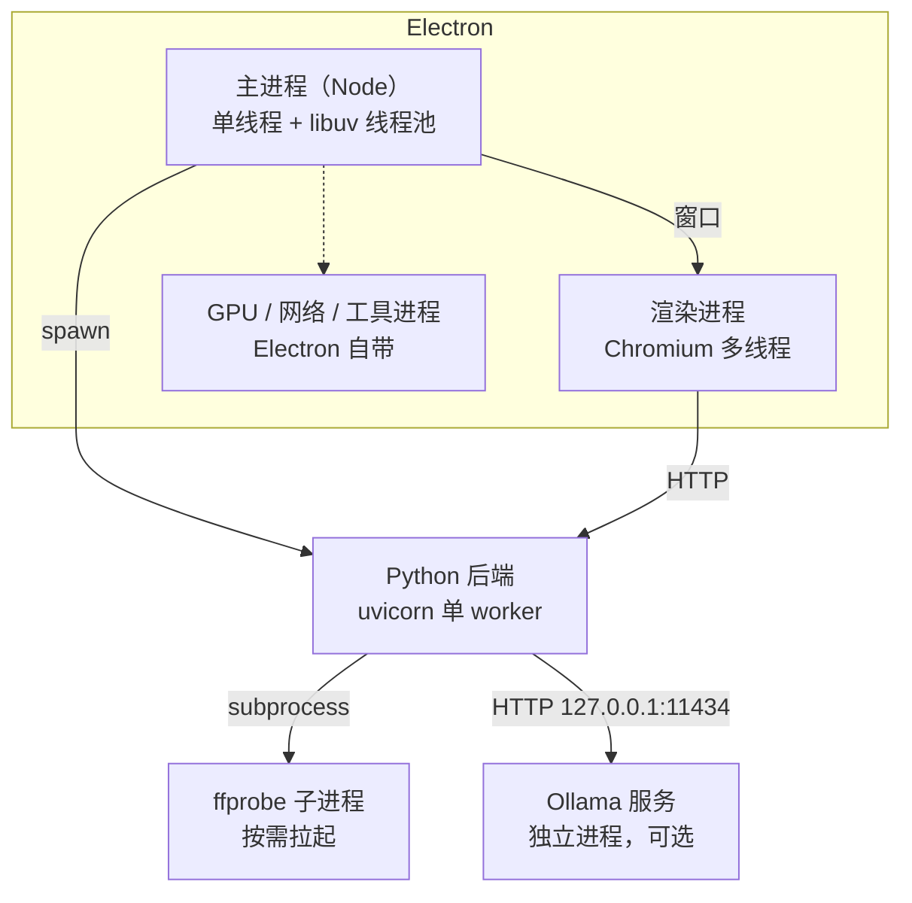
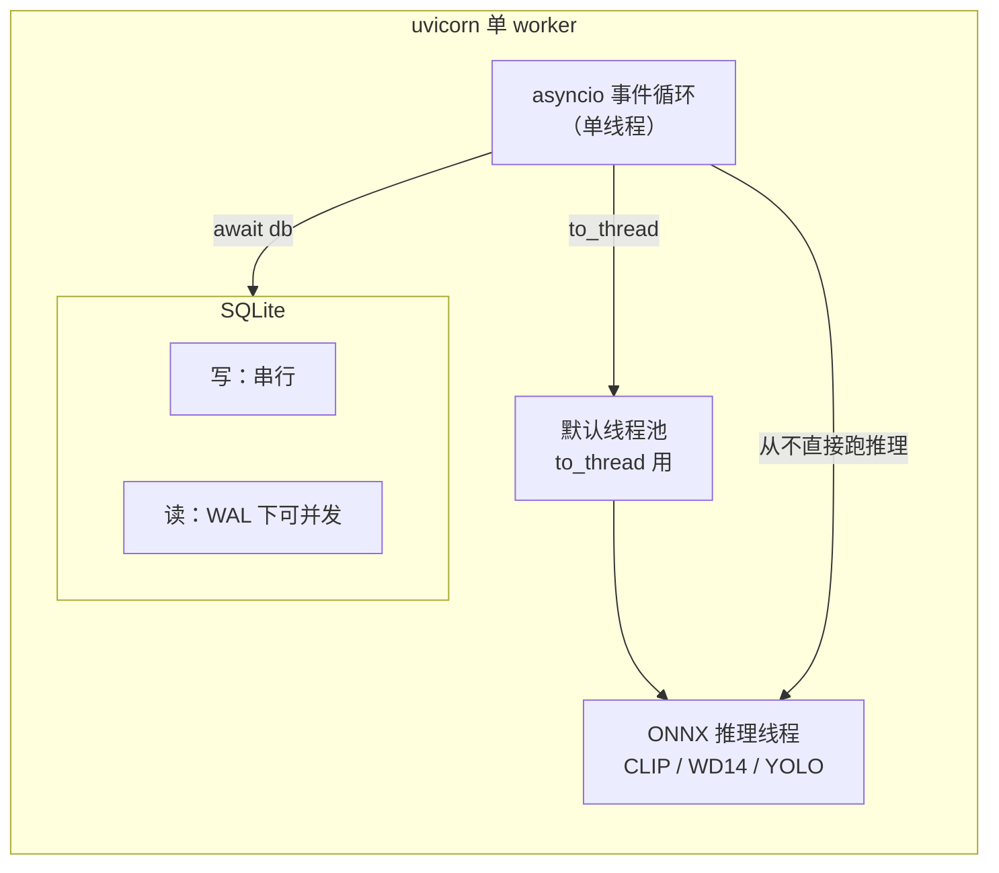
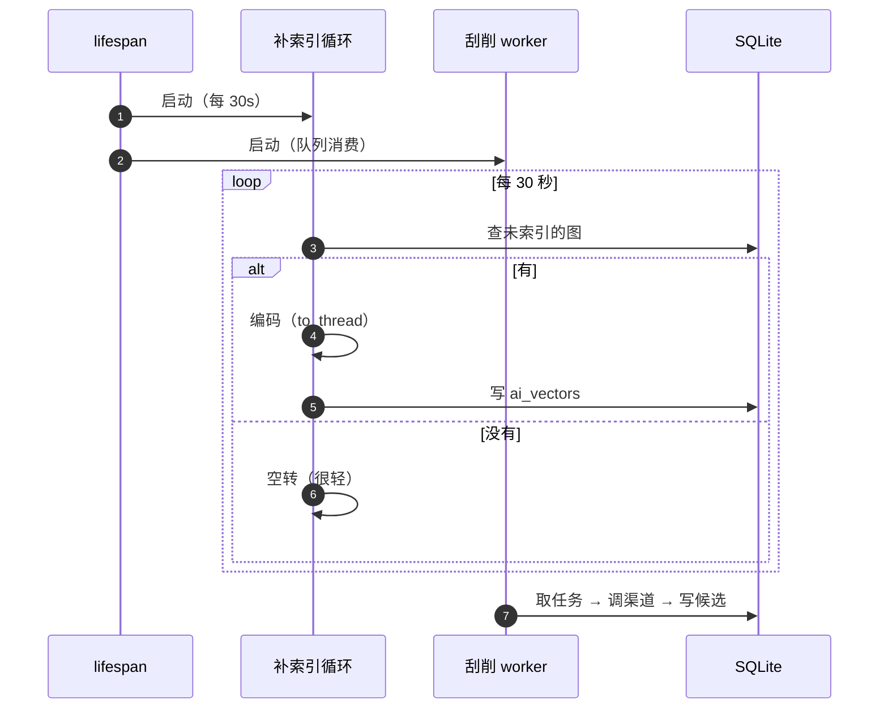
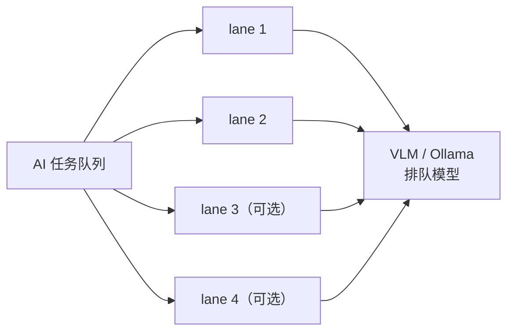
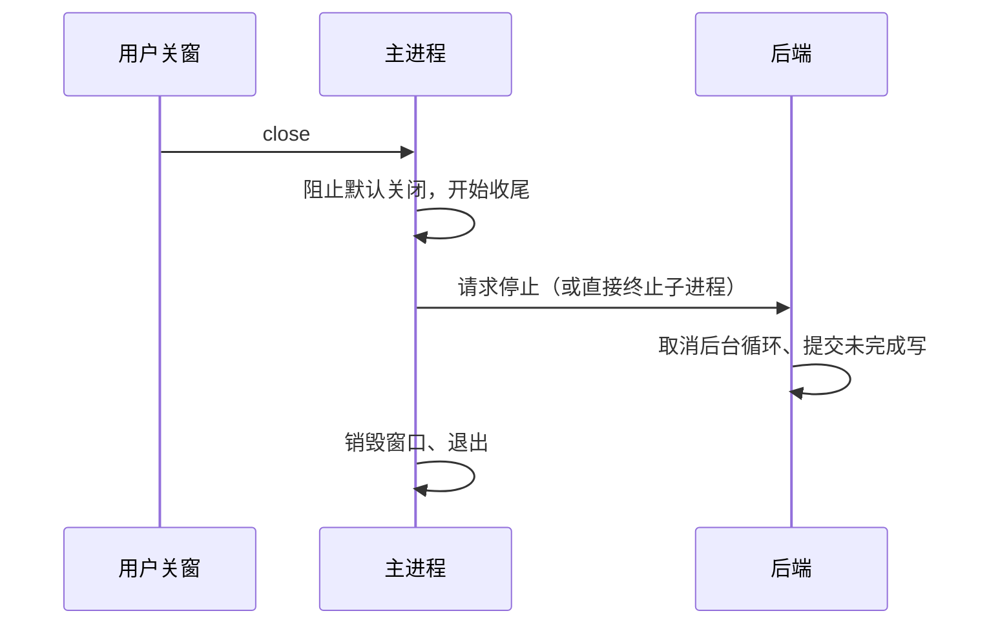

# 45 · 图解：进程、线程与并发

> 这个应用同时有 JS 的多进程、Python 的单进程多协程、以及若干线程池。搞清楚"谁在等谁"，才知道卡在哪。

## 1 进程全景

**为什么后端是独立进程而不是 Node 里跑 Python**：崩溃隔离（AI 推理可能把进程吃满）、依赖隔离（torch/onnxruntime 与 Node 无关）、可以单独重启。

## 2 Python 侧：一个事件循环 + 两个线程池

三条铁律：

1. **CPU 密集必须 `to_thread`**。ONNX 推理是同步阻塞的，直接在协程里跑会冻住整个循环——表现是"接口全卡住但没报错"。
2. **SQLite 单写者**。WAL 允许读写并发，但写与写必须排队；本仓所有写都集中在后端，天然满足。
3. **不要在协程里调 `subprocess.run`**，用 `asyncio.create_subprocess_exec`（ffprobe 走这条）。

## 3 为什么 JS 有 GIL 问题、Python 也有，但形态不同

| | JS（Node） | Python |
|---|---|---|
| 并发单位 | 事件循环 + 异步 IO | 事件循环（asyncio）+ 线程 |
| CPU 密集 | 阻塞整个循环 | 阻塞整个循环（GIL 下多线程也不并行） |
| 正确做法 | `worker_threads` / 子进程 | `to_thread` 只对 IO 有效；CPU 密集要**多进程** |
| 本仓选择 | 后端拆成独立进程 | ONNX 放线程（它内部会释放 GIL） |

**ONNX Runtime 是特例**：它的 C++ 内部计算会释放 GIL，所以放线程里能真正并行。纯 Python 的 CPU 计算放线程则没有收益。

## 4 后台循环：谁在定时跑

后台循环都遵守两条：**空闲时极轻**（一次 COUNT 或空查询）、**同一时刻只有一个实例**（进程内用标志位，不依赖锁）。

## 5 AI 任务的并发档位

- 档位 1–4，默认按显存/内存推荐
- 开太高不会更快：Ollama 内部也要排队，反而让单张延迟变长、超时增多
- 每个任务的状态写库（`ai_jobs.done/failed`），刷新页面能看到进度

## 6 什么会阻塞什么（排障用）

| 现象 | 可能原因 | 看哪里 |
|---|---|---|
| 整个界面转圈，`/health` 也慢 | 协程里跑了同步 CPU 任务 | 是否有 `to_thread` 遗漏 |
| 只有 AI 页卡，其它正常 | 正常（推理在跑） | `ai_jobs` 进度 |
| 导入很慢但接口正常 | 复制/哈希是 IO，正常 | 磁盘与文件数 |
| 保存设置偶发卡 1–2 秒 | SQLite 写等锁 | 是否有长事务 |
| 媒体图裂 | 签名缺失/过期 | 见 [34](34-踩坑-两个静默的数据层陷阱.md) |
| 后端启动后立刻退出 | 端口占用/迁移失败 | 后端日志 |

## 7 关闭时的顺序

**进程退出不保证数据安全**：播放进度靠"关闭时 flush + 每 5 秒节流"减少丢失，而不是靠退出钩子——因为强杀时钩子不执行。

## 扩展阅读

### 站内（本仓）

- [42-图解-一次请求的完整旅程](42-图解-一次请求的完整旅程.md)
- [46-图解-分层数据模型与状态机](46-图解-分层数据模型与状态机.md)
- [47-图解-数据血缘与并发冲突](47-图解-数据血缘与并发冲突.md)
- [48-图解-启动时序与发布流水线](48-图解-启动时序与发布流水线.md)

### 站外知识

- [Python · GIL 解释](https://docs.python.org/3/glossary.html#term-global-interpreter-lock)
- [asyncio 文档](https://docs.python.org/3/library/asyncio.html)
- [asyncio.to_thread](https://docs.python.org/3/library/asyncio-task.html#asyncio.to_thread)
- [SQLite · WAL 模式](https://www.sqlite.org/wal.html)
- [Electron · 进程模型](https://www.electronjs.org/docs/latest/tutorial/process-model)
