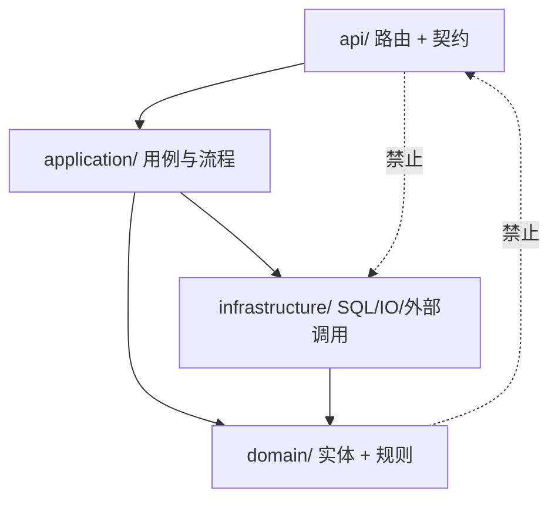
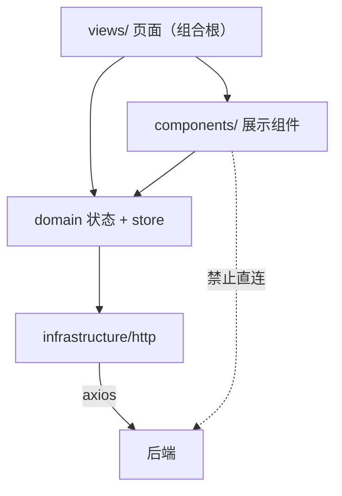
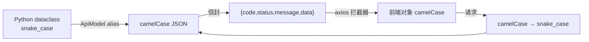
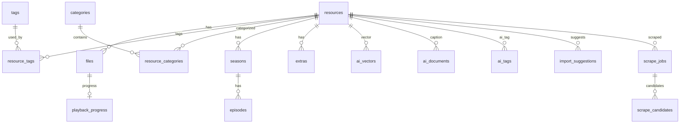
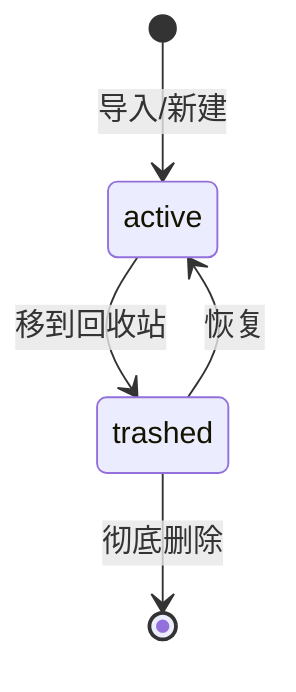
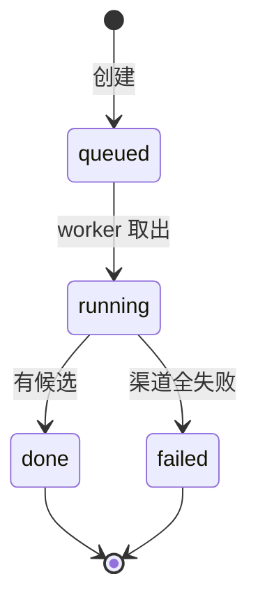
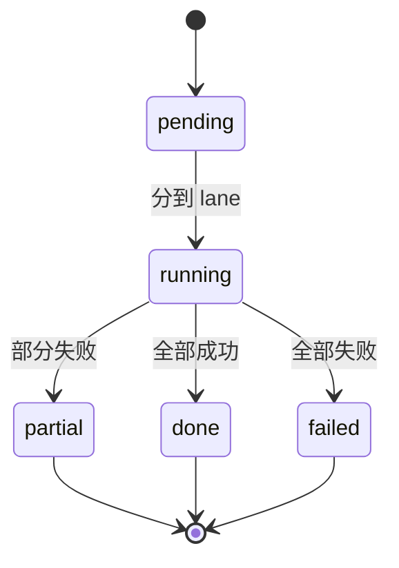
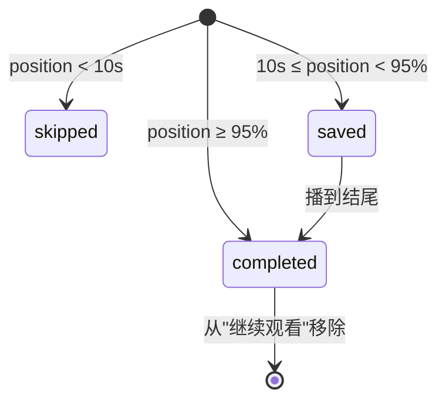
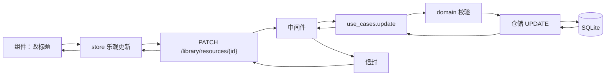

# 46 · 图解：分层、数据模型与状态机

> 前端与后端的分层规则、数据库长什么样、以及几个关键状态机。改代码前先看图，能少走一半弯路。

## 1 分层与依赖方向

### 后端

规则：**依赖只能指向 domain**。domain 不许 import FastAPI / SQLAlchemy / Vue / axios。

为什么：domain 是"规则"，规则不该知道数据从哪来、页面长什么样。做到这点，规则才能被单测直接调用，不需要起服务。

### 前端

页面对齐后端组合根：`LibraryWorkspace/index.vue` 负责组装，子组件只接收 props。

## 2 契约边界：三个转换

三条约定：

- 字段名转换由 `ApiModel(alias_generator=to_camel)` 统一做，禁止手写映射
- 成功用 `code=0`；`204` 不包信封
- 前端拦截器只拆一次 `data`，组件里拿到的就是业务对象

## 3 数据模型（核心部分）

几个容易误解的点：

| 疑问 | 事实 |
|---|---|
| 集是资源吗 | **不是**。1 部番剧 = 1 条 resource + N 条 file；集在 `episodes`，主键是 `file_id` |
| 播放进度挂哪 | 挂 **file**（`playback_progress.file_id`），所以每集独立 |
| 特典挂哪 | `extras`（resource_id + file_id + title + sort） |
| 字幕挂哪 | 只是 `files` 里 `role='subtitle'` 的文件，**没有**集号关联 |
| AI 向量挂哪 | `ai_vectors`（resource_id + model_id + dim + float32 blob） |

## 4 资源状态机

软删除用 `status='trashed'`。**所有列表查询默认都要带 `status='active'`**，忘记加就会把回收站内容查出来——这是同类需求最常见的一处遗漏。

## 5 刮削任务状态机

「候选」角标的判定：最近一次任务 `done` 且 `match_count > 0` 且没有候选被选中。清掉它的办法是确认/忽略候选，或关掉自动刮削。

## 6 AI 任务状态机

进度靠 `done / total` 计算百分比；`failed` 计数独立保留，便于"部分失败"不当作整体失败。

## 7 播放进度的三态

- `skipped` 返回 **204**（不是错误），前端不需要处理
- `completed` 会把进度归零/标记完成，不再出现在「继续观看」
- 阈值 10 秒是防抖：点开就划走不该产生记录

## 8 从"改一个字段"看完整路径

只改传入字段（PATCH 语义），没传的保持原值。**不要用 PUT 传全量**，否则并发编辑会互相覆盖。

## 扩展阅读

- [45-图解-进程线程与并发](45-图解-进程线程与并发.md)
- [47-图解-数据血缘与并发冲突](47-图解-数据血缘与并发冲突.md)
- [42-图解-一次请求的完整旅程](42-图解-一次请求的完整旅程.md)
- [37-设计-智能导入的动作与建议模型](37-设计-智能导入的动作与建议模型.md)
