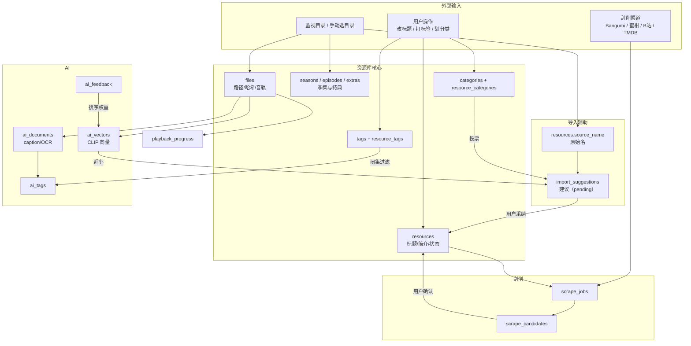
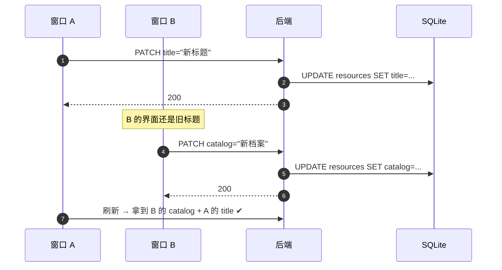
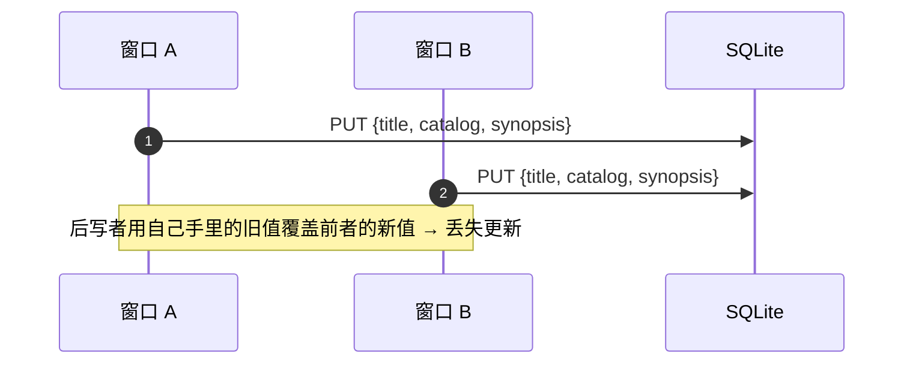
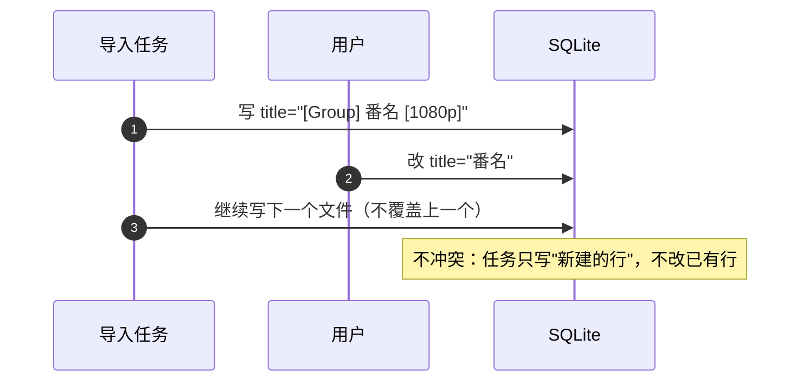
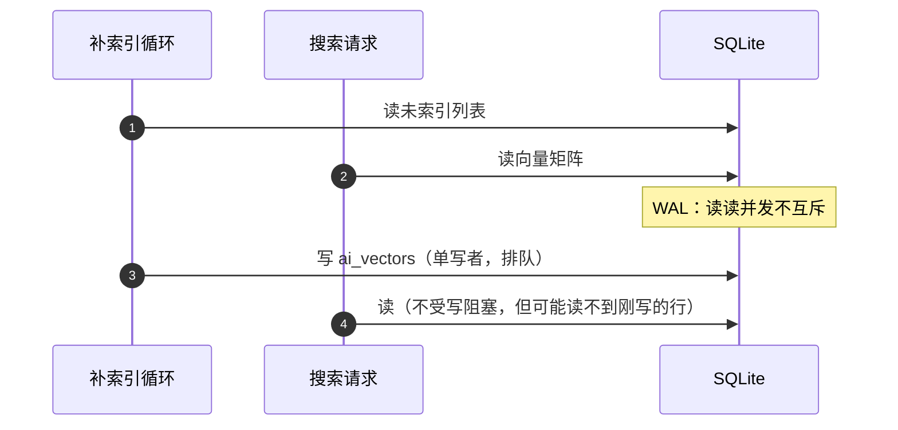
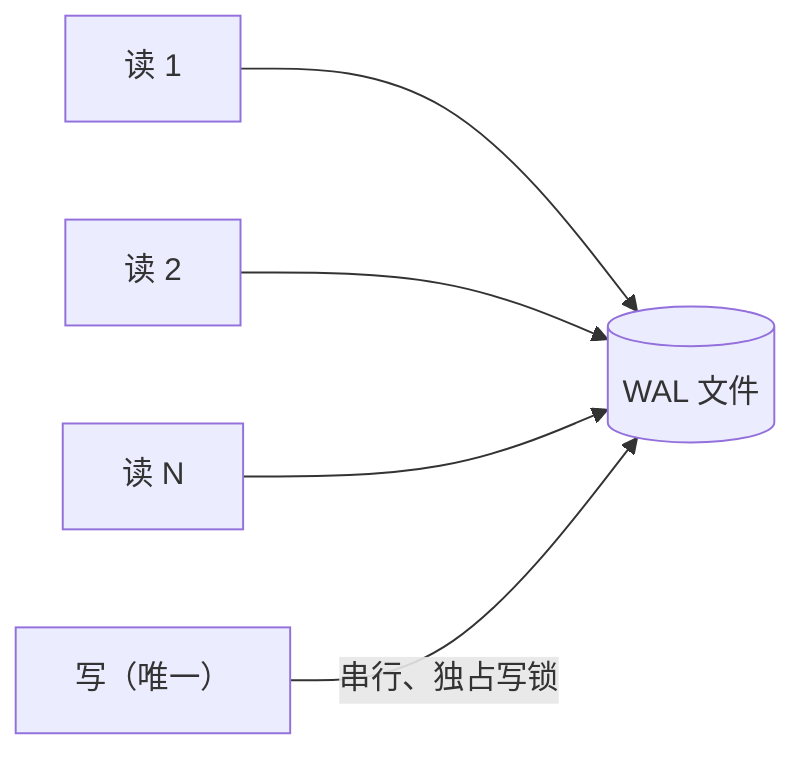

# 47 · 图解：数据血缘与并发冲突

> 两个问题：**这个字段是谁写的**、**两个人同时改会怎样**。这两个问题排障时最常遇到。

## 1 数据血缘：一张图看全

## 2 每张表的写入者与读取者

| 表 | 谁写 | 谁读 | 备注 |
|---|---|---|---|
| `resources` | 导入、刮削采纳、用户编辑、建议采纳 | 几乎所有读接口 | 标题有**三个写入源**，冲突时要看时间戳 |
| `files` | 导入（复制后） | 播放、导出、索引 | 主键被 `episodes`、`playback_progress` 引用 |
| `seasons/episodes/extras` | 导入（系列模式） | 播放器、信息栏 | 集的主键是 `file_id` |
| `source_name` | 导入时**一次性** | 建议、导出 | 之后改名也不动它，作为追溯源 |
| `import_suggestions` | 导入后异步 | 审阅面板 | 状态 `pending/accepted/rejected` |
| `scrape_jobs/candidates` | 刮削 worker | 候选面板 | 一个资源可有多轮任务 |
| `ai_vectors` | 后台补索引 | 检索、建议 | 按 `model_id` 区分模型 |
| `ai_documents/ai_tags` | AI 任务（手动） | 检索、建议 | 失败会留 `status` 标记 |
| `playback_progress` | 播放器（节流） | 首页继续观看 | 主键 `file_id` |

**排障口诀**：一个字段看起来"被改回去了"，先问**谁还会写它**——通常是导入/刮削/建议三个来源之一。

## 3 并发冲突一：两个窗口同时编辑

**为什么用 PATCH 而不是 PUT**：PATCH 只写传入字段，两个窗口改**不同字段**不会互相覆盖。

**真正危险的场景**：同字段并发。当前没有乐观锁（版本号/时间戳校验），所以：
- 界面在**编辑弹窗**里才允许改，减少同字段竞争
- 保存后立即刷新该资源，让另一窗口下次读到新值
- 若将来需要多人，应该加 `updated_at` 版本校验（设计上留了口子，未实现）

## 4 并发冲突二：导入任务 vs 用户编辑

设计上**导入只 INSERT，不 UPDATE 已有资源**；建议采纳才 UPDATE，且是用户主动触发的。这样自动流程永远不会覆盖人工编辑。

## 5 并发冲突三：后台索引 vs 用户搜索

结果：新导入的图**可能立刻搜不到**，几十秒后（下一轮索引）才能搜到。这是**最终一致**，不是 bug。

如果用户抱怨"刚导入的图搜不到"，正确回答是"等索引跑完"，而不是去查检索 bug。

## 6 SQLite 的并发边界

- 读读：并发
- 读写：不互斥（WAL 下读的是快照）
- 写写：**必须排队**，长事务会拖住其它写

所以规则是：**事务里不要做网络请求、不要跑推理**，否则一个慢写会把所有写堵住。

## 7 排障清单

| 现象 | 先查 |
|---|---|
| 字段莫名被改回 | §2 的写入者表，看是否刮削/建议重复写 |
| 两个窗口看到不同内容 | 是否用了 PUT 全量；是否有缓存未失效 |
| 新导入搜不到 | 等一轮索引（30s） |
| 偶发保存慢 1–2 秒 | 是否有长事务占写锁 |
| 进度"上报了没生效" | 写后读未 `expire_all()`（见 34） |
