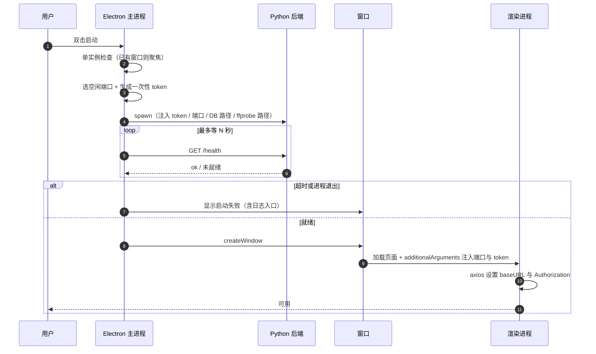
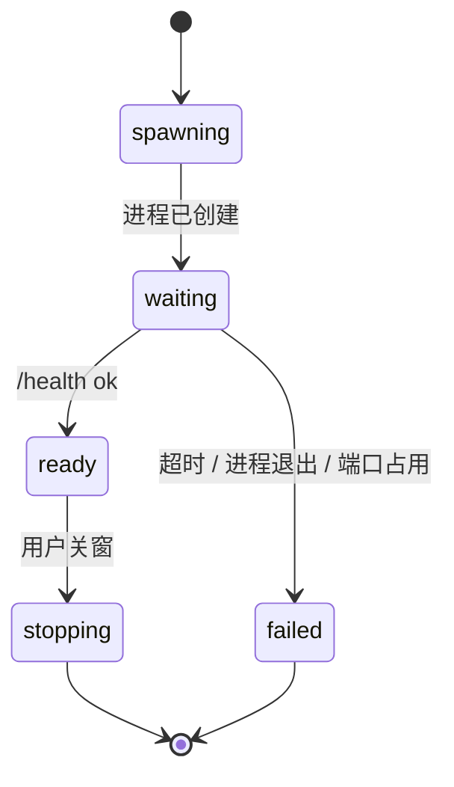
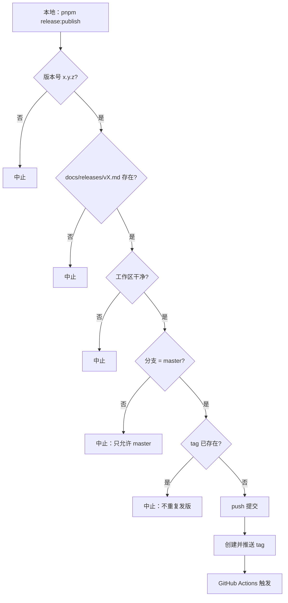
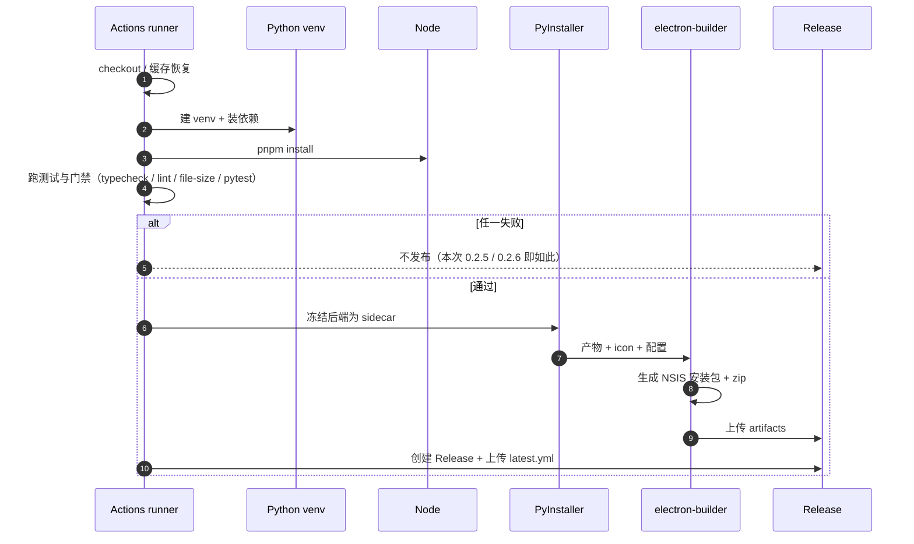
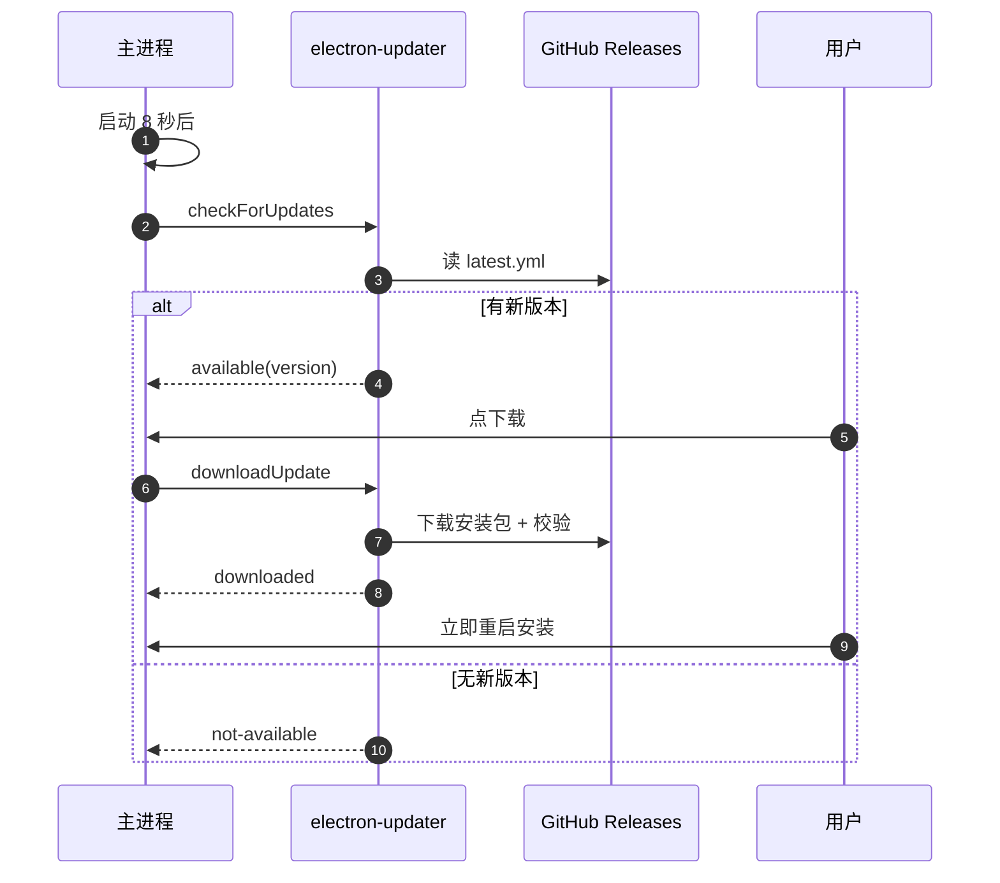

# 48 · 图解：启动时序与发布流水线

> 一个讲"点开图标之后发生了什么"，一个讲"推一个 tag 之后发生了什么"。两端都容易出问题，且都不在业务代码里。

## 1 启动：从图标到能点

**为什么必须等 `/health`**：Python 进程"起来了"不等于"能服务"（迁移可能还在跑）。直接开窗口会出现首屏 500。

**排障对照**：

| 现象 | 位置 |
|---|---|
| 窗口空白且无报错 | 是否等了 `/health`；渲染层 baseURL 是否拿到 |
| 请求全 401 | token 注入链路（additionalArguments → preload） |
| 启动即退出 | 迁移失败 / DB 被占用 / 端口冲突 |
| `electron.app` undefined | `ELECTRON_RUN_AS_NODE=1` 被继承（见 31） |

## 2 发布：从 tag 到 Release

**关键认知**：CI 里的测试是**发布闸门**。0.2.5 / 0.2.6 两次都是测试失败导致"tag 有了、包没有"——tag 本身不会回滚。

## 3 自动更新：装完之后

- `latest.yml` 由 CI 自动生成，**不要手改**
- 检查失败不影响主业务（更新是独立通道）
- zip 版用户不会自动更新，需要手动替换

## 4 三处"看起来成功其实没有"的坑

| 坑 | 表现 | 真相 |
|---|---|---|
| 只看 tag 有了就以为发成功 | Release 页面空 | 构建可能在测试步骤失败 |
| 本地门禁过了就推 tag | CI 红 | 本地有开发库/模型，CI 没有（见 29） |
| `/health` 通了就认为后端可用 | 首屏 500 | 迁移可能还没跑完，或首个请求触发了懒加载 |

## 5 一次发布的检查单

