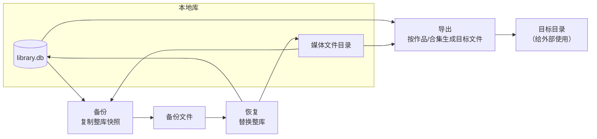
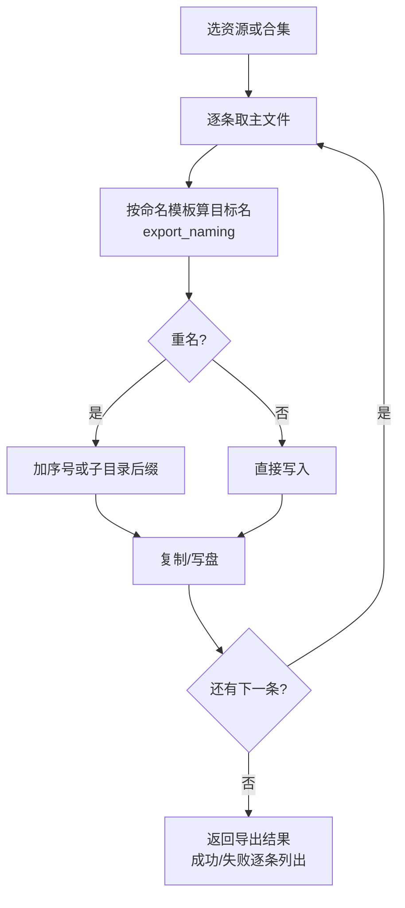
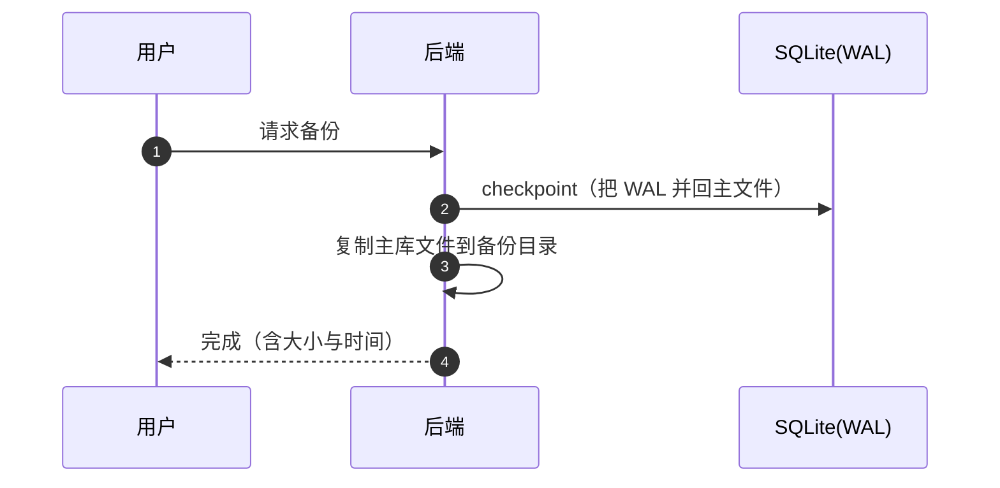
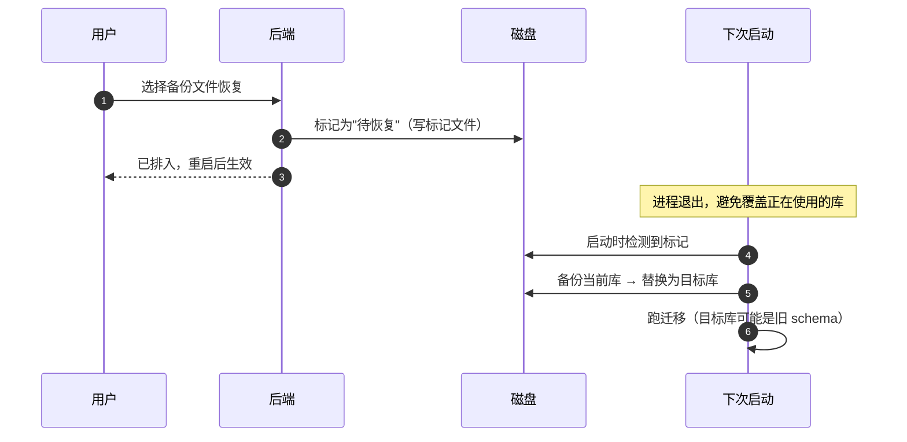
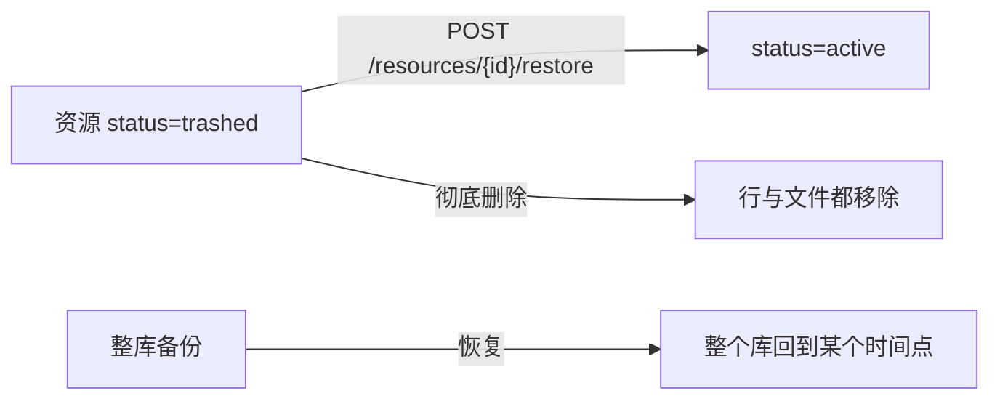

# 49 · 图解：导出、备份与恢复

> 三个容易混的概念：**导出**（把作品变成文件给别人）、**备份**（保住整个库）、**恢复**（把库换回来）。

## 1 三者不是一回事

| 动作 | 粒度 | 结果 | 影响原库 |
|---|---|---|---|
| 导出 | 单个资源 / 合集 | 目标目录里的一批文件 | 不影响 |
| 备份 | 整个库 | 一个快照文件 | 不影响 |
| 恢复 | 整个库 | 库被替换 | **会覆盖**，需重启生效 |

## 2 导出：命名才是难点

要点：

- **命名规则是唯一需要维护的逻辑**：模板里通常包含标题、序号、扩展名；重名必须自动消解，否则会静默覆盖
- 导出是**复制**，不是移动——原库不动
- 逐条返回成功/失败，不做"全成功才成功"的原子语义（部分失败可接受，用户能看到哪条没出去）

## 3 备份：快照不是"导出数据库文件"

**为什么必须先 checkpoint**：WAL 模式下最新的写入可能还在 `-wal` 文件里，直接复制主文件会丢最近的数据。这是备份最容易踩的坑。

## 4 恢复：为什么"待恢复"而不是立刻替换

三个关键点：

1. **不能热替换**：SQLite 连接还开着，直接覆盖会损坏
2. **恢复前先备份当前库**：用户点错了还能回来
3. **恢复后必须跑迁移**：旧库的 schema 版本更低，要靠 `migrate()` 补到当前

## 5 与"回收站"的区别

- **资源恢复**：软删除回滚，只影响一条
- **整库恢复**：时间机器，影响全部

两者都叫 restore，但一个是行级、一个是库级，排障时先分清。

## 6 排障对照

| 现象 | 原因 |
|---|---|
| 备份文件偏小、恢复后少最新几条 | 备份前没 checkpoint |
| 恢复后打不开 | 目标库 schema 太旧且没跑迁移 |
| 导出少文件 | 部分失败被忽略（应逐条看结果） |
| 导出文件名重复被覆盖 | 命名模板没有消解重名 |
| 恢复后旧库找不回来 | 恢复前没有先备份当前库 |

## 扩展阅读

- [07-SQLite迁移与仓储](07-SQLite迁移与仓储.md)
- [46-图解-分层数据模型与状态机](46-图解-分层数据模型与状态机.md)
- [48-图解-启动时序与发布流水线](48-图解-启动时序与发布流水线.md)
