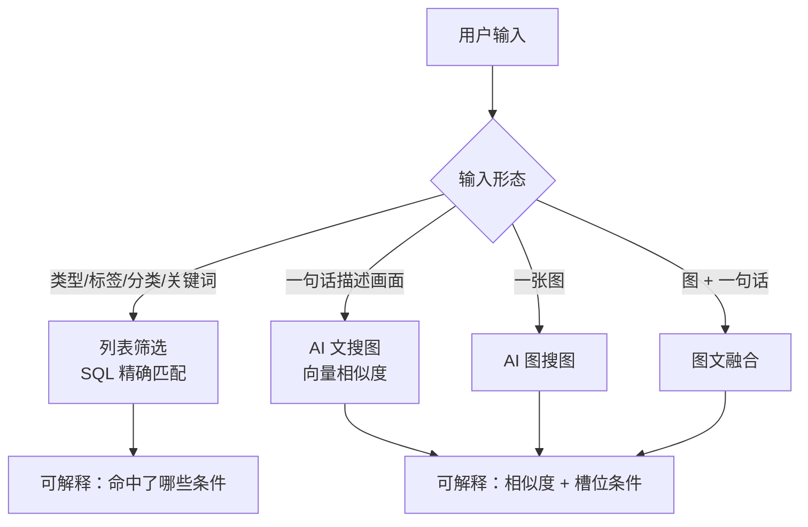
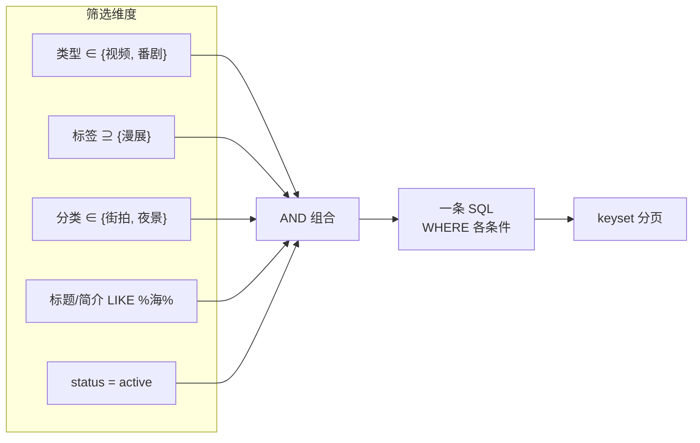
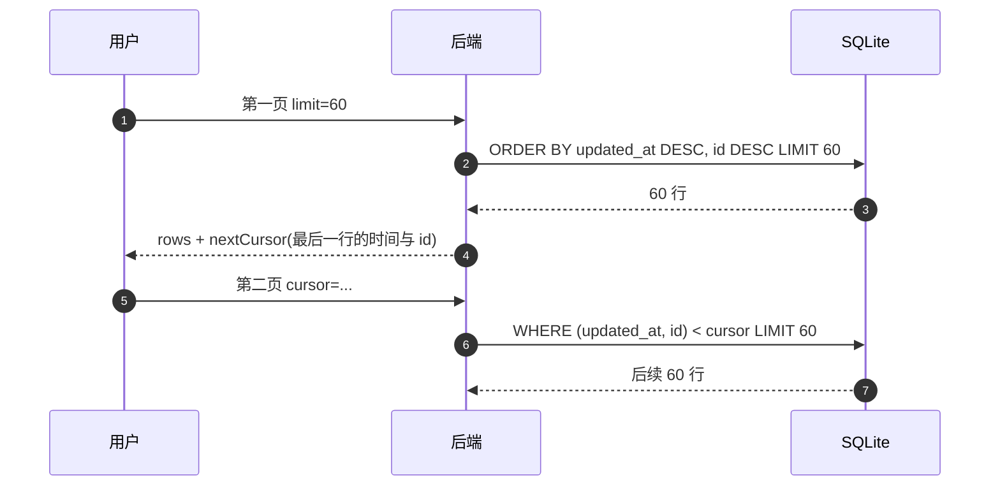
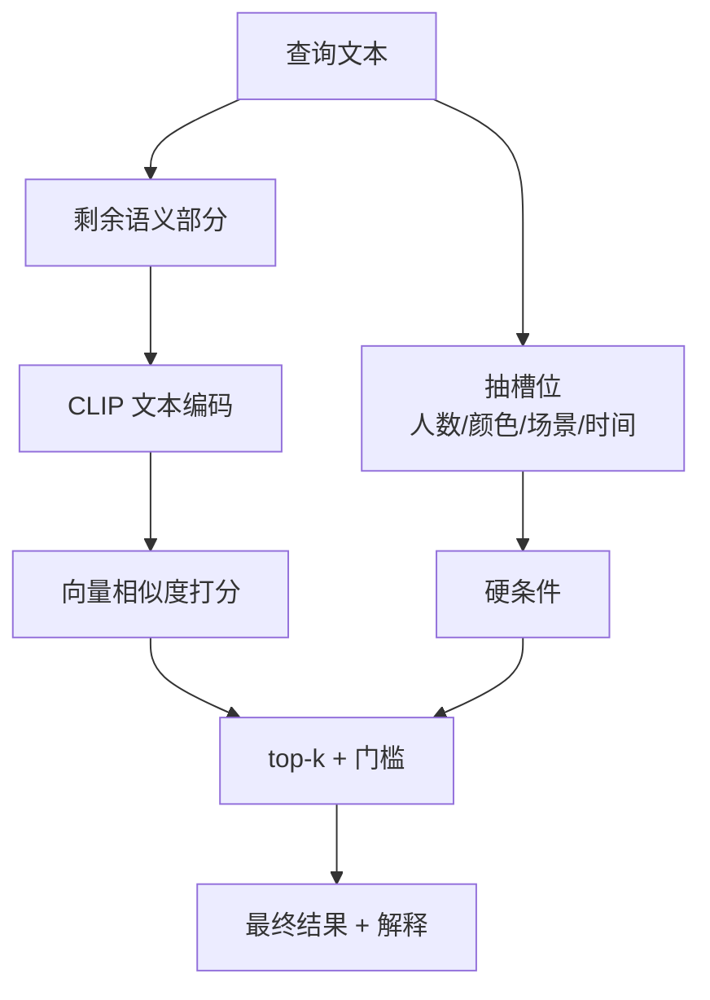
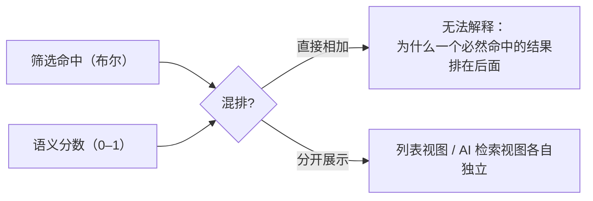

# 50 · 图解：搜索与筛选的组合逻辑

> 这个应用有**两套搜索**：列表筛选（确定性）和 AI 语义检索（概率性）。混用会得到无法解释的结果。

## 1 两套搜索的边界

**判断依据**：用户要的是"必须是"（筛选）还是"像这样的"（语义检索）。

## 2 列表筛选：维度之间 AND，维度之内 OR

| 层级 | 关系 | 例子 |
|---|---|---|
| 维度之间 | **AND** | 类型=视频 **且** 有「漫展」标签 |
| 同一维度内 | **OR**（集合成员） | 分类 ∈ {街拍, 夜景} |
| 标签多选默认 | **AND**（全部包含） | 同时有「漫展」和「夜景」 |

**为什么标签默认 AND**：多选标签时用户通常在做"缩小范围"，交集更符合直觉。若要做并集，需要显式提供"任一"选项。

## 3 分页为什么用游标而不是 offset

对比：

| | offset 分页 | keyset 分页 |
|---|---|---|
| 深翻页性能 | 越翻越慢（要跳过 N 行） | 恒定（走索引定位） |
| 并发插入 | 会重复或漏行 | 稳定 |
| 代价 | 简单 | 需要稳定的排序键（时间+id 复合） |

排序键必须是**唯一且稳定**的组合（`updated_at, id`），否则游标会跳过数据。

## 4 AI 语义检索的组合

**槽位为什么要单独抽**：向量对数量、颜色这类**离散属性**不敏感（"两个人"和"三个人"的向量非常接近）。所以走精确过滤，而不是指望模型。

## 5 两套结果为什么不能混排

结论：**筛选与检索分开展示**。硬条件筛选用列表，语义查找用 AI 检索；需要同时满足时，用融合检索（图+文）而不是把筛选分数和余弦分数相加。

## 6 常被问到的三个问题

| 问题 | 答案 |
|---|---|
| 为什么标签筛选没结果，但我确实有这个标签？ | 标签默认 AND；两个标签的交集可能为空 |
| 为什么 AI 搜「三个人」搜不到？ | 数量走槽位过滤，需要索引里有 `person_count` |
| 为什么刚导入的图搜不到？ | 索引还没跑（30 秒一轮），最终一致 |
| 为什么翻页时内容跳动？ | 用 offset 或排序键不唯一 |

## 扩展阅读

### 站内（本仓）

- [21-虚拟滚动与分页](21-虚拟滚动与分页.md)
- [42-图解-一次请求的完整旅程](42-图解-一次请求的完整旅程.md)
- [46-图解-分层数据模型与状态机](46-图解-分层数据模型与状态机.md)
- [43-图解-AI检索与建议的算法](43-图解-AI检索与建议的算法.md)

### 站外知识

- [Use The Index · 不用 OFFSET 分页](https://use-the-index-luke.com/no-offset)
- [BM25（维基）](https://en.wikipedia.org/wiki/Okapi_BM25)
- [余弦相似度（维基）](https://zh.wikipedia.org/wiki/%E4%BD%99%E5%BC%A6%E7%9B%B8%E4%BC%BC%E6%80%A7)
