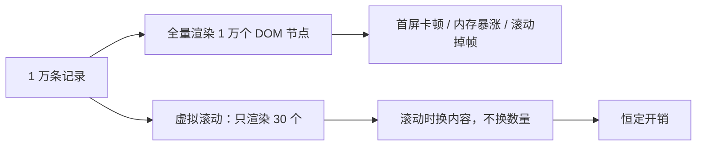
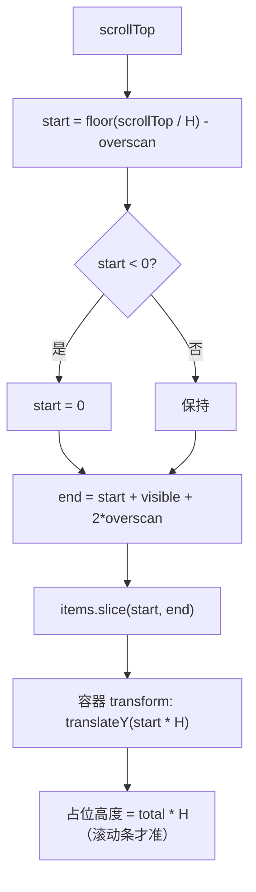
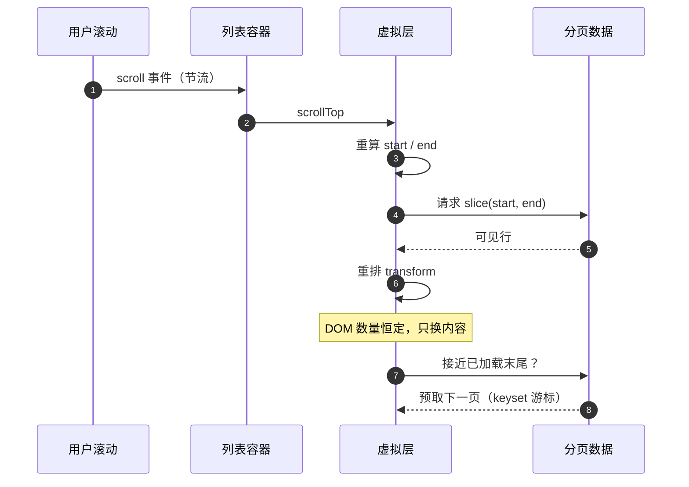
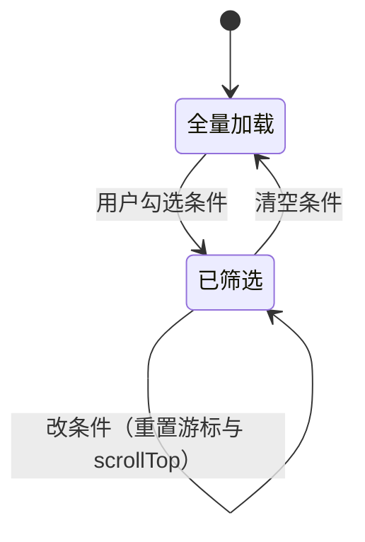

# 51 · 图解：虚拟滚动的算法

> 一万条数据不能生成一万个 DOM。虚拟滚动就是"只渲染能看见的那一段"，这篇讲它怎么算。

## 1 问题



## 2 核心公式

固定行高 `H`、视口高度 `V`、上下缓冲区 `overscan`：

```
可见行数   visible  = ceil(V / H)
渲染条数   count    = visible + 2 * overscan
起始下标   start    = max(0, floor(scrollTop / H) - overscan)
结束下标   end      = start + count
偏移量     offsetY  = start * H
```



**两个必须做对的点**：

1. **占位高度**必须写成 `总数 × 行高`，否则滚动条长度和实际内容不符，滚到底会突然变短。
2. **偏移用 transform 而不是 `margin-top`**：transform 不触发布局，滚动更顺。

## 3 一次滚动的数据流



**分页与虚拟滚动必须配合**：滚动到已加载数据的尾部时要预取下一页，否则会出现"滚到底但没有新内容"。

## 4 为什么行高必须固定

| 方案 | 优点 | 代价 |
|---|---|---|
| 固定行高 | 公式简单、O(1) 定位 | 内容必须裁剪成一行或固定高度 |
| 动态测量 | 内容自适应 | 需要缓存每行高度并做前缀和，定位 O(log n) 或 O(n) |

本仓选择**固定行高**：网格/列表都是缩略图卡，高度本来一致。这样 `start` 可以用除法直接算出来，不需要测量。

## 5 顶部插入新数据时的锚定

新数据插到顶部会让内容整体下移，用户正在看的位置"跳"一下。


如果只更新数据不补偿 `scrollTop`，用户会看到内容突然窜一下。这类问题在"刷新列表"和"删除中间项"时同样存在。

## 6 与筛选/搜索的交互



改筛选条件时必须**同时重置**：游标、`scrollTop`、已加载数组。只重置其中一个会出现"条件变了但列表没变"或"滚到中间却是空列表"。

## 7 参数与观感

| 参数 | 典型值 | 影响 |
|---|---|---|
| 行高 H | 与卡片高度一致 | 算错会错位 |
| overscan | 3–6 行 | 太小会在快速滚动时露白 |
| 预取阈值 | 剩余 1 页时触发 | 太大浪费请求，太小会卡顿 |
| scroll 节流 | 每帧一次（rAF） | 直接监听会触发过多次重算 |

## 8 排障对照

| 现象 | 原因 |
|---|---|
| 滚到底突然变短 | 占位高度没按 `总数 × 行高` 写 |
| 快速滚动露白 | overscan 太小 |
| 滚动卡顿 | 用 `margin-top` 代替 transform，或没节流 |
| 刷新后位置跳动 | 顶部插入未补偿 `scrollTop` |
| 筛选后列表不更新 | 没重置游标与滚动位置 |
| 滚动到末尾没有更多 | 未触发预取，或游标未更新 |

## 扩展阅读

### 站内（本仓）

- [21-虚拟滚动与分页](21-虚拟滚动与分页.md)
- [50-图解-搜索与筛选的组合逻辑](50-图解-搜索与筛选的组合逻辑.md)
- [42-图解-一次请求的完整旅程](42-图解-一次请求的完整旅程.md)

### 站外知识

- [vue-virtual-scroller](https://github.com/Akryum/vue-virtual-scroller)
- [web.dev · 长列表虚拟化](https://web.dev/articles/virtualize-long-lists-react-window)
- [Use The Index · 不用 OFFSET 分页](https://use-the-index-luke.com/no-offset)
